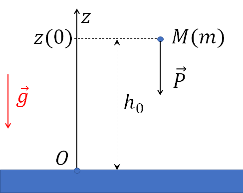
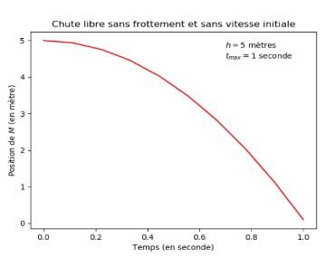
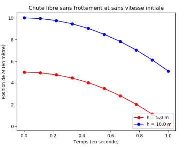

**Activité 1**

**Chute libre**

***Objectif :***

- Modéliser un problème physique et le résoudre analytiquement

- Se familiariser avec quelques méthodes graphiques Python an vue de
  tracer des évolutions de grandeurs physiques numériques et analytiques

- Dans cette activité, on souhaite tracer la courbe représentative de la
  vitesse et la loi horaire d’un phénomène de chute libre

***Nota Bene :***

1/ Dans cette activité, il est nécessaire d’importer deux modules :

- Le module ***numpy*** dédié au calcul numérique : il permet en
  particulier la manipulation de tableaux multidimensionnels pour
  stocker des données. Ce module fournit également un grand nombre de
  fonctions dédiées aux calculs mathématiques et numériques

- Le module ***matplotlib.pyplot*** pour les représentations graphiques.

2/ Pour tracer des graphiques, vous pouvez vous reporter à la
documentation et aux exemples sur le site
[*https://matplotlib.org/.*](https://matplotlib.org/)

1.  Mise en équation du problème

Dans un référentiel supposé galiléen, on s’intéresse à la chute libre
d’un corps $`M`$ de masse $`m`$, lâché sans vitesse initiale, d’une
hauteur $`h_{0}`$. On néglige les frottements dus à l’air. La verticale
du lieu définit l’axe $`(Oz)`$, vertical ascendant.

**Travail à réaliser : Déterminer, rigoureusement, l’équation horaire de
la trajectoire du point** $`\mathbf{M}`$ **notée**
$`\mathbf{z(t)}`$**.**

2.  Méthodologie de tracé

On se propose maintenant de tracer la loi horaire avec Python :

- Identifier et définir les paramètres physiques nécessaires au calcul
  de $`z(t)`$ et préciser leur valeur numérique ;

- Créer la fonction $`z(t)`$ ;

- Préciser l’intervalle de temps
  $`\left\lbrack t_{\min},t_{\max} \right\rbrack`$ sur lequel on désire
  tracer la courbe (on pourra s’appuyer sur la fonction *linespace*[^1])

- Tracer la courbe $`z(t)`$ puis l’afficher.

3.  Travail à effectuer

- **Question 1 :** Ecrire le script permettant d’obtenir la Figure 1
  avec légendes !

- **Question 2 :** Modifier le script précédent pour obtenir la [Figure
  1](#_Ref85202981) avec légendes !

Figure 1

- **Question 3 :** Dans une nouvelle fenêtre, sur un même graphique,
  tracer l’évolution temporelle de l’énergie cinétique par unité de
  masse (en rouge) et de l’énergie potentielle par unité de masse (en
  bleue). Tracer également la somme de ces deux quantités (en noire).
  Commenter le graphique obtenu.

- **Question 4 :** On considère un point matériel $`M`$ soumis
  uniquement à son poids, initialement lancé avec une vitesse
  $`\overrightarrow{v_{0}}\`$faisant un angle $`\alpha > 0`$ avec
  l’horizontale $`(Ox)`$, depuis une hauteur $`h_{0}`$. Ecrire un
  programme permettant de tracer l’équation de trajectoire$`\ z(x)`$ du
  point $`M`$.

[^1]: *linspace* permet la construction de tableau permet d’obtenir un
    tableau 1D allant d’une valeur de départ à une valeur de fin avec un
    nombre donné d’éléments.
