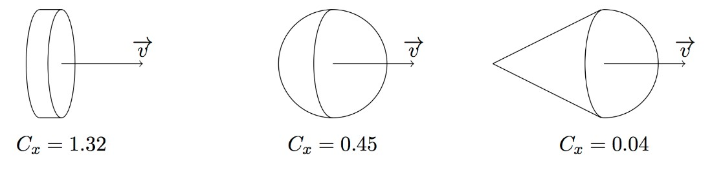

Modélisation physique avec Python 2023-2024 Activité 2

> **Activité 2**
>
> **Chute avec frottement**

***Objectif :***

- Modéliser un problème physique et le résoudre analytiquement

- Se familiariser avec une méthode de résolution d’équations
  différentielles : la méthode d’Euler (vue en mathématiques)

- Dans le prolongement de la première activité, on s’intéresse toujours
  à un problème de chute en tenant compte, cette fois-ci, de la présence
  de frottements fluides.

***Nota Bene :***

> Pour cette activité, il est nécessaire d’importer les deux mêmes
> modules que pour l’activité 1.

1.  Mise en équation du problème

> Dans un référentiel supposé galiléen, on s’intéresse à la chute libre
> d’un corps 𝑀, lâché sans vitesse initiale, d’une hauteur ℎ = 25𝑚. On
> considère que les frottements dus à l’air peuvent être modélisés par
> une force de frottement fluide de coefficient 𝜆 = 5𝑘𝑔/𝑠. La verticale
> du lieu définit l’axe (𝑂𝑧), vertical ascendant.

**Question : Déterminer l’équation différentielle d’ordre 1 régissant le
mouvement de** 𝑴 **puis déterminer** 𝒗(𝒕)

**(et non** 𝒗𝒛(𝒕) **! )**

2.  Méthodologie de tracé

> Pour tracer la courbe représentative de la loi horaire de 𝑣 avec
> Python, on doit :

- Définir les paramètres physiques 𝑔 et ℎ en précisant leurs valeurs
  numériques ;

- Préciser l’intervalle de temps \[𝑡𝑚𝑖𝑛, 𝑡𝑚𝑎𝑥\] sur lequel on désire
  tracer la courbe ;  Discrétiser cet intervalle de temps ;

- Évaluer de proche en proche les valeurs approchées de vitesses en
  utilisant la méthode d’Euler ;  Tracer la courbe et l’afficher.

> 3\. Travail à effectuer

**Partie 1 : Modélisation de l’évolution de la vitesse en régime
laminaire**

> Notons 𝑡𝑚𝑎𝑥 l’instant final d’observation de la chute.
>
> Δ𝑡
>
> Découpons la durée d’observation Δ𝑡 = 𝑡𝑚𝑎𝑥 − 0 en
> 𝑛𝑡 intervalles de mêmes durées 𝛿𝑡 = 𝑛𝑡.

1)  Créer une fonction **EulerExp** pour résoudre l’équation
    différentielle vérifiée par la vitesse.

2)  Sur un même graphique, tracer la solution théorique trouvée au 1 et
    la solution approchée. On fera apparaître la légende !

3)  Que remarque-t-on lorsque l’on fait varier la valeur de
    𝑛𝑡 ?

**Partie 2 : En régime turbulent**

> Pour une vitesse importante, la force de frottement est
> proportionnelle au carré de la vitesse :

𝐹⃗ = −µ𝑣𝑣⃗

> 1

Modélisation physique avec Python 2023-2024 Activité 2

> On parle de frottements quadratiques où μ est une constante qui dépend
> du fluide et des caractéristiques de

1 l’objet. Son expression est du type µ = 2 𝜌𝐶𝑥𝑆 avec 𝜌 la
masse volumique du fluide, 𝑺 la surface frontale de l’objet et
𝐶𝑥 le coefficient de trainée qui dépend de la géométrie du
corps. Par exemple, voici trois géométries et trois valeurs de
𝐶𝑥 :

1.  En appliquant le Principe Fondamental de la Dynamique, déterminer
    l’équation différentielle en 𝑣.

2.  En utilisant la méthode d’Euler, tracer la courbe 𝑣(𝑡). Comparer à
    la partie 1.

> 2
