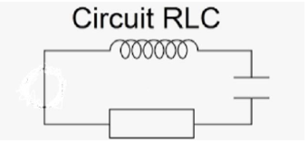

**Activité 3**

**Oscillations mécaniques et électriques**

***Objectif :***

- Modéliser un problème physique et le résoudre analytiquement

- Se familiariser avec une méthode de résolution d’équations
  différentielles du second ordre : la méthode d’Euler (vue en
  mathématiques).

- On s’intéresse, dans une première partie, à la modélisation des
  oscillations amorties par frottements fluides. Une ouverture vers les
  oscillations non-linéaires permet de dépasser le cadre des situations
  pour lesquelles une solution analytique existe.

- Dans une seconde partie, on souhaite s’intéresse au circuit RLC.

Nota Bene :

Pour cette activité, il est nécessaire d’importer les deux mêmes
modules que pour l’activité 1.

**PARTIE 1 : Oscillations mécaniques**

1.  Mise en équation du problème

Dans un référentiel galiléen, on s’intéresse au mouvement (à un seul
degré de liberté) d’un point matériel de masse $`m`$ soumis à une force
de rappel d’un ressort de constante de raideur $`k`$ de longueur à vide
$`l_{0}`$ et à une force de frottements fluides de coefficient
$`\lambda`$. A $`t = 0`$, on écarte le point matériel de sa position
d’équilibre d’une distance $`a`$ et on le lâche sans vitesse initiale.

**Question : Déterminer l’équation différentielle d’ordre 2 régissant le
mouvement du point matériel.**

2.  Méthodologie de tracé

Pour tracer l’allure des oscillations $`x(t)`$ avec Python, on devra :

- Définir les paramètres physiques en précisant leurs valeurs numériques
  ;

- Préciser l’intervalle de temps $`\lbrack tmin,\ tmax\rbrack\`$sur
  lequel on désire tracer la courbe ;

- Discrétiser cet intervalle de temps ;

- Évaluer de proche en proche les valeurs approchées de $`x(t)`$ ;

- Tracer la courbe et l’afficher.

3.  Travail à effectuer

    1.  Proposer un script complet qui donne l’évolution temporelle de
        $`x(t)`$ pour différentes valeurs de facteur de qualité $`Q`$.

*Les valeurs de* $`Q`$ *seront choisies de manière à mettre en évidence
différents comportements oscillatoires. Les courbes seront tracées sur
un même graphique. on rappelle la relation*
$`\frac{\omega_{0}}{Q} = \frac{\lambda}{m}`$*.*

2.  Sur un même graphique, représenter l’évolution temporelle des
    énergies cinétique, potentielle et mécanique.

3.  L’oscillateur de Van der Pol peut être modélisé par une équation
    différentielle du second ordre de la forme :
    $`\ddot{x}(t) - \varepsilon\omega_{0}\left( 1 - x^{2} \right)\dot{x}(t) + {\omega_{0}}^{2}x(t) = 0`$

> Proposer un script qui donne l’évolution temporelle de $`x(t)`$ pour
> différentes valeurs du coefficient de non-linéarité$`\ \varepsilon`$.
>
> Que devient $`x(t)`$ en régime forcé avec une force excitatrice de la
> forme $`{\omega_{0}}^{2}cos(\omega t)`$ ?
>
> **PARTIE 2 : Oscillations électriques**

1.  Mise en équation

On s’intéresse à l’amortissement d’un circuit $`RLC`$, composé d’une
résistance, d’une bobine d’inductance $`L`$ et d’un condensateur de
capacité $`C`$.

Avec $`\omega_{0} = \frac{1}{\sqrt{LC}}`$ la pulsation propre, on
prendra comme inductance pour la bobine $`L = 1\ Henry\`$la capacité du
condensateur : $`C = 6\mu F`$ et pour la résistance entre 10 et 100 ohms

**Question : Déterminer l’équation différentielle d’ordre 2 régissant la
tension aux bornes du condensateur.**

2.  Méthodologie de tracé

Pour tracer l’allure de $`u_{C}(t)`$ avec Python, on devra :

- Définir les paramètres physiques en précisant leurs valeurs numériques
  ;

- Préciser l’intervalle de temps $`\lbrack tmin,\ tmax\rbrack\`$sur
  lequel on désire tracer la courbe ;

- Discrétiser cet intervalle de temps ;

- Évaluer de proche en proche les valeurs approchées de $`u_{C}(t)\`$ ;

- Tracer la courbe et l’afficher (on prendra un intervalle de temps
  entre $`t = 0s\ et\ t = 0,08s`$).

4.  Travail à effectuer

<!-- -->

1.  Ecrire le script permettant d’obtenir $`u_{C}(t)`$.

2.  Modifier le script précédent pour obtenir plusieurs figures en
    faisant varier la résistance.

3.  Dans quel domaine trouve ton des circuits RLC.
