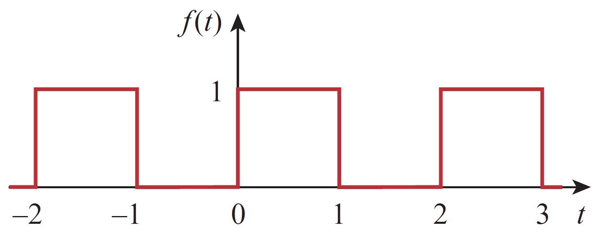
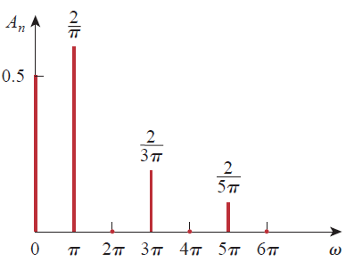
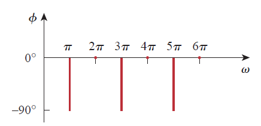
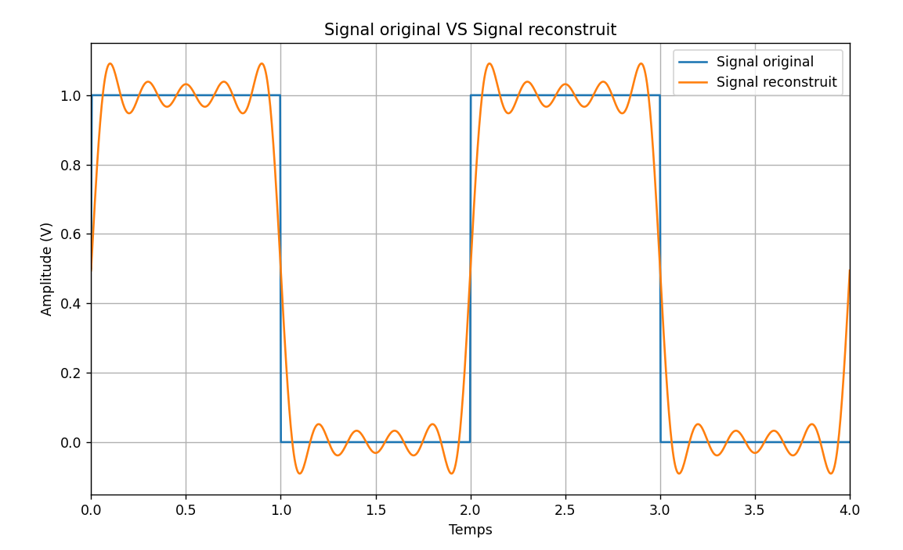
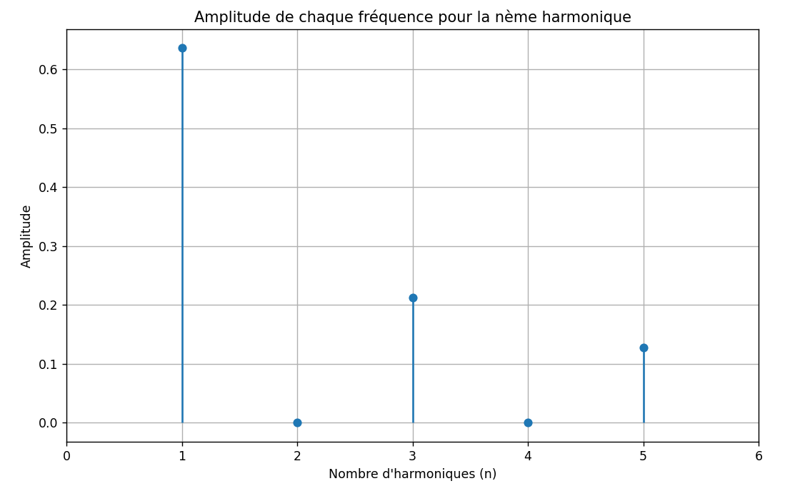
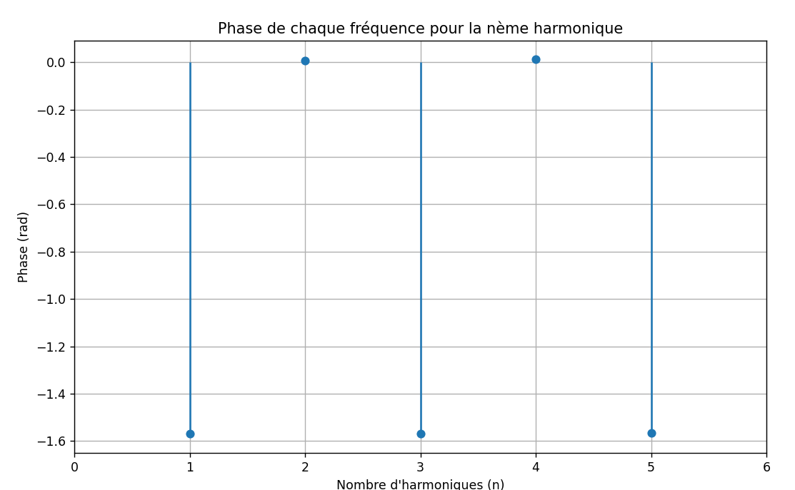
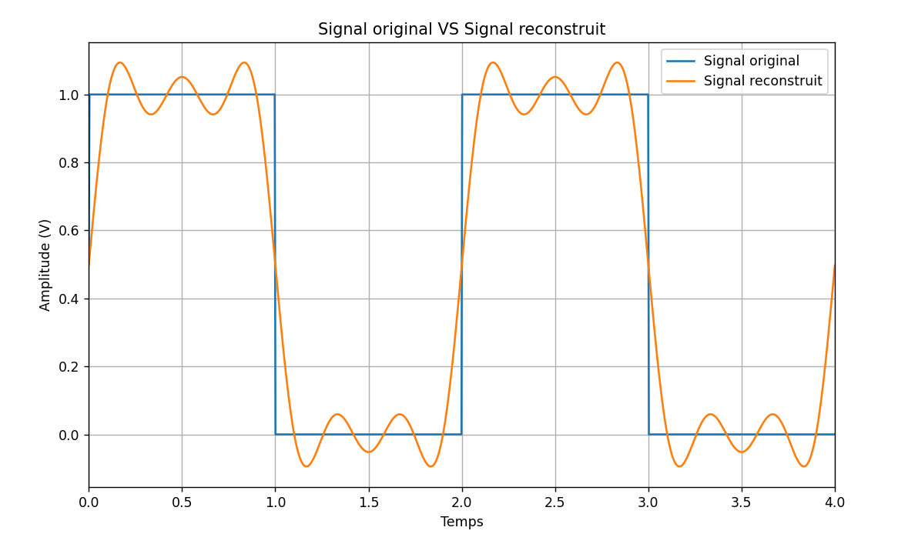
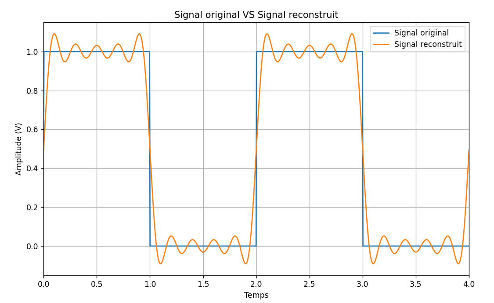
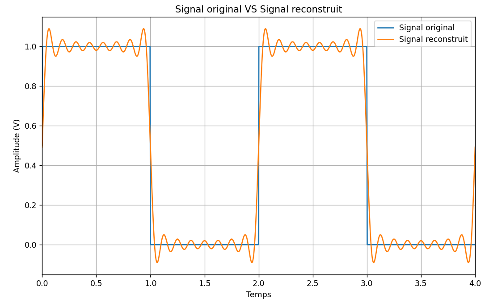
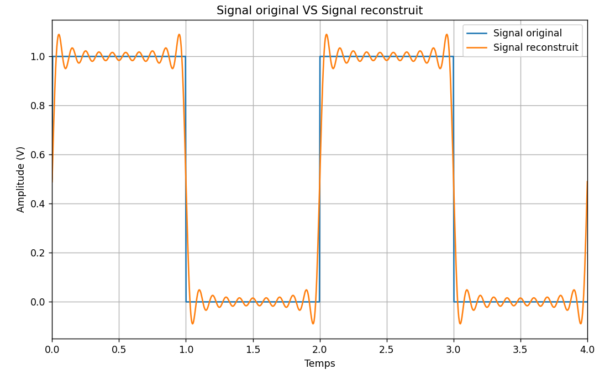

**Activité x Série de Fourier**

On considère le signal carré périodique suivant :

<figure>

<figcaption><p>Figure 1 : signal carré</p></figcaption>
</figure>

**Calcul analytique à faire :**

1)  Déterminer l’expression analytique de la fonction $`f(t)`$ sur une
    période $`T`$.

``` math
f(t) = \left\{ \begin{array}{r}
1,\ \ 0 < t < 1 \\
0,\ \ 1 < t < 2
\end{array} \right.\ 
```

2)  Déterminer la période fondamentale $`T`$ en déduisant la fréquence
    fondamentale $`\omega_{0}`$

``` math
T = 2,\ {\ \omega}_{0} = \frac{2\pi}{T} = \pi
```

3)  Déterminer analytiquement la valeur moyenne du signal $`f(t)`$.
    Expliquer le résultat obtenu

``` math
a_{0} = \ \frac{1}{T}\ \int_{0}^{T}{f(t)\ dt} = \frac{1}{2}\left\lbrack \int_{0}^{1}{1\ dt} + \int_{1}^{2}{0\ dt} \right\rbrack = \frac{1}{2}t\left| \binom{1}{0} = \frac{1}{2} \right.\ 
```

$`a_{0} \neq 0`$, donc le signal contient un composant DC.

4)  Déterminer analytiquement les valeurs des coefficients de Fourier
    $`a_{n}`$ et $`b_{n}`$

``` math
a_{n} = \ \frac{2}{T}\ \int_{0}^{T}{f(t)\cos{(n\omega_{0}t)}\ dt} = \frac{2}{2}\left\lbrack \int_{0}^{1}{1\cos{(n\pi t)}\ dt} + \int_{1}^{2}{0\ \cos{(n\pi t)}\ dt} \right\rbrack = \frac{1}{n\pi}\sin{(n\pi t)}\left| \binom{1}{0} = \frac{1}{n\pi}\left\lbrack \sin{(n\pi) - sin(0)} \right\rbrack = 0 \right.\ 
```

``` math
b_{n} = \ \frac{2}{T}\ \int_{0}^{T}{f(t)\sin{(n\omega_{0}t)}\ dt} = \frac{2}{2}\left\lbrack \int_{0}^{1}{1\sin{(n\pi t)}\ dt} + \int_{1}^{2}{0\ \sin{(n\pi t)}\ dt} \right\rbrack = - \frac{1}{n\pi}\cos(n\pi t)\left| \binom{1}{0} = - \frac{1}{n\pi}\left\lbrack \cos{(n\pi) - 1} \right\rbrack = \frac{1}{n\pi}\left\lbrack 1 - ( - 1)^{n} \right\rbrack \right.\  = \left\{ \begin{array}{r}
\frac{2}{n\pi},\ \ n\ impair \\
0,\ \ n\ pair
\end{array} \right.\ 
```

5)  Récrire l’expression $`f(t)`$ en prenant en compte les valeurs de
    $`a_{0},\`$ $`a_{n}`$ et $`b_{n}`$

``` math
f(t) = \frac{1}{2} + \frac{2}{\pi}\sin(\pi t) + \frac{2}{3\pi}\sin(3\pi t) + \frac{2}{5\pi}\sin(5\pi t) + \ldots
```

``` math
f(t) = \underset{DC}{\overset{\frac{1}{2}}{︸}} + \frac{2}{\pi}\underset{AC}{\overset{\sum_{n = 1}^{\infty}{{\frac{1}{n}\sin}(n\pi t))}}{︸}}
```

6)  Tracer le spectre (amplitudes et phases) du signal $`f(t)`$ pour
    n=1,3 et 5. commenter le résultat obtenu.

|  |  |
|----|----|

**Calcul numérique à faire :**

1)  Ecrire le code sous python traduisant l’algorithme indiqué ci-avant.

import math\
import numpy as np\
import matplotlib.pyplot as plt\
\
\# Exemple d'utilisation\
T = 2 \# Période du signal périodique (à saisir)\
n_harmoniques = (10) \# Nombre d'harmoniques (à saisir)\
\
\# Définition du signal carée périodique d'amplitude 1V\
\
def signal(t):\
\
signal= 0.5 \* (1 + np.sign(np.sin(2 \* np.pi \* t/T)))\
return signal\
\
def CalculIntegral(fonc, a, b, N=1000): \#fonction permet de cacluler
l'integral d'une fonction entre a et b, avec un nombre de point N entre
a et b\
\
x = np.linspace(a, b, N) \# création de N point entre a et b\
y = fonc(x)\
dx = (b - a) / (N - 1)\
resultat_integral = np.sum(0.5 \* (y\[1:\] + y\[:-1\]) \* dx)\
return resultat_integral\
\
def SerieFourier(signal, T, n_harmoniques): \#fonction qui permet de
calculer les coefficients de Fourier a0, an, bn\
\
a0 = (1 / T) \* CalculIntegral(signal, 0, T) \# calcul du coeff a0
(valeur moyenne du signal))\
\
an = np.zeros(n_harmoniques) \# initialisation à zero de an\
bn = np.zeros(n_harmoniques) \# initialisation à zero de bn\
\
for n in range(1, n_harmoniques + 1):\
an\[n-1\] = (2 / T) \* CalculIntegral(lambda t: signal(t) \* np.cos(2 \*
np.pi \* n \* t / T), 0, T) \# caclul de an\
bn\[n-1\] = (2 / T) \* CalculIntegral(lambda t: signal(t) \* np.sin(2 \*
np.pi \* n \* t / T), 0, T) \# caclul de bn\
\
return a0, an, bn\
\
\# Calcul de la série de Fourier\
a0, an, bn = SerieFourier(signal, T, n_harmoniques)\
\
\# Reconstruction du signal\
def SignalReconstruit(t): \#fonction peremt de reconstruire le signal
f(t) en utilisant les coeeficients a0, an, bn\
resultat = a0\
for n in range(1, n_harmoniques + 1):\
resultat += an\[n-1\] \* np.cos(2 \* np.pi \* n \* t / T) + bn\[n-1\] \*
np.sin(2 \* np.pi \* n \* t / T) \# créaction de la fonction f(t)\
return resultat\
\
\# Tracer le signal original et le signal reconstruit\
t_valeurs = np.linspace(0, 2\*T, 1000) \# création du l'axe du temps sur
deux periodes\
Valeurs_originales = signal(t_valeurs) \# création du signal à analyser
par la série de Fourier\
Valeurs_reconstruites = SignalReconstruit(t_valeurs) \# signal
reconstruit en utilisant les coefficients de Fourier\
\
\#spectre du signal (Amplitude An et Phase Phi_n)\
Amp_n=(an\*\*2+bn\*\*2)\*\*0.5 \#calcul d'Amplitude\
Phase_n=np.arctan(bn/an) \#calcul de la phase\
\
plt.figure(figsize=(10, 6))\
plt.plot(t_valeurs, Valeurs_originales, label="Signal original")\
plt.plot(t_valeurs, Valeurs_reconstruites, label="Signal reconstruit")\
plt.xlabel("Temps")\
plt.ylabel("Amplitude (V)")\
plt.title("Signal original VS Signal reconstruit")\
plt.legend()\
plt.xlim(0, 2\*T)\
plt.grid(True)\
\
plt.figure(figsize=(10, 6))\
plt.stem(range(1, n_harmoniques+1), Amp_n, basefmt=" ")\
plt.xlabel("Nombre d'harmoniques (n)")\
plt.ylabel("Amplitude")\
plt.xlim(0, n_harmoniques+1)\
plt.title("Amplitude de chaque fréquence pour la nème harmonique")\
plt.grid(True)\
\
plt.figure(figsize=(10, 6))\
plt.stem(range(1, n_harmoniques+1), Phase_n, basefmt=" ")\
plt.xlabel("Nombre d'harmoniques (n)")\
plt.ylabel("Phase (rad)")\
plt.xlim(0, n_harmoniques+1)\
plt.title("Phase de chaque fréquence pour la nème harmonique")\
plt.grid(True)\
plt.show()

2)  Soit n=5. Tracer le signal original $`f(t)`$ et le signal
    reconstruit sur la même figure. Commenter le résultat obtenu.



Pour n=5, on remarque que le signal reconstruit tend vers le signal
original.

3)  Tracer les amplitudes $`A_{n}\`$obtenues par calcul numérique en
    fonction des harmoniques.



4)  Tracer les phases $`\varphi_{n}\`$obtenues par calcul numérique en
    fonction des harmoniques.



5)  Retracer le signal original $`f(t)`$ et le signal reconstruit sur la
    même figure pour n= 5, 10, 15, et 20. Commenter et justifier les
    résultats obtenus.

**Pour n=5 :**



**Pour n= 10 :**



**Pour n=15 :**



**Pour n=20 :**



En augmentant n, le signal reconstruit en utilisant les coefficients de
Fourier tend exactement vers le signal original
