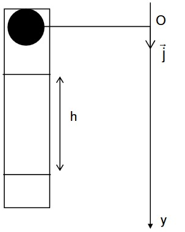
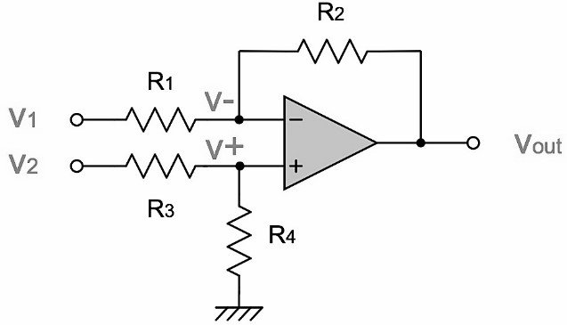
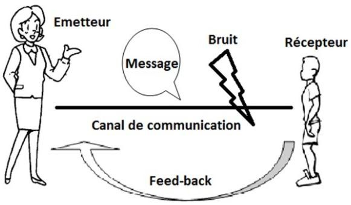
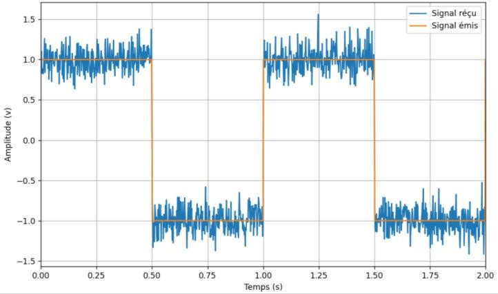
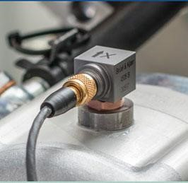
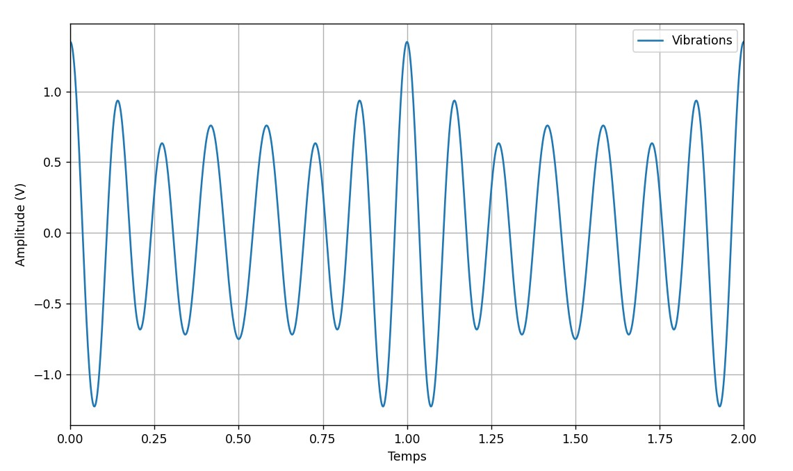
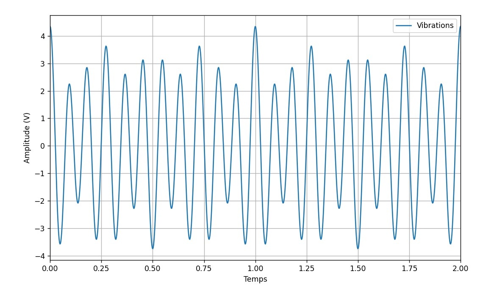

> Sujets de soutenance

# Sujet 1 : Ski de vitesse (Kilomètre Lancé) 

Dans cette épreuve, le skieur, doté d’un équipement spécial, prend de la
vitesse en descendant une pente d’angle 𝛼 selon une trajectoire
rectiligne. Les vitesses atteintes sont considérables… Heureusement, la
descente est réalisée sur une piste parfaitement dégagée.

Les frottements de l’air sont modélisés par la force 𝑓⃗ = −𝑘𝑣𝑣⃗ avec 𝑘 =
 𝜌𝑆𝐶𝑥 où 𝜌
est la masse volumique du fluide dans lequel se fait le mouvement, 𝑆 est
la surface frontale et 𝐶𝑥 un coefficient aérodynamique (on
pourra le prendre égal à 0,35 dans cette situation).

1/ Tracer le graphique traduisant l’évolution de la vitesse 𝑣(𝑡).
Commenter.

2/ Étudier l’influence des différents paramètres physiques.

# Sujet 2 : Viscosimètre 

On souhaite modéliser la chute libre d’une bille en acier dans de la
glycérine.

Pour mesurer la viscosité de la glycérine, on utilise un dispositif
appelé viscosimètre de HOEPLER (ou viscosimètre à chute de bille). Il se
compose d’un long tube de verre vertical, rempli du liquide étudié, dans
lequel on laisse tomber une bille sphérique de rayon r, en acier de
diamètre calibré.

Dans le cas du fluide étudié,
la force de frottement est proportionnelle à la vitesse de chute de la
bille : 𝑓⃗ = −6𝜋𝑟𝜂𝑣⃗ où η est la viscosité de la glycérine

1.  Comparer les graphiques obtenus pour :

    1.  L’équation horaire théorique de la vitesse

    2.  L’équation horaire de la vitesse obtenue par une méthode de
        calcul approché

2.  Étudier l’influence de la viscosité sur la durée de chute de la
    bille.

3.  Même question avec la taille de la bille.

# Sujet 3 : Badminton 

On envisage un volant de badminton envoyé du fond du court avec une
vitesse initiale ⃗𝑣⃗⃗⃗0⃗ et faisant un angle 𝛼 avec
l’horizontal.

1.  En l’absence de frottement. Étudier l’influence de l’angle de tir
    sur la trajectoire du volant. Mettre en évidence l’existence de la
    parabole dite de sûreté.

2.  Etudier l’effet de l’ajout de frottement (linéaire et/ou
    quadratique) sur la trajectoire du volant. Commenter.

Aide : Les frottement de l’air peuvent être modélisés par :

- la force de frottement linéaire 𝑓⃗ = −6𝜋𝑟𝜂𝑣⃗ où η est la viscosité du
  fluide, 𝑟 le rayon de l’objet

- la force de frottements quadratiques 𝑓⃗ = −𝑘𝑣𝑣⃗ avec 𝑘 =
   𝜌𝑆𝐶𝑥 où
  𝜌 est la masse volumique du fluide dans lequel se fait le mouvement, 𝑆
  est la surface frontale et 𝐶𝑥 un coefficient aérodynamique
  (on pourra prendre une valeur de 0,1).

# Sujet 4 : Balançoire 1 

Le mouvement d’un enfant sur une balançoire peut se modéliser par un
mouvement pendulaire.

> 1\. SANS FROTTEMENT : Comparer les graphiques obtenus pour :

1.  L’équation du mouvement obtenue en utilisant l’approximation des
    petits angles (solution théorique)

2.  L’équation du mouvement obtenue sans utiliser l’approximation
    précédente (solution approchée numériquement)

On comparera les solutions obtenues pour différentes conditions
initiales sur la position 𝜃(𝑡 = 0) exprimée en radians.

# Sujet 5 : Balançoire 2 

Le mouvement d’un enfant sur une balançoire peut se modéliser par un
mouvement pendulaire.

> 1\. SANS FROTTEMENT : Comparer les graphiques obtenus pour :

1.  Graphique 1 : L’énergie cinétique obtenue en utilisant
    l’approximation des petits angles (solution théorique) et sans
    l’utiliser (solution approchée numériquement)

2.  Graphique 2 : L’énergie potentielle obtenue en utilisant
    l’approximation des petits angles (solution théorique) et sans
    l’utiliser (solution approchée numériquement)

On comparera les solutions obtenues pour différentes conditions
initiales sur la position 𝜃(𝑡 = 0) exprimée en radians.

# Sujet 6 : Balançoire 3 

On s’intéresse au mouvement d’un enfant sur une balançoire en présence
de frottement linéaire dus au vent.

1.  Étudier l’effet de l’intensité du vent sur le mouvement de l’enfant.

2.  Étudier l’effet de l’intensité du vent sur les courbes énergétiques.

NB : on pourra aussi étudier l’effet des conditions initiales.

# Sujet 7 : Camion sur route ondulée 

On s’intéresse à un camion roulant sur une route sinusoïdale en présence
de frottement.

1.  Dans le cas d’un camion vide, étudier l’effet de la fréquence
    d’ondulation de la route sur l’amplitude des oscillations forcées.
    Mettre en évidence un phénomène de résonance.

2.  Quel est l’effet sur l’amplitude de l’oscillation lorsque le camion
    est chargé ?

# Sujet 8 : Circuit LC – RLC 

On s’intéresse aux oscillations d’un circuit LC. Le condensateur est
initialement chargé.

1.  Étudier l’influence de l’inductance sur la courbe de la charge du
    condensateur en fonction du temps.

2.  Que se passe-t-il si l’on ajoute une résistance au circuit initial ?

# Sujet 9 : Circuit à AOP 

Soit le circuit électronique suivant :

>  style="width:2.88944in;height:1.65347in"
> alt="Une image contenant diagramme, ligne, Police, Tracé Description générée automatiquement" />

Avec :

- 𝑅1 = 22 𝑘Ω,𝑅2 = 33 𝑘Ω, 𝑅3 = 10 𝑘Ω,
  𝑅4 = 15 𝑘Ω ;

- 𝑉1(𝑡) = 0,1 sin(2000𝜋𝑡) + 2 ;

- 𝑉2(𝑡) = −0,1 sin(2000𝜋𝑡) + 2.

1.  En considérant l’AOP comme idéal, proposer une façon de linéariser
    ce circuit, et présenter la matrice A correspondante. Comme dans
    l’activité 5, Il ne doit y avoir qu’une seule valeur de composant
    par ligne de la matrice.

2.  Tracer les tensions 𝑉1(𝑡), 𝑉2(𝑡) et
    𝑉𝑜𝑢𝑡(𝑡) sur deux périodes.

> Vous devez calculer les tensions avec la méthode d’analyse nodale
> étudiée en activité 5, avec les fonctions de produit matriciel et
> d’inversion de matrice par pivot de Gauss que vous avez créées.
>
> À quoi sert ce montage ?

3.  Étudier l’impact de la valeur de 𝑅2 sur la tension de
    sortie 𝑉𝑜𝑢𝑡(𝑡), en traçant plusieurs courbes.

# Sujet 10 : Débruitage d’un signal périodique 

**Objectif :** L'objectif de cette activité est d'utiliser la série de
Fourier d'un signal périodique comme une technique pour filtrer/réduire
les bruits présents dans un signal périodique reçu, dans un système de
communication.

**Contexte :** Imaginons que vous envoyiez des données nommées 𝑓(𝑡) du
coté émetteur à travers un canal de communication (câble, espace libre,
etc) comme indiqué dans la figure ci-dessous :

>  style="width:2.9375in;height:1.71458in"
> alt="Eléments de la communication [Des aspects de la communication en classe]" />

*Figure 1 : Schéma de la communication*

En pratique, le canal de communication introduit du bruit 𝑛(𝑡). Ce bruit
est un signal borné qui varie aléatoirement en fonction du temps. Dans
ce cas le signal reçu du coté récepteur devient le suivant :

𝑓(𝑡) + 𝑛(𝑡)

La Figure 2 montre un exemple du signal reçu en comparaison avec le
signal émis (signal rectangulaire périodique) et en prenant en compte
l’effet du bruit du canal de propagation. Il est remarquable que malgré
le niveau de bruit rajouté 𝑛(𝑡), les deux signaux ont certaines
similarités.

>  style="width:3.61042in;height:2.13861in"
> alt="Une image contenant texte, Tracé, ligne, diagramme Description générée automatiquement" />

*Figure 2 : Signaux émis et reçu*

Pour que les données 𝑓(𝑡) puissent être récupérées correctement du coté
récepteur, il est essentiel d’éliminer/réduire l’effet de canal en
réduisant le niveau de bruit 𝑛(𝑡) qui a été rajouté par le canal de
propagation.

Nous supposons dans cette activité que les données du coté émetteur sont
représentées sous forme d’un signal périodique (signal émis). Cela
signifie qu'elles peuvent être décomposées en une somme de sinusoïdes de
différentes fréquences. Ces données sont reçues de l’autre extrémité du
coté récepteur mais ils peuvent être affectés par le bruit du canal 𝑛(𝑡)
durant la propagation.

En utilisant la décomposition de la série de Fourier du signal reçu du
coté récepteur, les coefficients de Fourier calculés seront utilisés
pour reconstruire les données original 𝑓(𝑡). Cette reconstruction peut
être effectuée en dépit du bruit introduit par le canal de
communication/propagation. Une fois que le signal reçu est reconstruit,
une technique de filtrage peut être utilisées pour éliminer le bruit
résiduel et récupérer les données 𝑓(𝑡) de manière plus précise.

**<u>Travail à effectuer :</u>**

Le signal émis via le canal de propagation est un signal rectangulaire
comme indiqué en figure 2. Après la transmission du signal via le canal
de propagation, le signal a été reçu avec un niveau de bruit important
(figure 2). Dans ce cas, le bruit 𝑛(𝑡) rajouté est supposé un bruit
blanc gaussien de moyenne nulle et avec un écart type de 0,15.

Pour le travail ci-dessous, vous aurez besoin de calculer le spectre
fréquentiel des signaux. Ces calculs **doivent être réalisés comme dans
l’Activité 6**. Ainsi, vous devez calculer les coefficients
𝑎𝑛 et 𝑏𝑛 **en intégrant la fonction**. Cette
intégrale doit être calculée numériquement par la **méthode des
trapèzes** présentée en Activité 0 Partie 2.

1.  Tracer le signal émis et le signal reçu sur la même figure.

2.  Tracer les spectres (module et phase) des signaux émis et reçus
    (soit 𝑛, le nombre d’harmonie égale à 10). Commenter les résultats
    obtenus en module et phase.

3.  Dans cette partie, l’idée consiste à calculer les coefficients des
    Fourier du signal reçu (signal bruité). Tracer le signal émis, et le
    signal reconstruit à partir de ces coefficients pour un nombre
    d’harmonies, 15, 100, 600 et 900. Commenter les résultats obtenus.

4.  Comment pouvez-vous choisir 𝑛 (nombre des harmonies) afin que le
    calcul de la série de Fourier du signal reçu puisse réagir comme un
    filtre pour réduire le niveau de bruit. Expliquer votre choix de 𝑛
    (nombre d’harmonie)

5.  Tracer les spectres des signaux émis et reçu (n=15). Expliquer les
    résultats obtenus en terme du module et phase.

6.  Refaire la question précédente avec un bruit blanc gaussien de
    moyenne nulle et avec un écart type de 0 ,5.

> Commenter les résultats obtenus sur les composants fréquentiels des
> signaux émis et reçu.

# Sujet 11 : Débruitage d’un signal périodique 

**Objectif :** L'objectif de cette activité est d'utiliser la série de
Fourier d'un signal périodique comme une technique pour contrôler la
qualité des produits manufacturés à l’aide de la série de Fourier.

**Contexte :** Dans une usine, différents capteurs sont utilisés pour
surveiller les paramètres de fabrication d’une machine donnée (Figure
3). Par exemple, des capteurs peuvent être installés sur une machine de
production pour mesurer les vibrations pendant le processus de
fabrication. **Ces données sont collectées en temps réel et enregistrées
pour les analyser.**

>  style="width:1.33819in;height:1.29999in"
> alt="Capteurs de vibrations BRUEL ET KJAER | Capteur | Capteur de vibration" />

*Figure 3: : Exemple d'un capteur de vibration*

**Les vibrations normales d’un processus de fabrication (sans erreurs)
représentent un phénomène périodique,** et donc les données de vibration
collectées peuvent être décomposées en une série de Fourier. Cette série
représente les différentes fréquences présentes dans le signal de
vibration. La décomposition permet d'identifier les composantes de
fréquence qui pourraient indiquer des défauts ou des problèmes dans le
processus de fabrication.

Les informations obtenues à partir de l'analyse des fréquences
permettent d'ajuster et d'optimiser le processus de fabrication. Par
exemple, si des vibrations excessives sont détectées, des mesures
correctives peuvent être prises pour réduire ces vibrations, telles que
la lubrification des composants, le remplacement des pièces usées, ou
encore le recalibrage de la machine.

**<u>Travail à effectuer :</u>**

Les vibrations d'une nouvelle machine, exempte d'erreurs de fabrication,
ont été enregistrées (Figure 4).

>  style="width:4.22278in;height:2.50903in"
> alt="Une image contenant texte, ligne, Tracé, diagramme Description générée automatiquement" />

*Figure 4 : Vibrations exemptées d'erreurs de fabrication*

Ce signal représenté par des vibrations en fonction du temps est
enregistré dans un fichier appelé signalSansErreur.txt.

Avec le temps, cette machine a commencé à présenter des erreurs de
fabrication, ce qui a entraîné une baisse de la qualité des produits.
Les vibrations de la machine ont été enregistrées à nouveau, comme
illustré dans la Figure 5, et sauvegardées dans un fichier nommé
signalErreurs.txt. Les deux fichiers signalSansErreur.txt et
signalAvecErreur.txt sont disponibles sur la page Boostcamp.

>  style="width:4.26931in;height:2.48958in"
> alt="Une image contenant texte, ligne, Parallèle, Tracé Description générée automatiquement" />

*Figure 5 : Vibrations avec erreurs de fabrication*

Pour le travail ci-dessous, vous aurez besoin de calculer le spectre
fréquentiel des signaux. Ces calculs **doivent être réalisés comme dans
l’Activité 6**. Ainsi, vous devez calculer les coefficients
𝑎𝑛 et 𝑏𝑛 **en intégrant la fonction**. Cette
intégrale doit être calculée numériquement par la **méthode des
trapèzes** présentée en Activité 0 Partie 2.

1.  Tracer le signal exempt d’erreurs de fabrication et son spectre.

> Quels sont les composants fréquentiels présents dans ce signal ?

2.  Tracer le signal inclut les erreurs de fabrication et son spectre.

> Quels sont les composants fréquentiels présents dans ce signal ?

3.  En comparant les résultats des deux parties précédentes, identifiez
    la fréquence qui représente l’erreur de fabrication. Justifiez votre
    réponse.

4.  L'objectif dans cette section est d'utiliser la série de Fourier
    comme un filtre passe-bas.

> Proposez une solution numérique pour ne conserver que les deux
> fréquences 5 kHz et 7 kHz dans le signal. Tracer le signal avant et
> après filtrage. Expliquez la technique choisie.
