{width="4.354206036745407in"
height="0.9739632545931759in"}

+-------------------------------------------------------+
| Cours de Physique                                     |
|                                                       |
| 0                                                     |
+=======================================================+
| Semestre 1                                            |
+-------------------------------------------------------+
| ING1 - Année 2025/2026                                |
+-------------------------------------------------------+

  ------------------------------------------------------
  Thieulin Coralie
  ------------------------------------------------------

  ------------------------------------------------------

**\**
TABLE DES MATIERES

[Chapitre 0** :** Principes fondamentaux
[5](#chapitre-0-principes-fondamentaux)](#chapitre-0-principes-fondamentaux)

[1. Introduction [5](#_Toc10792162)](#_Toc10792162)

[2. La révolution Newtonienne [6](#_Toc10792163)](#_Toc10792163)

[3. Les principes fondamentaux de la mécanique du point matériel
[7](#_Toc10792164)](#_Toc10792164)

[3.1. Qu'est-ce qu'un point matériel ?
[7](#_Toc10792165)](#_Toc10792165)

[3.2. Le principe fondamental de la dynamique
[7](#_Toc10792166)](#_Toc10792166)

[3.3. Le principe d'action-réaction [8](#_Toc10792167)](#_Toc10792167)

[4. Conséquence de l'invariance de la masse : Les 3 lois de Newton
[9](#_Toc10792168)](#_Toc10792168)

[5. Conditions d'application du PFD [10](#_Toc10792169)](#_Toc10792169)

[5.1. Référentiels, repères et systèmes de coordonnées
[10](#_Toc10792170)](#_Toc10792170)

[5.2. Référentiel Inertiel (ou Galiléen)
[10](#_Toc10792171)](#_Toc10792171)

[5.3. Ensemble des référentiels Galiléens
[11](#_Toc10792172)](#_Toc10792172)

[6. Bilan du chapitre [12](#_Toc10792173)](#_Toc10792173)

[Chapitre 1 : Cinématique du point matériel
[13](#chapitre-1-cinématique-du-point-matériel)](#chapitre-1-cinématique-du-point-matériel)

[1. Introduction [13](#_Toc76046076)](#_Toc76046076)

[2. Relativité du mouvement [13](#_Toc76046076)](#_Toc76046076)

[3. Systèmes de coordonnées [14](#_Toc76046077)](#_Toc76046077)

[3.1. Coordonnées cartésiennes [14](#_Toc76046078)](#_Toc76046078)

[3.2. Coordonnées cylindriques [14](#_Toc76046079)](#_Toc76046079)

[4. Trajectoire d'un point matériel [14](#_Toc10551308)](#_Toc10551308)

[4.1. Définition [14](#_Toc76046081)](#_Toc76046081)

[4.2. Equations horaires [14](#_Toc76046082)](#_Toc76046082)

[4.3. Equations horaires de mouvements particuliers
[15](#_Toc76046083)](#_Toc76046083)

[5. Notion de vitesse d'un point matériel
[16](#_Toc10551309)](#_Toc10551309)

[5.1. La Vitesse moyenne [16](#_Toc10551310)](#_Toc10551310)

[5.2. Vitesse instantanée [16](#_Toc10551311)](#_Toc10551311)

[6. Calcul de la vitesse dans un référentiel Galiléen donné
[17](#_Toc10551312)](#_Toc10551312)

[6.1. Expression de la vitesse en coordonnées cartésiennes
[17](#_Toc10551313)](#_Toc10551313)

[6.2. Expression de la vitesse en coordonnées cylindriques
[17](#_Toc10551314)](#_Toc10551314)

[7. Accélération d'un point matériel [19](#_Toc10551316)](#_Toc10551316)

[7.1. Définition [19](#_Toc10551317)](#_Toc10551317)

[7.2. Mouvement accéléré ou retardé ?
[19](#_Toc10551318)](#_Toc10551318)

[7.3. Expression de l'accélération en coordonnées cartésiennes
[20](#_Toc10551319)](#_Toc10551319)

[7.4. Expression de l'accélération en coordonnées cylindriques
[20](#_Toc10551320)](#_Toc10551320)

[7.5. Comment retrouver les équations horaires à partir de
l'accélération ? [20](#_Toc10551321)](#_Toc10551321)

[8. Etude des mouvements usuels [22](#_Toc76046096)](#_Toc76046096)

[8.1. Mouvement rectiligne [22](#_Toc76046097)](#_Toc76046097)

[8.2. Mouvement circulaire [23](#_Toc10551328)](#_Toc10551328)

[8.3. Mouvement rectiligne + circulaire : mouvement composé
[24](#_Toc10551329)](#_Toc10551329)

[9. Bilan [24](#_Toc76046100)](#_Toc76046100)

[Chapitre 2 : Les forces usuelles
[26](#chapitre-2-les-forces-usuelles)](#chapitre-2-les-forces-usuelles)

[1. Introduction [13](#_Toc76046076)](#_Toc76046076)1

[2. La notion de force [26](#_Toc10792176)](#_Toc10792176)

[3. Les forces d'interaction à distance
[26](#_Toc10792177)](#_Toc10792177)

[3.1. La force de gravitation [26](#_Toc10792178)](#_Toc10792178)

[3.2. Le poids [27](#_Toc10792179)](#_Toc10792179)

[3.3. Les forces de Lorentz [28](#_Toc10792180)](#_Toc10792180)

[3.4. Les forces inertielles : la force centrifuge [**Erreur ! Signet
non défini.**](#_Toc76046107)](#_Toc76046107)

[4. Les forces de contact [29](#_Toc10792182)](#_Toc10792182)

[4.1. Force de frottement solide [29](#_Toc10792183)](#_Toc10792183)

[4.2. Force de frottement fluide [30](#_Toc10792184)](#_Toc10792184)

[4.3. La poussée d'Archimède [31](#_Toc10792185)](#_Toc10792185)

[4.4. Les forces de tension [31](#_Toc10792186)](#_Toc10792186)

[Chapitre 3 : De la statique du point matériel
[33](#chapitre-3-de-la-statique-du-point-matériel)](#chapitre-3-de-la-statique-du-point-matériel)

[1. Introduction [13](#_Toc76046076)](#_Toc76046076)8

[2. Méthodologie pour étudier un système en équilibre
[33](#_Toc10551334)](#_Toc10551334)

[3. Appliquons les lois de la statique
[34](#_Toc10551335)](#_Toc10551335)

[Chapitre 4 : De la dynamique du point matériel en référentiel galiléen
*Mouvements plans et inclinés, chute libre et Balistique*
[36](#chapitre-4-de-la-dynamique-du-point-matériel-en-référentiel-galiléen-mouvements-plans-et-inclinés-chute-libre-et-balistique)](#chapitre-4-de-la-dynamique-du-point-matériel-en-référentiel-galiléen-mouvements-plans-et-inclinés-chute-libre-et-balistique)

[1. Introduction [13](#_Toc76046076)](#_Toc76046076)44

[2. Comment Résoudre un problème de dynamique
[36](#_Toc10551338)](#_Toc10551338)

[3. Mouvement rectiligne (sur le sol plat)
[37](#_Toc10551339)](#_Toc10551339)

[4. Mouvement rectiligne (sur le sol incliné)
[39](#_Toc10551340)](#_Toc10551340)

[6. La balistique [43](#_Toc10551342)](#_Toc10551342)

[7. Bilan [45](#_Toc10551343)](#_Toc10551343)

[Chapitre 5 : De la dynamique du point matériel en référentiel galiléen
[46](#chapitre-5-de-la-dynamique-du-point-matériel-en-référentiel-galiléen)](#chapitre-5-de-la-dynamique-du-point-matériel-en-référentiel-galiléen)

[*Mouvements oscillants (pendules et ressorts), et théorème du moment
cinétique*
[46](#mouvements-oscillants-pendules-et-ressorts-et-théorème-du-moment-cinétique)](#mouvements-oscillants-pendules-et-ressorts-et-théorème-du-moment-cinétique)

[1. Introduction 59](#_Toc76046076)

[2. Mouvements oscillants [46](#_Toc10551347)](#_Toc10551347)

[2.1. Le ressort linéaire [46](#_Toc76046125)](#_Toc76046125)

[3. Théorème du moment cinétique [51](#_Toc10551348)](#_Toc10551348)

[3.1. Préambule : notion de produit vectoriel
[51](#_Toc76046127)](#_Toc76046127)

[3.2. La notion de moment [53](#_Toc76046128)](#_Toc76046128)

[3.3. Le moment cinétique [53](#_Toc76046129)](#_Toc76046129)

[3.4. Le moment de force [53](#_Toc76046130)](#_Toc76046130)

[3.5. Le théorème du moment cinétique
[54](#_Toc76046131)](#_Toc76046131)

[4. Bilan [54](#_Toc10551350)](#_Toc10551350)

[Exercice bilan sur la dynamique : Le looping [**Erreur ! Signet non
défini.**](#_Toc76046133)](#_Toc76046133)

[Annales des années précédentes [**Erreur ! Signet non
défini.**](#_Toc76046134)](#_Toc76046134)

# Chapitre 0** :** Principes fondamentaux {#chapitre-0-principes-fondamentaux .ch}

Dans ce chapitre, nous allons poser les relations fondamentales sur
lesquelles se construira la mécanique.

Les lois sont données sous forme vectorielle. Ceci suppose un espace
Euclidien (espace de dimension finie, muni du produit scalaire) et
isotrope, c'est-à-dire qui a les mêmes propriétés dans tous les sens.

1.  []{#_Toc10792162 .anchor}Introduction

Dans un cours sur la mécanique du point matériel, il est naturel de
commencer par se poser la question suivante : *qu'est-ce que la
mécanique du point matériel* ?

La mécanique du point est la base de la **mécanique classique**, aussi
appelée **mécanique Newtonienne** car on la doit au physicien ***Isaac
Newton***. C'est la théorie Physique qui traite du mouvement d'objets
qui se déplacent à des vitesses faibles par rapport à la vitesse de la
lumière ($c = 3.\ 10^{8}\ m.s^{- 1})$. Dans le cas de vitesses
importantes par rapport à la vitesse de la lumière, on doit utiliser la
**mécanique relativiste**. De plus, la taille des objets considérés doit
être petite par rapport à l'échelle du problème envisagé pour négliger
les mouvements internes de l'objet. Par exemple, la mécanique du point
permet de déterminer le mouvement des planètes du système solaire, la
distance entre planètes étant grande par rapport à la taille de chacune
des planètes. Ainsi, seuls les mouvements d'ensembles peuvent être
considérés et des objets aussi volumineux dans la réalité que les
planètes peuvent être assimilés à des points. La taille des objets doit
être dans le même temps grande devant les dimensions atomiques afin de
pouvoir négliger les mouvements des atomes constituants la matière. En
effet, il a été montré il y a un siècle que les notions de mécanique
classique doivent être remplacées par celles de mécanique quantique dans
ce cas.

La mécanique du point n'est pas la seule composante de la mécanique
Newtonienne. La mécanique du solide indéformable fait elle aussi partie
intégrante de la mécanique classique. Elle a été développée à partir de
la mécanique du point pour tenir compte des mouvements internes des
objets solides en plus de leur mouvement d'ensemble, les mouvements
internes étant les mouvements de rotation. L'exemple le plus simple et
parlant étant le cas d'une balle roulant sur la terre : elle tourne sur
elle-même et en même temps elle avance. La mécanique du point matériel
ne peut rendre compte que du mouvement global, c'est-à-dire de la
translation de la balle sur le sol (=mouvement d'ensemble).

Une grandeur physique dont nous n'avons pas encore parlé mais qui est
primordiale est le temps. En effet, nous savons maintenant que celui-ci
n'est pas absolu mais s'écoule de manière différente suivant la vitesse
des mouvements et la durée du mouvement étudiés. Dans le cadre de la
mécanique classique, comme les vitesses des corps observés sont faibles
devant la vitesse de la lumière et que la durée d'observation des
mouvements est courte, nous pourrons toujours considérer le temps comme
absolu, c'est à dire s'écoulant de la même manière en tous points de
l'espace.

+---------------------------------------------------------------------+
| Nota Bene :                                                         |
|                                                                     |
| $${vitesse}_{objet} \ll c$$                                         |
|                                                                     |
| $$Dimension\ atomique \ll Taille\ objet \ll Echelle\ du\ problème$$ |
+=====================================================================+

2.  []{#_Toc10792163 .anchor}La révolution Newtonienne

Si l'histoire de la mécanique débute réellement avec Galilée au
XVII^ème^ siècle, cette science prend ses racines dans des savoirs
datant de l'Antiquité notamment avec Aristote et Archimède.

En effet, aux origines, la mécanique (qui ne porte pas encore ce nom)
regroupe un ensemble de réflexions d'ordre philosophique ou religieux
dont l'objectif est l'étude du mouvement des astres. A cette époque, le
ciel et les astres sont considérés comme une grosse machine.

C'est Aristote (384-322 av. JC) qui pose les bases de la mécanique. Pour
lui, tous les corps de l'Univers tirent leur mouvement d'un moteur, les
mouvements sont ensuite transmis par contact. A cela s'ajoute l'idée que
ces corps se meuvent pour atteindre le lieu propre qui leur est destiné,
où ils trouvent l'immobilité.

Les contributions d'Archimède (287-212 av. JC) sont également
fondamentales. En particulier, ses réflexions sur l'étude de l'équilibre
des corps seront reprises ensuite par Galilée.

Bien plus tard, Galilée va poser les fondements de la mécanique en tant
que science. On lui doit notamment la loi de la chute des corps. Il
montre que deux objets de masses différentes atteignent le sol en même
temps lorsqu'ils sont lâchés du haut d'une tour. Il est également à
l'origine du principe de l'inertie (un corps en mouvement sur une
surface plane garde une vitesse et une direction constante si on néglige
la résistance de l'air et les frottements). Enfin, on lui doit la loi de
composition des mouvements.

Finalement, la théorie de la mécanique du point matériel, telle qu'on la
connaît aujourd'hui, est développée par Sir Isaac Newton en 1686 dans
l'ouvrage *Philosophiae naturalis principia mathematica*, ouvrage
scientifique en trois tomes. Dans le premier tome, Newton expose les 3
lois du mouvement universel (qui à l'origine de sa réflexion étaient au
nombre de 5). Il y clarifie des notions fondamentales qui n'étaient pas
claires auparavant sur les forces et il définit en termes scientifiques
la [notion de masse, c'est à dire la quantité de matière que possède un
corps indépendamment de son volume.]{.underline} La masse d'un corps
réel peut varier au cours du temps pour de nombreuses raisons. La
mécanique de Newton ne considère pas ce cas. Le modèle choisi implique
que la masse du corps étudié est constante pendant l'étude de son
mouvement : $m = cte$.

C'est la première restriction importante dans la théorie de mécanique
Newtonienne.

Citons les trois lois du mouvement telles que Newton les a exprimées en
1686 (bien que traduites du latin) :

**[Première loi]{.underline}** : Tout corps persévère dans l'état de
repos ou de mouvement uniforme en ligne droite dans lequel il se trouve,
à moins que quelque force n'agisse sur lui, et ne le contraigne à
changer d'état.

**[Deuxième loi]{.underline}** : L'altération du mouvement est
proportionnelle à la force qui lui est imprimée ; et cette altération se
fait en ligne droite dans la direction de la force.

**[Troisième loi]{.underline}** : Pour chaque action, il existe une
réaction égale et opposée. L'action est toujours égale à la réaction ;
c'est à dire que les actions de deux corps l'un sur l'autre sont
toujours égales, et dans des directions contraires.

La théorie décrite par Newton s'inspire des nombreux scientifiques qui
l'ont précédé ! Comme dit par Newton lui-même, il est « assis sur des
épaules de géants ». Néanmoins, l'approche de Newton est radicalement
différente : ces lois sont d'une nature différente des lois précédentes.
Elles sont des hypothèses sur la réalité physique des relations entre
matière (masse), forces et mouvements.

Ces lois du mouvement ont dicté la Physique jusqu'au début du vingtième
siècle et l'émergence de la théorie de la relativité et de la théorie de
la mécanique quantique. Toutefois, ces lois restent entièrement
fondamentales et utiles à l'échelle humaine pour comprendre les
mouvements, étudier et concevoir des systèmes de notre environnement.

Dans ces lois du mouvement, Newton indique déjà que la notion de
direction et de sens des grandeurs physiques est aussi importante que
leur intensité. Mathématiquement, cela fait intervenir un formalisme
géométrique et la notion de vecteurs.

3.  []{#_Toc10792164 .anchor}Les principes fondamentaux de la mécanique
    du point matériel

4.  []{#_Toc10792165 .anchor}Qu'est-ce qu'un point matériel ?

Nous en parlons depuis le début de ce chapitre mais la notion de point
matériel n'a pas encore été définie. Un corps, un objet réel possède un
volume ou une surface. C'est un ensemble fermé de points qui peuvent
posséder chacun une masse particulière dont la somme donne la masse
totale du corps.

Dans notre espace à trois dimensions, un point peut être défini grâce à
uniquement trois coordonnées d'espace (correspondant aux trois
directions de l'espace). **Considérer un corps quelconque comme un point
matériel comme dans la théorie de la mécanique Newtonienne correspond à
faire abstraction de sa forme et allouer la masse totale du corps en un
seul point de l'espace**. Généralement ce point correspond au centre de
masse (barycentre) du corps réel, mais ce n'est pas une obligation. La
motivation vient qu'en mécanique du point, seuls les mouvements
d'ensemble peuvent être caractérisés : l'étude de la direction et du
sens d'un seul point suffit (mais celui-ci doit avoir la masse totale du
corps réel).

5.  []{#_Toc10792166 .anchor}Le principe fondamental de la dynamique

Le principe fondamental de la dynamique est basé sur la grandeur
quantité de mouvement. C'est une grandeur essentielle dans l'approche
des mouvements dont la définition et la compréhension permettent de
clarifier bien des choses.

La quantité de mouvement est le produit de la masse (scalaire) et de la
vitesse (qui est vectorielle). **La quantité de mouvement est donc un
vecteur.**

Elle est usuellement notée : $\overrightarrow{p}$.

Soit M un point de masse M, on a :
$\overrightarrow{p}(M) = m\overrightarrow{v}(M)$

La quantité de mouvement est donc une grandeur physique qui augmente
avec la vitesse d'un corps mais aussi avec la masse. La définition que
nous venons de donner ci-dessus de la quantité de mouvement permet
d'énoncer le principe fondamental de la dynamique :

PRINCIPE FONDAMENTAL DE LA DYNAMIQUE :

La variation de quantité de mouvement est égale au produit d'une action
extérieure (=force) s'appliquant sur le corps par le temps pendant
lequel cette action s'applique.

Si l'intervalle de temps pendant lequel l'action s'applique est très
petit alors le principe fondamental de la dynamique peut s'énoncer comme
suit :

L'action qui s'applique sur un corps est égale à la dérivée en temps de
la quantité de mouvement.

Soit le point M de masse m, on note $\$:
$d\overrightarrow{p}(M) = \overrightarrow{F}dt$ ou
$\overrightarrow{F} = \frac{d\overrightarrow{p}(M)}{dt}$

Remarque : Cette relation est valable uniquement dans un référentiel
Galiléen.

6.  []{#_Toc10792167 .anchor}Le principe d'action-réaction

Quand deux corps interagissent l'un avec l'autre, la force exercée par
le premier corps sur le second est égale en intensité, de même direction
et opposée en sens à la force produite par le second corps sur le
premier.

Ce principe fondamental est directement la troisième loi de Newton telle
qu'énoncée en 1686. Ce principe (et donc cette loi de Newton) concerne
uniquement les forces et n'est pas reliée à d'autres grandeurs
contrairement aux deux autres lois.

Soit deux points interagissant l'un sur l'autre, on a :

${\overrightarrow{F}}_{1/2} = - {\overrightarrow{F}}_{2/1}$ ou
$\left\| {\overrightarrow{F}}_{1/2} \right\| = \left\| {\overrightarrow{F}}_{2/1} \right\|$

APPLICATION** :** LE SYSTEME ISOLE

Considérons deux points matériels (notés 1 et 2) isolés de l'extérieur.
Cela veut dire qu'aucune force extérieure ne s'applique et ne peut
s'appliquer sur le système. Les deux points réunis définissent un
système fermé, et seules les forces d'interactions entre les deux points
sont mises en jeu dans le système.

D'après le principe d'action-réaction, nous avons alors :

${\overrightarrow{F}}_{1/2} = - {\overrightarrow{F}}_{2/1}$.

C'est-à-dire que
${\overrightarrow{F}}_{1/2} + {\overrightarrow{F}}_{2/1} = \overrightarrow{0}$

D'après le principe fondamental de la dynamique, nous pouvons écrire
pour chacun des points :

${\overrightarrow{F}}_{1/2} = \frac{d\overrightarrow{p_{2}}}{dt}$ et
${\overrightarrow{F}}_{2/1} = \frac{d\overrightarrow{p_{1}}}{dt}$.

Additionnons ces deux équations :

${\overrightarrow{F}}_{1/2} + {\overrightarrow{F}}_{2/1} = \frac{d\overrightarrow{p_{2}}}{dt} + \frac{d\overrightarrow{p_{1}}}{dt} = \frac{d(\overrightarrow{p_{2}} + \overrightarrow{p_{1}})}{dt}$

Or la quantité de mouvement totale du système est :
$\overrightarrow{p} = \overrightarrow{p_{2}} + \overrightarrow{p_{1}}$.

On a donc :
${\overrightarrow{F}}_{1/2} + {\overrightarrow{F}}_{2/1} = \frac{d\overrightarrow{p}}{dt}$.

Comme
${\overrightarrow{F}}_{1/2} + {\overrightarrow{F}}_{2/1} = \overrightarrow{0}$,
on obtient alors que
$\frac{d\overrightarrow{p}}{dt} = \overrightarrow{0}.$

Conclusion : dans un système isolé de deux points, il n'y a pas de
variation de quantité de mouvement. Elle est conservée au cours du
temps : $\overrightarrow{p} = \overrightarrow{cste}$.

Il est assez facile généraliser ce problème à un système fermé de N
points matériels. Ainsi en suivant le même raisonnement et en sommant
les interactions deux à deux dans le système, on obtient le théorème de
la conservation de la quantité de mouvement :

**La quantité de mouvement d'un système isolé est conservée au cours du
temps.**

7.  []{#_Toc10792168 .anchor}Conséquence de l'invariance de la masse :
    Les 3 lois de Newton

Les deux principes fondamentaux que nous venons d'expliciter peuvent
être réécrits dans le cadre de la [mécanique du point en considérant la
masse]{.underline} $m$ [constante]{.underline}.

D'après le principe fondamental de la dynamique et la définition de la
quantité de mouvement, puisque la masse est constante et est scalaire,
il vient de suite que :

**Une force est égale au produit de la masse et de la dérivée par
rapport au temps de la vitesse du point matériel.**

C'est la seconde loi de Newton. Le terme de dérivée par rapport au temps
de la vitesse représente l'altération du mouvement dont parlait Newton
en 1686. Nous verrons par la suite que ce terme est égal à
l'accélération du point.

La première loi de Newton se déduit immédiatement de cette seconde loi.
En effet, si les forces se compensent (la force totale appliquée est
égale à zéro), on a la dérivée de la vitesse par rapport au temps qui
est nulle. Donc la vitesse est constante vectoriellement (elle garde au
cours du temps même norme, même direction et même sens). C'est la
première loi de Newton.

Nous avons vu que le principe d'action-réaction est directement la
troisième loi de Newton.

Ceci nous permet d'énoncer les lois de Newton dans un formalisme
mathématique moderne.

**Première loi** :
$\overrightarrow{F} = \overrightarrow{0} \Leftrightarrow \overrightarrow{\ v} = \overrightarrow{cste}$

Cette loi est aussi appelée **principe d'inertie**.

**Deuxième loi** :
$\overrightarrow{F} = m\frac{d\overrightarrow{\ v}}{dt}$

Cette loi est aussi appelée **principe fondamental de la dynamique
(PFD)**

**Troisième loi** :
${\overrightarrow{F}}_{1/2} = - {\overrightarrow{F}}_{2/1}$ et
$\left\| {\overrightarrow{F}}_{1/2} \right\| = \left\| {\overrightarrow{F}}_{2/1} \right\|$

Cette loi est aussi appelée **principe d'action-réaction**.

**[Remarques :]{.underline}**

*Nous avons vu que la première loi se déduit immédiatement de la seconde
loi de Newton. Elle peut apparaitre superflue. Néanmoins, elle est
gardée séparée de la seconde pour des raisons historiques : Newton les
avait différenciées car la première loi peut être attribuée à Galilée.*

*Même si cette loi apparait évidente et simple de nos jours, elle est
loin dans les faits d'être triviale. Pendant longtemps, on pensait que
s'il n'y avait pas de force appliquée sur un corps en mouvement celui-ci
s'arrêtait dans tous les cas. C'est une idée fausse et une observation
fausse que nous faisons dans la vie courante. En effet, dans la vie de
tous les jours tout corps s'arrête effectivement si le mouvement n'est
pas entretenu. La cause en est les frottements qui sont inévitables ! En
d'autres termes, il est extrêmement difficile sur Terre d'observer des
systèmes réellement isolés de l'environnement extérieur.*

*La seconde loi de Newton (anciennement loi fondamentale de la dynamique
générale) est dans la Physique actuelle une forme restrictive du
principe fondamental de la dynamique puisqu'elle n'est valable que pour
des masses constantes au cours du temps. Néanmoins, dans le cadre d'un
cours de mécanique classique, utiliser le principe fondamental de la
dynamique ou la seconde loi de Newton est parfaitement équivalent.*

8.  []{#_Toc10792169 .anchor}Conditions d'application du PFD

9.  []{#_Toc10792170 .anchor}Référentiels, repères et systèmes de
    coordonnées

Avant tout, il est essentiel de préciser la signification de ces
notions.

Référentiel :

Un référentiel (= point de vue d'un observateur) est la référence que
l'on utilise pour décrire un mouvement. Cette référence est constituée
de l'ensemble des points qui sont immobiles pour l'observateur.

Cela peut être la salle de cours, une voiture, un train, un avion, la
lune...

Notation : $R$

Repère :

Pour repérer le mouvement d'un corps dans un référentiel (=point de vue
d'un observateur immobile), il faut associer au référentiel un repère
d'espace dont l'origine est un point fixe du référentiel et dont la base
est aussi fixe.

Les axes du repère ne sont pas forcément orthogonaux (c'est plus simple
s'ils le sont !), mais ils ne doivent en aucun cas être coplanaires.
Pour un même référentiel, il y a une infinité de repères différents.

Notation :
$R(0,\overrightarrow{u},\overrightarrow{v},\overrightarrow{w})$

Remarque : Dans l'absolu, il faudrait ajouter une base de temps au
référentiel. Mais, comme en mécanique Newtonienne on considère le temps
comme absolu, il n'est pas nécessaire de l'indiquer.

Systèmes de coordonnées :

Afin de déterminer les composantes du mouvement du corps dans le
référentiel et de quantifier ce mouvement, le plus simple consiste à
prendre un système d'axes orthonormés fixes dans le référentiel.
Toutefois de nombreux problèmes sont plus évidents à résoudre en
utilisant un système de coordonnées de résolution du problème autre que
celui associé au référentiel (coordonnées cylindriques, sphériques...).

Dans tous les cas, il faudra définir trois vecteurs unitaires
constituants la base de résolution du problème.

Attention, si la base de résolution est différente de celle liée au
référentiel, ces vecteurs unitaires ne seront pas fixes dans le
référentiel : leurs sens et directions vont suivre le mouvement.

10. []{#_Toc10792171 .anchor}Référentiel Inertiel (ou Galiléen)

C'est le référentiel utilisé en mécanique du point (en mécanique
classique). En effet, la première et la seconde loi de Newton ne sont
valables que lorsqu'elles sont appliquées dans un **référentiel
non-accéléré dit référentiel inertiel ou référentiel Galiléen**. On doit
la définition de ce référentiel à Galileo Galilei dit Galilée.

Mais qu'est-ce qu'un référentiel non-accéléré ?

Un référentiel inertiel peut être défini comme étant un référentiel dans
lequel la première loi de Newton est vérifiée. C'est-à-dire qu'un corps
est soit au repos soit en mouvement à vitesse constante si aucune force
ne s'applique sur lui. Il faut donc que le corps soit isolé dans le
référentiel Galiléen. Il faudrait alors vérifier à chaque fois dans ce
référentiel que la vitesse est bien constante (et donc que la quantité
de mouvement est bien conservée). On a vu que ce n'est pas évident à
réaliser sur Terre, principalement à cause des frottements mais aussi
des forces à distance qui s'appliquent inévitablement comme la force
d'attraction de la gravitation !

Donc restons pragmatique : un référentiel inertiel ou Galiléen est un
référentiel où tout se passe bien. Si vous posez un objet à l'équilibre,
il ne doit rien lui arriver (il ne bouge pas).

Ainsi pour nos problèmes locaux et pour des temps bien inférieurs à la
journée, nous pourrons considérer la Terre comme un référentiel Galiléen
(on ne ressent pas la rotation de la Terre et tout se passe bien !).

Vous verrez donc souvent dans les exercices : le référentiel d'étude est
le référentiel terrestre considéré comme Galiléen ou pseudo-Galiléen.

Si le problème met en jeu des mouvements ou des temps à plus grande
échelle, alors le référentiel inertiel de référence (référentiel absolu)
doit avoir pour origine le centre de la terre et des axes liés aux
étoiles.

Si l'on regarde le mouvement des planètes du système solaire, l'origine
du référentiel inertiel de référence est le centre de masse du système
solaire (quasiment le centre du soleil à quelques centimètres près !) et
des axes liés aux étoiles : ce référentiel a été défini par Nicolas
Copernic dès 1517. Il est généralement appelé le référentiel de
Copernic. Le référentiel héliocentrique a lui pour origine le centre du
Soleil.

11. []{#_Toc10792172 .anchor}Ensemble des référentiels Galiléens

Si l'on connait un seul référentiel Galiléen R (le référentiel de
Copernic par exemple ou le référentiel terrestre), on peut en définir
une infinité.

En effet, tout référentiel R' qui effectue une translation à vitesse
constante par rapport à R est lui-même un référentiel Galiléen.

*Remarque : Un référentiel R' est en translation par rapport à un
référentiel R si tous les points de R' se déplacent à la même vitesse
dans R.*

*Dans une translation d'un référentiel R' par rapport à R, uniquement le
point origine du repère associé à R' est animé d'un mouvement entre les
instants t et t+dt. Les vecteurs de la base associée à R' sont fixes
(ils n'ont pas de mouvement).*

*Il existe différents types de translations :*

- *Translation rectiligne (ex : voiture qui se déplace en ligne droite à
  vitesse constante)*

- *Translation circulaire (ex : la grande roue)*

- *Translation curviligne*

##### Exemple 

Un passager (noté 1) se déplace à la vitesse $\overrightarrow{v}$' dans
un train se déplaçant à la vitesse constante $\overrightarrow{v}$ par
rapport au sol.

Le train est donc en **translation rectiligne uniforme** par rapport au
sol : il est donc en translation rectiligne uniforme dans le référentiel
terrestre $R(0,\overrightarrow{U_{x}},\overrightarrow{U_{y}})$ considéré
comme pseudo-Galiléen.

On peut définir le train comme le référentiel
$R'\left( 0',\overrightarrow{U_{x'}},\overrightarrow{U_{y'}} \right)$
qui est galiléen. C'est effectivement un ensemble de point fixe pour le
passager 1 qui se déplace.

12. []{#_Toc10792173 .anchor}Bilan du chapitre

Au cours de ce chapitre, nous avons vu qu'il existe deux principes
fondamentaux qui permettent de résoudre tous les problèmes de la
mécanique classique.

Dans le cadre spécifique de la mécanique du point matériel, où la
**masse est constante**, ces deux principes peuvent être déclinés par
les trois lois de Newton qui seront les lois fondamentales utilisées
dans toute la suite.

Ces lois sont valables pour des référentiels dit Galiléens ou Inertiels.

# Chapitre 1 : Cinématique du point matériel {#chapitre-1-cinématique-du-point-matériel .ch}

1.  Introduction

Nous allons maintenant regarder les propriétés des mouvements (vitesse,
variation de vitesse, trajectoire) d'un corps dans un référentiel
Galiléen mais sans connaitre la cause de ce mouvement. C'est-à-dire sans
connaitre les actions mécaniques (forces) provoquant ce mouvement. **Si
on veut parler de vitesse ou accélération, il est essentiel de définir
un référentiel *ie* par rapport à quoi on mesure cette vitesse et cette
accélération**. Ce chapitre est purement mathématique.

Si l'on regarde les trois lois de Newton :

> [Première loi]{.mark} :
> $\overrightarrow{F} = \overrightarrow{0} \Leftrightarrow \ \overrightarrow{v}{(M)}_{/R} = \overrightarrow{cte}$
>
> ($\overrightarrow{F}$ représentant la résultante des forces
> extérieures s'appliquant sur le système.
>
> [Deuxième loi]{.mark} :
> $\overrightarrow{F} = m\frac{d\overrightarrow{\ v}(M)}{dt}_{/R}$
>
> [Troisième loi]{.mark} :
> ${\overrightarrow{F}}_{1/2} = - {\overrightarrow{F}}_{2/1}$ et
> $\left\| {\overrightarrow{F}}_{1/2} \right\| = \left\| {\overrightarrow{F}}_{2/1} \right\|$

On voit que la vitesse et sa variation interviennent dans les deux
premières lois. Nous allons donc regarder dans ce chapitre exclusivement
les termes concernant la vitesse.

On rappelle ici que nous étudions la mécanique du point matériel. Un
point matériel est un système dont la position d'ensemble peut être
définie à l'aide de trois coordonnées seulement. Rappelons que ce
concept de point matériel est un modèle qui représente convenablement le
comportement d'un solide animé d'un mouvement de translation.

13. []{#_Toc76046076 .anchor}Relativité du mouvement

L'étude du mouvement d'un point matériel implique nécessairement la
présence simultanée du point et d'un observateur qui analyse le
mouvement de ce point. L'observateur est le pilier de l'étude de ce
mouvement car, en fonction de sa position par rapport à l'objet en
mouvement, ses conclusions quant à la nature du mouvement changeront.
Ainsi, dans un train qui se déplace à vitesse constante, un passager qui
lâche verticalement une bille conclut que la bille a un mouvement
rectiligne. La personne qui est sur le quai et qui observe la même
action conclut que le mouvement n'est pas rectiligne. Pourtant, il
s'agit bien de la même bille. Un mouvement est donc toujours lié à un
observateur, il est dit **relatif**.

Avant de commencer tout problème de mécanique, il sera donc essentiel de
définir un **référentiel** dans lequel l'observateur est fixe. Par
exemple, dans le cas du train cité plus haut, on pourra choisir le train
comme référentiel ou bien le référentiel terrestre.

Ensuite, pour caractériser le mouvement de l'objet, l'observateur a
besoin de se repérer dans l'espace, il doit pouvoir déterminer la
position de l'objet au cours du temps. En d'autres termes, il doit
pouvoir répondre aux questions « Où ? » et « Quand ? ».

Pour répondre à la question « Où ? », il doit choisir un **repère
d'espace** défini par une **origine** (fixe dans le référentiel) et des
**axes de référence** (liés au référentiel). Pour un référentiel donné,
il existe une infinité de repères possibles (la réciproque est fausse).

Pour répondre à la question « Quand ? », il faut rajouter un **repère
temporel**. En mécanique classique ou newtonienne, on postule que le
repère de temps est le même pour tous les référentiels et que le temps
s'écoule de la même manière dans les référentiels en mouvement les uns
par rapport aux autres (ce n'est plus le cas en mécanique relativiste).

Enfin, dans tout problème de mécanique, on sera amené à définir des
grandeurs vectorielles telles que les vecteurs position, vitesse et
accélération. Il faudra donc faire un choix de **systèmes de
coordonnées** adaptées à la géométrie du problème et utiliser la
**base** correspondante qui pourra être **fixe ou mobile** dans le
référentiel choisi (ceci aura des conséquences sur la dérivation des
vecteurs de la base).

14. []{#_Toc76046077 .anchor}Systèmes de coordonnées

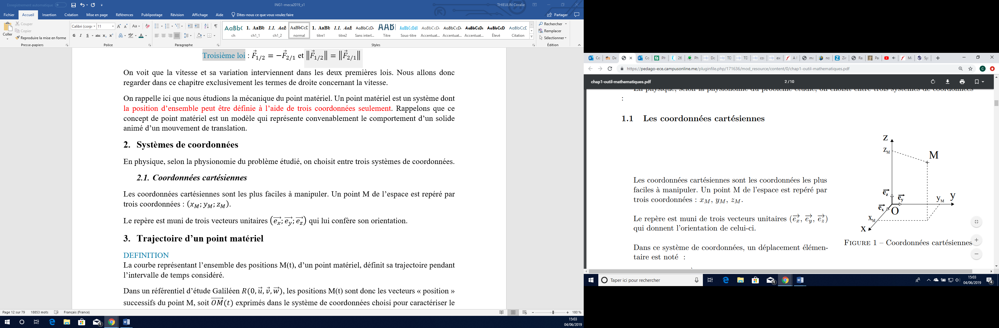{width="1.5888888888888888in"
height="1.488888888888889in"}En physique, selon la physionomie du
problème étudié, on choisit entre trois systèmes de coordonnées qui sont
des bases orthonormées directes (BOND).

15. []{#_Toc76046078 .anchor}Coordonnées cartésiennes

Les coordonnées cartésiennes sont les plus faciles à manipuler. Un point
$M$ de l'espace est repéré par trois coordonnées :
$\left( x_{M};y_{M};z_{M} \right)$ où
$x_{M},\ y_{M},\ z_{M}\  \in \mathbb{R}^{3}.$

Le repère est muni de trois vecteurs unitaires
$\left( \overrightarrow{e_{x}};\overrightarrow{e_{y}};\overrightarrow{e_{z}} \right)$
qui lui confère son orientation.

On définit le vecteur position $\overrightarrow{OM}$ tel que :
$\overrightarrow{OM} = x_{M}\overrightarrow{e_{x}} + y_{M}\overrightarrow{e_{y}} + z_{M}\overrightarrow{e_{z}}$.

*Remarque : cette base est fixe dans le référentiel d'étude.*

16. []{#_Toc76046079
    .anchor}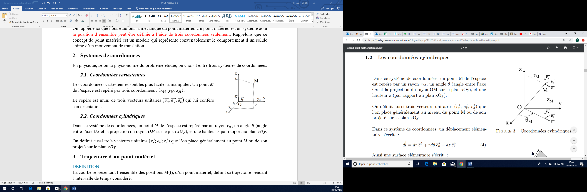{width="1.3868055555555556in"
    height="1.3402777777777777in"}Coordonnées cylindriques

Dans ce système de coordonnées, un point $M$ de l'espace est repéré par
un rayon $r_{M} > 0$, un angle
$\theta \in \left\lbrack 0;2\pi \right\lbrack\$(angle entre l'axe $Ox$
et la projection du rayon $OM$ sur le plan $xOy$), et une hauteur
$z\mathbb{\in R}$ par rapport au plan $xOy$.

On définit aussi trois vecteurs unitaires
$\left( \overrightarrow{e_{r}};\overrightarrow{e_{\theta}};\overrightarrow{e_{z}} \right)$
que l'on place généralement au point $M$ ou de son projeté sur le plan
$xOy.$

On définit le vecteur position $\overrightarrow{OM}$ tel que :
$\overrightarrow{OM} = r_{M}\overrightarrow{e_{r}} + z_{M}\overrightarrow{e_{z}}$.

*Remarque : cette base est « attachée » au point* $M$ *et bouge en même
temps que ce dernier. On dit que la base cylindrique est une base
mobile.*

17. []{#_Toc10551308 .anchor}Trajectoire d'un point matériel

18. []{#_Toc76046081 .anchor}Définition

La courbe représentant l'ensemble des positions M(t), d'un point
matériel, définit sa **trajectoire** pendant l'intervalle de temps
considéré.

Dans un référentiel d'étude Galiléen
$R(0,\overrightarrow{u},\overrightarrow{v},\overrightarrow{w})$, les
positions M(t) sont donc les vecteurs « position » successifs du point
M, soit $\overrightarrow{OM}(t)$ exprimés dans le système de coordonnées
choisi pour caractériser le mouvement.

19. []{#_Toc76046082 .anchor}Equations horaires

De la trajectoire, les équations horaires du mouvement du point $M$
peuvent être déduites. L'inverse est aussi vrai, des équations horaires,
on peut en déduire la trajectoire du mouvement du point $M$.

En coordonnées cartésiennes, le vecteur position d'un point $M(x,y,z)$
est donné par :

$\overrightarrow{OM} = x{\overrightarrow{u}}_{x} + y{\overrightarrow{u}}_{y} + z{\overrightarrow{u}}_{z}$.

Lorsque le point $M$ est en mouvement on a donc :
$\overrightarrow{OM}(t) = x{(t)\overrightarrow{u}}_{x} + y{(t)\overrightarrow{u}}_{y} + z(t){\overrightarrow{u}}_{z}$
et l'ensemble de ces vecteurs aux différents temps permet de tracer la
trajectoire. Les trois coordonnées sont des fonctions du temps : elles
sont appelées les équations horaires du mouvement du point $M$.

Notation : les **équations horaires** du point $M$ sont
$\left( \begin{array}{r}
x(t) = \ldots \\
y(t) = \ldots \\
z(t) = \ldots
\end{array} \right)$. En combinant ces fonctions, on peut trouver
l'équation décrivant la trajectoire.

20. []{#_Toc76046083 .anchor}Equations horaires de mouvements
    particuliers

Mouvement circulaire dans le plan 

Lorsque le point $M$ décrit un cercle (mouvement plan en 2D), il est
plus facile de décrire le vecteur position en coordonnées polaires,
soit : $\overrightarrow{OM}(t) = r{(t)\overrightarrow{u}}_{r}$.

Or en projetant ${\overrightarrow{u}}_{r}$ sur
${\overrightarrow{u}}_{x}$ et sur ${\overrightarrow{u}}_{y}$, on obtient
facilement :
${\overrightarrow{u}}_{r} = \cos{\theta(t)}{\overrightarrow{u}}_{x} + \sin{\theta(t)}{\overrightarrow{u}}_{y}$.

On a alors :
$\overrightarrow{OM}(t) = r(t)\cos{\theta(t)}{\overrightarrow{u}}_{x} + r(t)\sin{\theta(t)}{\overrightarrow{u}}_{y}$.

On en déduit que les équations du point $M$ sont
$\left( \begin{array}{r}
x(t) = r(t)\cos{\theta(t)} \\
y(t) = r(t)\sin{\theta(t)}
\end{array} \right)$.

Si $r(t) = r = cte$ (cas du mouvement circulaire), on obtient :
$\left( \begin{array}{r}
x(t) = r\cos{\theta(t)} \\
y(t) = r\sin{\theta(t)}
\end{array} \right)$.

Mouvement cylindrique 

De même, on peut montrer que pour un mouvement cylindrique (3D) :

Les équations du point $M$ sont $\left( \begin{array}{r}
x(t) = r(t)\cos{\theta(t)} \\
y(t) = r(t)\sin{\theta(t)} \\
z(t) = h(t)
\end{array} \right)$.

###### Exemple de détermination de la trajectoire à partir d'équations horaires données

Soit un point matériel $M$ en mouvement dans le référentiel
$R(O;{\overrightarrow{u}}_{x},{\overrightarrow{u}}_{y})$ selon les
équations horaires suivantes :

$$M(t) = \left\{ \begin{array}{r}
x(t) = 4\cos{\theta(t)} \\
y(t) = 4\sin{\theta(t)}
\end{array} \right\}$$

Déterminez la trajectoire du point $M$ ainsi que son mouvement.

*On remarque que :*

$x^{2}(t) + y^{2}(t) = {(4\cos{\theta(t))}}^{2} + \ {(4\sin{\theta(t))}}^{2} = 4^{2}\left( \cos^{2}{\theta(t)} + \sin^{2}{\theta(t)} \right) = 4^{2}$*.*

*On a alors* $x^{2}(t) + y^{2}(t) = 4^{2}\$*: c'est l'équation d'un
cercle de centre le point* $O$ *de coordonnées* $(0,0)$ *et de rayon 4.
Alors d'après ses équations horaires, le point* $M$ *décrit un cercle de
centre O et son mouvement est circulaire (translation circulaire).*

21. []{#_Toc10551309 .anchor}Notion de vitesse d'un point matériel

Il y a plusieurs vitesses. Par exemple, vous prenez votre voiture. Vous
parcourez 6 km en 10 minutes. Alors vous aurez parcouru ces 6 km à la
vitesse moyenne de :

$$v_{moy} = \frac{6}{10} = 0,6\ km/min = 36\ km/h$$

Par contre, si au bout des 10 minutes, un policier vous arrête en vous
disant que vous roulez à $90\ km/h$, vous ne pouvez pas lui répondre que
*c'est impossible car vous n'avez fait que 6 km en 10 minutes*.

Il y a donc deux vitesses différentes. Déjà parce qu'il y a peu de
chance que le policier sache où vous habitez et vous voyez bien que la
vitesse énoncée par le policier n'est pas une vitesse moyenne mais une
vitesse sur l'instant : une vitesse instantanée.

22. []{#_Toc10551310 .anchor}La Vitesse moyenne

Soit $M$ la position d'un point matériel à l'instant t.

Soit $M’$ la position de ce point matériel M à l'instant t+$dt$.

$\overrightarrow{MM'}$ est appelé **vecteur déplacement**, à ne pas
confondre avec le vecteur position.

On définit la vitesse moyenne vectorielle de M pendant l'intervalle

de temps (t, t+$\ dt$) telle que :

$$\overrightarrow{v_{moy}} = \frac{\overrightarrow{MM'}}{dt}$$

Cette vitesse est donc indépendante du chemin parcouru ; elle dépend
exclusivement de la distance entre le point de départ et le point
d'arrivée (ligne droite) et du temps pour aller d'un point à un autre.

23. []{#_Toc10551311 .anchor}Vitesse instantanée

Si on fait tendre le temps de parcours vers 0, soit $dt \rightarrow 0$,
alors on a
$\overrightarrow{v}(t) = \lim_{dt \rightarrow 0}\overrightarrow{v_{moy}}$

On a :
$\overrightarrow{MM'} = \overrightarrow{MO} + \overrightarrow{OM'} = \overrightarrow{OM'} - \overrightarrow{OM} = \overrightarrow{OM}(t + dt) - \overrightarrow{OM}(t)$

Donc
:$\ \lim_{dt \rightarrow 0}\overrightarrow{v_{moy}} = \lim_{dt \rightarrow 0}\frac{\overrightarrow{MM'}}{dt} = \lim_{dt \rightarrow 0}\frac{\overrightarrow{OM}(t + dt) - \overrightarrow{OM}(t)}{dt} = \frac{d\overrightarrow{OM}}{dt}$

Les mouvements sont relatifs, on doit définir cette vitesse instantanée
par rapport à un référentiel.

Soit O un point fixe du référentiel R d'étude, alors la vitesse du point
M par rapport au référentiel R s'écrit :

$$\overrightarrow{v}\left( \frac{M}{R} \right) = {(\frac{d\overrightarrow{OM}}{dt})}_{\slash R}$$

*Remarque : l'unité de la vitesse est le m/s*

Le terme $\frac{d\overrightarrow{OM}}{dt}$ représente la dérivée du
vecteur position $\overrightarrow{OM}$ en fonction du temps *t*. C'est
une notation particulière.

##### Les différentes notations de la dérivée

Il existe différentes notations pour exprimer la valeur de la dérivée
d\'une fonction $f$ en un point.

[La notation de Lagrange]{.underline} : $f'(a)$ : utilisée en
mathématiques

[La notation de Leibniz]{.underline} : $\frac{df}{dx}(a)$ ou
$\frac{df}{dx}|_{x = a}$ : c'est la notation la plus utilisée en
Physique

[La notation de Newton]{.underline} : $\dot{f}(a)$, cette notation est
très utilisée en mécanique pour désigner une dérivée [par rapport au
temps]{.underline}

24. []{#_Toc10551312 .anchor}Calcul de la vitesse dans un référentiel
    Galiléen donné

Pour l'ensemble des calculs de cette partie, le référentiel d'étude est
donné par :
$R(0,\overrightarrow{u_{x}},\overrightarrow{u_{y}},\ \overrightarrow{u_{z}})$
avec
($\overrightarrow{u_{x}},\overrightarrow{u_{y}},\ \overrightarrow{u_{z}}$)
la base cartésienne.

25. []{#_Toc10551313 .anchor}Expression de la vitesse en coordonnées
    cartésiennes

Le vecteur position d'un point M quelconque qui s'écrit en coordonnées
cartésiennes :

$$\overrightarrow{OM} = x\overrightarrow{u_{x}} + y\overrightarrow{u_{y}} + z\overrightarrow{u_{z}}$$

Comme :
$\overrightarrow{v}\left( \frac{M}{R} \right) = \left( \frac{d\overrightarrow{OM}}{dt} \right)_{/R}$

Alors :
$\overrightarrow{v}\left( \frac{M}{R} \right) = \frac{dx}{dt}\overrightarrow{u_{x}} + x{.(\frac{d\overrightarrow{u_{x}}}{dt})}_{\slash R} + \frac{dy}{dt}\overrightarrow{u_{y}} + y{.(\frac{d\overrightarrow{u_{y}}}{dt})}_{\slash R} + \frac{dz}{dt}\overrightarrow{u_{z}} + z{.(\frac{d\overrightarrow{u_{z}}}{dt})}_{\slash R}$

Or
${(\frac{d\overrightarrow{u_{x}}}{dt})}_{\slash R} = {(\frac{d\overrightarrow{u_{y}}}{dt})}_{\slash R} = {(\frac{d\overrightarrow{u_{z}}}{dt})}_{\slash R} = \overrightarrow{0}$,
car ces vecteurs ne varient pas au cours du temps (ce sont les vecteurs
de la base liée au référentiel).

D'où

$$\overrightarrow{v}\left( \frac{M}{R} \right) = \frac{dx}{dt}\overrightarrow{u_{x}} + \frac{dy}{dt}\overrightarrow{u_{y}} + \frac{dz}{dt}\overrightarrow{u_{z}}$$

Ou autrement écrit

$$\overrightarrow{v}\left( \frac{M}{R} \right) = \dot{x}\overrightarrow{u_{x}} + \dot{y}\overrightarrow{u_{y}} + \dot{z}\overrightarrow{u_{z}}$$

26. []{#_Toc10551314 .anchor}Expression de la vitesse en coordonnées
    cylindriques

Le vecteur position d'un point M quelconque s'écrit en coordonnées
cylindriques :

$$\overrightarrow{OM} = r\overrightarrow{u_{r}} + z\overrightarrow{u_{z}}$$

Alors :
$\overrightarrow{v}\left( \frac{M}{R} \right) = \dot{r}\overrightarrow{u_{r}} + r{.(\frac{d\overrightarrow{u_{r}}}{dt})}_{\slash R} + \dot{z}\overrightarrow{u_{z}} + {z.(\frac{d\overrightarrow{u_{z}}}{dt})}_{\slash R}$

Or
${(\frac{d\overrightarrow{u_{z}}}{dt})}_{\slash R} = \overrightarrow{0}$
car le vecteur $\overrightarrow{u_{z}}$ est lié au référentiel d'étude.
En revanche les vecteurs
$\overrightarrow{u_{r}}\ et\ \overrightarrow{u_{Ѳ}}\ \$varient au cours
du temps dans ce référentiel :

$$\left| \begin{array}{r}
\left( \frac{d\overrightarrow{u_{r}}}{dt} \right)_{/R} = \frac{d\theta}{dt}\overrightarrow{.u_{\theta}} = \dot{\theta}.\overrightarrow{u_{\theta}}\ \ \  \\
\  \\
\left( \frac{d\overrightarrow{u_{\theta}}}{dt} \right)_{/R} = - \frac{d\theta}{dt}\overrightarrow{.u_{r}} = - \dot{\theta}.\overrightarrow{u_{r}}
\end{array} \right.\ $$

On obtient alors :
$\overrightarrow{v}\left( \frac{M}{R} \right) = \dot{r}\overrightarrow{u_{r}} + r\dot{\theta}\overrightarrow{u_{\theta}} + \dot{z}\overrightarrow{u_{z}}$

[Démontrons que:]{.underline} $\left| \begin{array}{r}
\left( \frac{d\overrightarrow{u_{r}}}{dt} \right)_{/R} = \frac{d\theta}{dt}\overrightarrow{.u_{\theta}} = \dot{\theta}.\overrightarrow{u_{\theta}}\ \ \  \\
\  \\
\left( \frac{d\overrightarrow{u_{\theta}}}{dt} \right)_{/R} = - \frac{d\theta}{dt}\overrightarrow{.u_{r}} = - \dot{\theta}.\overrightarrow{u_{r}}
\end{array} \right.\$

[Méthode 1]{.underline} : calcul (à savoir refaire)

a)  $\left( \frac{d\overrightarrow{u_{r}}}{dt} \right)_{/R}$

On a
$\overrightarrow{u_{r}} = \cos\theta\ \overrightarrow{u_{x}} + \sin\theta\ \overrightarrow{u_{y}}$

Alors$\ \left( \frac{d\overrightarrow{u_{r}}}{dt} \right)_{/R} = - \dot{\theta}\sin\theta\ \overrightarrow{u_{x}} + \ \dot{\theta}\cos\theta\ \overrightarrow{u_{y}} = \dot{\theta}( - sin\theta\ \overrightarrow{u_{x}} + cos\theta\ \overrightarrow{u_{y}})$

Or comme
$\overrightarrow{u_{\theta}} = \  - sin\theta\ \overrightarrow{u_{x}} + cos\theta\ \overrightarrow{u_{y}}$
on a donc :

$$\left( \frac{d\overrightarrow{u_{r}}}{dt} \right)_{/R} = \frac{d\theta}{dt}.\overrightarrow{u_{\theta}} = \dot{\theta}.\overrightarrow{u_{\theta}}$$

b)  $\left( \frac{d\overrightarrow{u_{\theta}}}{dt} \right)_{/R}$

On a
$\overrightarrow{u_{\theta}} = \  - \ \sin\theta\ \overrightarrow{u_{x}} + \cos\theta\ \overrightarrow{u_{y}}$

Alors
$\left( \frac{d\overrightarrow{u_{\theta}}}{dt} \right)_{/R} = - \dot{\theta}\ cos\theta\ \overrightarrow{u_{x}} - \dot{\theta}\sin\theta\ \overrightarrow{u_{y}} = - \dot{\theta}(cos\theta\ \overrightarrow{u_{x}} + sin\theta\ \overrightarrow{u_{y}})$

Or comme
$\overrightarrow{u_{r}} = cos\theta\ \overrightarrow{u_{x}} + sin\theta\ \overrightarrow{u_{y}}$
on a donc :

$$\ \ \left( \frac{d\overrightarrow{u_{\theta}}}{dt} \right)_{/R} = - \frac{d\theta}{dt}.\overrightarrow{u_{r}} = - \dot{\theta}.\overrightarrow{u_{r}}$$

[Méthode 2]{.underline} : géométrique.

On voit lorsque $d\theta$ tend vers 0 sur la figure ci-dessous que :
$d\overrightarrow{u_{r}} = d\theta\overrightarrow{u_{\theta}}$ et
$d\overrightarrow{u_{\theta}} = - d\theta\overrightarrow{u_{r}}$

En effet :
$\overrightarrow{u_{r}}(t + dt) - \overrightarrow{u_{r}}(t) = d\overrightarrow{u_{r}}$ ;
$\overrightarrow{u_{\theta}}(t + dt) - \overrightarrow{u_{\theta}}(t) = d\overrightarrow{u_{\theta}}$
et
$\sin{d\theta = \frac{du_{r}}{1}} = \frac{du_{\theta}}{1}\sim d\theta$

Donc :
$\frac{d\overrightarrow{u_{r}}}{dt} = \frac{d\theta}{dt}\overrightarrow{u_{\theta}} = \dot{\theta}\overrightarrow{u_{\theta}}$

et

$$\frac{d\overrightarrow{u_{\theta}}}{dt} = - \frac{d\theta}{dt}\overrightarrow{u_{r}} = - \dot{\theta}\overrightarrow{u_{r}}$$

27. []{#_Toc10551316 .anchor}Accélération d'un point matériel

28. []{#_Toc10551317 .anchor}Définition

L'accélération traduit les variations de vitesse au cours du temps, son
unité est le m.s^-2^, son expression est la suivante :

$$\overrightarrow{a}\left( \frac{M}{R} \right) = {(\frac{d\overrightarrow{v}(M \slash R)}{dt})}_{\slash R} = {(\frac{d\overrightarrow{²OM}}{{dt}^{2}})}_{\slash R}$$

29. []{#_Toc10551318 .anchor}Mouvement accéléré ou retardé ?

##### Vitesse constante d'un point matériel

$$\left\| \overrightarrow{v}\left( \frac{M}{R} \right) \right\| = cst \rightarrow \left\| \overrightarrow{v}\left( \frac{M}{R} \right) \right\| ² = cst \rightarrow \overrightarrow{v}²\left( \frac{M}{R} \right) = cst$$

Donc :

$$\frac{d\left\| \overrightarrow{v}\left( \frac{M}{R} \right) \right\| ²}{dt} = \frac{d\overrightarrow{v}²\left( \frac{M}{R} \right)}{dt} = 0$$

Or
$\frac{d\overrightarrow{v}²\left( \frac{M}{R} \right)}{dt} = 2\overrightarrow{v}\left( \frac{M}{R} \right).\frac{d\overrightarrow{v}\left( \frac{M}{R} \right)}{dt} = 2\overrightarrow{v}\left( \frac{M}{R} \right).\overrightarrow{a}\left( \frac{M}{R} \right)$

Donc :
$\overrightarrow{v}\left( \frac{M}{R} \right).\overrightarrow{a}\left( \frac{M}{R} \right) = 0$

[Commentons ce résultat]{.underline} :

Soit $\left\| \overrightarrow{a}\left( \frac{M}{R} \right) \right\| = 0$
(pas d'accélération)🡪 *mouvement rectiligne uniforme*

Soit $\overrightarrow{a}\bot\overrightarrow{v}\$🡪 *mouvement circulaire
uniforme* où
$\overrightarrow{v} = R.\omega.\overrightarrow{u_{\theta}}$, et
$\omega = \frac{d\theta}{dt}$ (vitesse angulaire : $rad/s$).

##### 

##### vitesse variable d'un point matériel :

Si
$v \nearrow \ \ \ \ alors\ \ \ \ \ v² = \overrightarrow{v}² \nearrow \ \ \ \ donc\ \ \ \ \ \frac{d\overrightarrow{v}²}{dt} = 2\overrightarrow{v}.\overrightarrow{a} > 0\ \  \rightarrow mouvement\ accéléré$
($\overrightarrow{v}$ et $\overrightarrow{a}$ sont dans le même sens)

Si
$v \searrow \ \ \ \ alors\ \ \ \ \ v² = \overrightarrow{v}² \searrow \ \ \ \ donc\ \ \ \ \ \frac{d\overrightarrow{v}²}{dt} = 2\overrightarrow{v}.\overrightarrow{a} < 0\ \  \rightarrow mouvement\ retardé$
($\overrightarrow{v}$ et $\overrightarrow{a}$ sont en sens opposés)

**Descente :**
$\overrightarrow{\mathbf{v}}\mathbf{.}\overrightarrow{\mathbf{a}}\mathbf{> 0}$

**Montée :**
$\overrightarrow{\mathbf{v}}\mathbf{.}\overrightarrow{\mathbf{a}}\mathbf{< 0}$

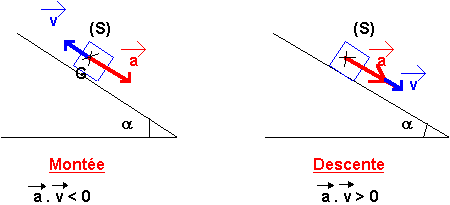{alt="http://sgbd.ac-poitiers.fr/bde/exos/98LGB018/Image6.gif"
width="3.60962489063867in" height="1.160741469816273in"}

**A retenir : Ce n'est pas le signe de l'accélération qui indique le
caractère retardé ou accéléré d'un mouvement mais le signe du produit
scalaire**
$\overrightarrow{\mathbf{v}}\mathbf{.}\overrightarrow{\mathbf{a}}$** !**

30. []{#_Toc10551319 .anchor}Expression de l'accélération en coordonnées
    cartésiennes

Dans
$R(0,\overrightarrow{u_{x}},\overrightarrow{u_{y}},\ \overrightarrow{u_{z}})$
avec
($\overrightarrow{u_{x}},\overrightarrow{u_{y}},\ \overrightarrow{u_{z}}$)
la base cartésienne.

D'après l'expression de la vitesse on a immédiatement :

$$\overrightarrow{a}\left( \frac{M}{R} \right) = \ddot{x}\overrightarrow{u_{x}} + \ddot{y}\overrightarrow{u_{y}} + \ddot{z}\overrightarrow{u_{z}}$$

31. []{#_Toc10551320 .anchor}Expression de l'accélération en coordonnées
    cylindriques

Dans
$R(0,\overrightarrow{u_{x}},\overrightarrow{u_{y}},\ \overrightarrow{u_{z}})$
avec
($\overrightarrow{u_{x}},\overrightarrow{u_{y}},\ \overrightarrow{u_{z}}$)
la base cartésienne.

Comme
$\overrightarrow{v}\left( \frac{M}{R} \right) = \dot{r}\overrightarrow{u_{r}} + r\dot{\theta}\overrightarrow{u_{\theta}} + \dot{z}\overrightarrow{u_{z}}$
et
$\overrightarrow{a}\left( \frac{M}{R} \right) = {(\frac{d\overrightarrow{v}(M \slash R)}{dt})}_{\slash R}$,
on a :

$$\overrightarrow{a}\left( \frac{M}{R} \right) = \ddot{r}\overrightarrow{u_{r}} + \dot{r}{.(\frac{d\overrightarrow{u_{r}}}{dt})}_{\slash R} + \dot{r}\dot{\theta}\overrightarrow{u_{\theta}} + r\ddot{\theta}\overrightarrow{u_{\theta}} + r\dot{\theta}{.(\frac{d\overrightarrow{u_{\theta}}}{dt})}_{\slash R} + \ddot{z}\overrightarrow{u_{z}} + {\dot{z}.(\frac{d\overrightarrow{u_{z}}}{dt})}_{\slash R}$$

Comme
${(\frac{d\overrightarrow{u_{r}}}{dt})}_{\slash R} = \dot{\theta}\overrightarrow{u_{\theta}}$
;
${(\frac{d\overrightarrow{u_{\theta}}}{dt})}_{\slash R} = - \dot{\theta}\overrightarrow{u_{r}}$
et
${(\frac{d\overrightarrow{u_{z}}}{dt})}_{\slash R} = \overrightarrow{0}$

Alors :
$\overrightarrow{a}\left( \frac{M}{R} \right) = \left( \ddot{r} - r{\dot{\theta}}^{2} \right)\overrightarrow{u_{r}} + \left( 2\dot{r}\dot{\theta} + r\ddot{\theta} \right)\overrightarrow{u_{\theta}} + \ddot{z}\overrightarrow{u_{z}}$

32. []{#_Toc10551321 .anchor}Comment retrouver les équations horaires à
    partir de l'accélération ?

Lorsque vous connaitrez l'accélération le but sera de remonter aux
équations horaires afin de connaitre la trajectoire (c'est-à-dire le
mouvement). Il faut alors savoir non pas dériver mais intégrer. En effet
nous savons que :

$$\overrightarrow{a}\left( \frac{M}{R} \right) = {(\frac{d\overrightarrow{v}(M \slash R)}{dt})}_{\slash R} = {(\frac{d\overrightarrow{²OM}}{{dt}^{2}})}_{\slash R}$$

Si
$\overrightarrow{a}\left( \frac{M}{R} \right) = a_{x}(t)\overrightarrow{u_{x}} + a_{y}(t)\overrightarrow{u_{y}} + a_{z}(t)\overrightarrow{u_{z}}$
(qui est le cas le plus général dans un espace à trois dimensions comme
le nôtre) alors :

$$\left( \begin{array}{r}
a_{x}(t) \\
a_{y}(t) \\
a_{z}(t)
\end{array} \right) = \left( \begin{array}{r}
\frac{dv_{x}(t)}{dt} \\
\frac{dv_{y}(t)}{dt} \\
\frac{dv_{z}(t)}{dt}
\end{array} \right) \Leftrightarrow \left( \begin{array}{r}
a_{x}(t) = \frac{dv_{x}(t)}{dt} \\
a_{y}(t) = \frac{dv_{y}(t)}{dt} \\
a_{z}(t) = \frac{dv_{z}(t)}{dt}
\end{array} \right)$$

C'est ici que la notation Leibniz prend tout son sens car les trois
dernières équations peuvent s'écrire :

$$\left\{ \begin{array}{r}
{dv}_{x}(t) = a_{x}(t)dt \\
{dv}_{y}(t) = a_{y}(t)dt \\
{dv}_{z}(t) = a_{z}(t)dt
\end{array} \right.\ $$

On peut alors intégrer chacune des équations afin de déterminer
$v_{x}(t)$,$\ v_{y}(t)$ et $v_{z}(t)$.

On a alors : $\left\{ \begin{array}{r}
\int_{v_{x}(0)}^{v_{x}(t)}{{dv}_{x}(t)} = \int_{0}^{t}{a_{x}(t)dt} \\
\int_{v_{y}(0)}^{v_{y}(t)}{{dv}_{y}(t)} = \int_{0}^{t}{a_{y}(t)dt} \\
\int_{v_{z}(0)}^{v_{z}(t)}{{dv}_{z}(t)} = \int_{0}^{t}{a_{z}(t)dt}
\end{array} \right.\$

Soit :

$$\left\{ \begin{array}{r}
\left\lbrack v_{x}(t) \right\rbrack_{v_{x}(0)}^{v_{x}(t)} = \left\lbrack A_{x}(t) \right\rbrack_{0}^{t} \\
\left\lbrack v_{y}(t) \right\rbrack_{v_{y}(0)}^{v_{y}(t)} = \left\lbrack A_{y}(t) \right\rbrack_{0}^{t} \\
\left\lbrack v_{z}(t) \right\rbrack_{v_{z}(0)}^{v_{z}(t)} = \left\lbrack A_{y}(t) \right\rbrack_{0}^{t}
\end{array} \right.\ $$

Où les fonctions $A_{x}(t)$, $A_{y}(t)$,$\ A_{z}(t)\$sont les fonctions
primitives respectives de $a_{x}(t)$, $a_{y}(t)$, $a_{z}(t)$, fonctions
dont l'expression est connue.

Ceci donne au final :

$$\left\{ \begin{array}{r}
v_{x}(t) = A_{x}(t) + v_{x}(0) \\
v_{y}(t) = A_{y}(t) + v_{y}(0) \\
v_{z}(t) = A_{z}(t) + v_{z}(0)
\end{array} \right.\ $$

avec $v_{x}(0)$, $v_{y}(0)$ et $v_{z}(0)$ les vitesses initiales
(vitesse au départ du mouvement), ce sont donc des valeurs.

Alors comme :

$$\left( \begin{array}{r}
v_{x}(t) \\
v_{y}(t) \\
v_{z}(t)
\end{array} \right) = \left( \begin{array}{r}
\frac{dx(t)}{dt} \\
\frac{dy(t)}{dt} \\
\frac{dz(t)}{dt}
\end{array} \right) \Leftrightarrow \left\{ \begin{array}{r}
dx(t) = v_{x}(t)dt \\
dy(t) = v_{y}(t)dt \\
dz(t) = v_{z}(t)dt
\end{array} \right.\ $$

Alors en intégrant de nouveau, on obtient :

$$\left\{ \begin{array}{r}
x(t) = A_{x}'(t) + v_{x}(0)t + x(0) \\
y(t) = A_{y}'(t) + v_{y}(0)t + y(0) \\
z(t) = A_{z}'(t) + v_{z}(0)t + z(0)
\end{array} \right.\ $$

où les fonctions$\ A_{x}'(t)$, $A_{y}'(t)$et$\ A_{z}'(t)$sont les
fonctions primitives respectives de $A_{x}(t)$, $A_{y}(t)$
et$\ A_{z}(t)$.

33. []{#_Toc76046096 .anchor}Etude des mouvements usuels

34. []{#_Toc76046097 .anchor}Mouvement rectiligne

Un mouvement est rectiligne s'il correspond à un déplacement le long
d'une droite fixe dans le référentiel d'étude. Dans ce cas, les vecteurs
vitesse et accélération sont portées par la droite sur laquelle
s'effectue le mouvement.

On utilise le système de coordonnées cartésiennes pour ce type de
mouvement.

Mouvement rectiligne uniforme

C'est le mouvement de translation le plus simple : le mouvement du point
matériel est en ligne droite (rectiligne) et l'accélération est nulle
(mouvement uniforme, ce qui veut dire que le vecteur vitesse est
constant au cours du temps).

Si l'axe du mouvement est l'axe $0x$, on a dans le référentiel
$R(0,\overrightarrow{u_{x}},\overrightarrow{u_{y}},\ \overrightarrow{u_{z}})\$:

$$\overrightarrow{OM} = x\overrightarrow{u_{x}}$$

$$\overrightarrow{v}\left( \frac{M}{R} \right) = \frac{dx}{dt}\overrightarrow{u_{x}} = v_{0}\overrightarrow{u_{x}} = \overrightarrow{cst}$$

Ce qui en intégrant de l'instant initial à l'instant t donne l'équation
horaire (ou ici équation du mouvement du point) :
$x(t) = \ v_{0}t + x(t = 0)$

Mouvement rectiligne uniformément accéléré

C'est le même mouvement que précédemment, mais cette fois-ci
l'accélération n'est pas nulle, elle est constante :

$$\overrightarrow{a}(M/R) = a_{0}\overrightarrow{u_{x}} = \frac{dv}{dt}\overrightarrow{u_{x}}$$

*Remarques :*

- *Si* $a_{0} > 0\$*alors le mouvement est accéléré (la vitesse
  augmente)*

- *Si* $a_{0} < 0\$*alors le mouvement est retardé (la vitesse diminue)*

En intégrant de l'instant initial à l'instant $t$, on trouve alors
l'expression de la vitesse :

$\overrightarrow{v}\left( \frac{M}{R} \right) = {(a}_{0}t + v(t = 0))\overrightarrow{u_{x}}$
ou $v(t) = a_{0}t + v(t = 0)$

*Remarque : comme il n'y a qu'un seul axe, l'accélération et la vitesse
n'ont qu'une seule composante suivant ce même axe. La notation
vectorielle peut être abandonnée.*

Ce qui en intégrant de nouveau de l'instant initial à
l'instant$\ t\$donne l'équation horaire (ou ici équation du mouvement du
point) :

$$x(t) = {\frac{1}{2}a}_{0}t^{2} + v(t = 0)t + x(t = 0)$$

$$\overrightarrow{OM} = \left( {\frac{1}{2}a}_{0}t^{2} + v(t = 0)t + x(t = 0) \right)\overrightarrow{u_{x}}$$

Mouvement rectiligne sinusoïdal

Un mouvement rectiligne sinusoïdal est un mouvement oscillatoire de
pulsation $\omega\ (rad/s)$, de période $T = \frac{2\pi}{\omega}(s)$, de
fréquence $f = \ \frac{\omega}{2\pi} = \ \frac{1}{T}\ (Hz)$
d'amplitude$\ x_{m}\ (m)$ et de phase $\varphi\ (rad)$, tel que :

$$x(t) = x_{m}\ cos(\omega t + \varphi)$$

Le plus souvent l'équation horaire est donnée et il faut déterminer la
vitesse et l'accélération du point matériel.

La vitesse est donnée par la relation suivante :

$$v(t) = \frac{dx(t)}{dt} = - x_{m}.\omega.sin(\omega t + \varphi)$$

En dérivant de nouveau, on trouve l'accélération, donnée par la relation
suivante :

$$a(t) = \ddot{x}(t) = - x_{m}.\omega ².cos(\omega t + \varphi)$$

*Remarque : ce sera le cas d'un point matériel attaché à un ressort et
astreint à se déplacer sur une droite.*

35. []{#_Toc10551328 .anchor}Mouvement circulaire

Le mouvement circulaire consiste en un point matériel M décrivant un
mouvement de centre O, de rayon $R = OM$, à vitesse angulaire
$\omega = \frac{d\theta}{dt} = \dot{\theta}$. Attention, $\omega$ n'est
pas obligatoirement constant !

Les coordonnées les plus adaptées sont les coordonnées polaires.

Dans ce cas, dans un référentiel
$R\left( 0,\overrightarrow{u_{x}},\overrightarrow{u_{y}},\ \overrightarrow{u_{z}} \right)$,
on a :

$$\overrightarrow{OM} = R\overrightarrow{u_{r}}$$

$$\overrightarrow{v}\left( \frac{M}{R} \right) = R\dot{\theta}\overrightarrow{u_{\theta}} = R\omega(t)\overrightarrow{u_{\theta}}$$

La vitesse n'a donc qu'une seule composante dans un mouvement circulaire
et est toujours dirigée suivant le vecteur unitaire
$\overrightarrow{u_{\theta}}$ quelque soit le temps t. *On dit que le
vecteur vitesse est orthoradial.*

On peut également exprimer l'accélération :

$$\overrightarrow{a}(M/R) = - R\dot{\theta ²}\overrightarrow{u_{r}} + R\ddot{\theta}\overrightarrow{u_{\theta}} = - R\omega ²\overrightarrow{u_{r}} + R\dot{\omega}\overrightarrow{u_{\theta}}$$

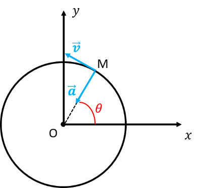{width="1.7909722222222222in"
height="1.6958333333333333in"}**Si**
$\mathbf{\omega}\mathbf{=}\mathbf{cst}\mathbf{\rightarrow}\mathbf{mouvement}\mathbf{\ }\mathbf{circulaire}\mathbf{\ }\mathbf{uniforme}$

Dans ce cas :
$\overrightarrow{v}\left( \frac{M}{R} \right) = R\omega\overrightarrow{u_{\theta}}$

La vitesse dans un mouvement circulaire uniforme est de norme constante
(uniforme) quel que soit le temps $t$.

L'accélération est alors donnée par :
$\overrightarrow{a} = - R\omega^{2}\overrightarrow{u_{r}}$

L'accélération dans un mouvement circulaire uniforme n'est pas nulle. On
appelle cette accélération l'accélération centripète car elle est
toujours portée par $\overrightarrow{u_{r}}$ et dirigée vers le point O
centre du mouvement.

36. []{#_Toc10551329 .anchor}Mouvement rectiligne + circulaire :
    mouvement composé

Ce mouvement consiste en un point matériel M décrivant un cercle (rayon
R, à la vitesse angulaire $\omega = \frac{d\theta}{dt} = \dot{\theta}$)
autour du point A, lui-même animé d'un mouvement rectiligne uniforme
dans le référentiel d'étude
$R\left( 0,\overrightarrow{u_{x}},\overrightarrow{u_{y}},\ \overrightarrow{u_{z}} \right)$.

On note
$\overrightarrow{v}\left( \frac{A}{R} \right) = v_{0}\overrightarrow{u_{x}}$.

On a :
$\overrightarrow{v}\left( \frac{M}{R} \right) = {(\frac{d\overrightarrow{OM}}{dt})}_{\slash R}$
=${(\frac{d\overrightarrow{OA}}{dt})}_{\slash R} + {(\frac{d\overrightarrow{AM}}{dt})}_{\slash R}$=$\overrightarrow{v}\left( \frac{A}{R} \right) + {(\frac{d\overrightarrow{AM}}{dt})}_{\slash R}$

Effectivement on a bien, par définition,
$\overrightarrow{v}\left( \frac{A}{R} \right) = {(\frac{d\overrightarrow{OA}}{dt})}_{\slash R}$.

${(\frac{d\overrightarrow{AM}}{dt})}_{\slash R}$ n'est pas une vitesse
car le point A et le point M sont mobiles dans le référentiel d'étude.

Il faut donc changer de référentiel d'étude afin de rendre le point A
fixe.

On définit alors le référentiel
$R\left( A,\overrightarrow{u_{x}},\overrightarrow{u_{y}},\ \overrightarrow{u_{z}} \right)$.
Le repère
$\left( \overrightarrow{u_{x}},\overrightarrow{u_{y}},\ \overrightarrow{u_{z}} \right)$
associé à $R'$ est centré en A (qui est fixe dans *R'*) et possède une
base associée qui est la même que celle de R.

Ce référentiel *R'* est dit en translation dans *R*.

Pour deux référentiels en translation l'un par rapport à l'autre on a :
${(\frac{d\overrightarrow{AM}}{dt})}_{\slash R} = {(\frac{d\overrightarrow{AM}}{dt})}_{\slash R'}$

Or
$\overrightarrow{v}\left( \frac{M}{R'} \right) = {(\frac{d\overrightarrow{AM}}{dt})}_{\slash R'}$=$\ r\dot{\theta}\overrightarrow{u_{\theta}}$
(même résolution en polaire que dans le cas précédent).

On a finalement :

$$\overrightarrow{v}\left( \frac{M}{R} \right) = \overrightarrow{v}\left( \frac{A}{R} \right) + \overrightarrow{v}\left( \frac{M}{R'} \right)$$

Soit :
$\overrightarrow{v}\left( \frac{M}{R} \right) = v_{0}\overrightarrow{u_{x}} + \ r\dot{\theta}\overrightarrow{u_{\theta}}$

**La vitesse**
$\overrightarrow{\mathbf{v}}\left( \frac{\mathbf{A}}{\mathbf{R}} \right)$
**est appelée la vitesse d'ensemble ou vitesse d'entrainement.**

**La vitesse**
$\overrightarrow{\mathbf{v}}\left( \frac{\mathbf{A}}{\mathbf{R'}} \right)$
**est appelée la vitesse relative**.

37. []{#_Toc76046100 .anchor}Bilan

- On a :
  $\ \overrightarrow{v}\left( \frac{M}{R} \right) = {(\frac{d\overrightarrow{OM}}{dt})}_{\slash R}$
  et
  $\ \overrightarrow{a}\left( \frac{M}{R} \right) = {(\frac{d\overrightarrow{v}(M \slash R)}{dt})}_{\slash R} = {(\frac{d\overrightarrow{²OM}}{{dt}^{2}})}_{\slash R}$

- Il faut bien regarder et définir le référentiel d'étude et les
  constantes du problème (A-t-on
  $r = cte\ ?\ \frac{d\theta}{dt} = cte\ ?\ldots)$ puis dériver.

- Il ne sert à rien d'apprendre par cœur les expressions de la vitesse
  et l'accélération en coordonnées polaires et/ou cylindriques car les
  expressions dépendent du référentiel d'étude.

- Par contre dans
  $R(0,\overrightarrow{u_{x}},\overrightarrow{u_{y}},\ \overrightarrow{u_{z}})$,
  il faut savoir que : $\left| \begin{array}{r}
  \left( \frac{d\overrightarrow{u_{r}}}{dt} \right)_{/R} = \dot{\theta}.\overrightarrow{u_{\theta}}\ \ \  \\
  \  \\
  \left( \frac{d\overrightarrow{u_{\theta}}}{dt} \right)_{/R} = - \dot{\theta}.\overrightarrow{u_{r}}
  \end{array} \right.\$

# Chapitre 2 : Les forces usuelles {#chapitre-2-les-forces-usuelles .ch}

1.  Introduction

Dans le chapitre « principes fondamentaux », nous avons vu les relations
fondamentales qui permettront d'étudier et de résoudre un problème de
mécanique du point matériel. Ces relations fondamentales sont les trois
lois de Newton. La notion de force intervient dans ces trois lois.

Dans ce chapitre nous allons voir les forces rencontrées le plus
fréquemment dans les problèmes physiques relevant de la mécanique du
point.

38. []{#_Toc10792176 .anchor}La notion de force

Une force est une quantité physique qui modélise l'action exercée sur un
système physique. Ainsi, une force est une action ou effort qui,
s'appliquant en un point matériel, modifie son comportement. Si le point
est immobile, une force s'appliquant va le mettre en mouvement dans un
sens et une direction donnés. Si le point est déjà en mouvement, une
nouvelle force s'appliquant sur le point va le faire changer de
direction voire de sens.

Toute force est caractérisée par son intensité (norme), par une
direction dans laquelle elle est appliquée et par un sens : les forces
sont donc des **notions vectorielles** (comme notées dans les lois de
Newton).

La dimension de toute force est *M.L.T ^-2^* .

Les forces sont exprimées en $N$ (Newton) ou dans le système
international en $kg.m.s^{- 2}$.

Les forces peuvent se scinder en deux familles :

- Les forces à distance

- Les forces de contact

Regardons ces deux familles l'une après l'autre.

39. []{#_Toc10792177 .anchor}Les forces d'interaction à distance

Ces forces sont des forces d'interaction : elles sont dues à l'action
d'un point matériel sur un autre point matériel, les deux points étant
distants l'un de l'autre (= ils ne se touchent pas !). Ces forces sont
au nombre de quatre en Physique. Elles possèdent toutes un point
commun : leur intensité décroit lorsque la distance d'interaction
augmente. Les quatre types de forces sont :

- La force de gravitation

- Les forces électriques et magnétiques

- Les forces d'interactions faibles

- Les forces d'interactions fortes

Les deux dernières sortent totalement du cadre de la mécanique du point
car elles interviennent dans la cohérence de la matière au niveau
subatomique (Physique des particules). Nous ne les aborderons donc pas.

Nous avons donc deux types de force à distance à regarder, à décrire et
qui seront rencontrés par la suite : les forces de gravitation et les
forces électriques et magnétiques.

40. []{#_Toc10792178 .anchor}La force de gravitation

Enoncée par Newton dès 1650 (les lois du mouvement datent de 1686), la
force de gravitation a été une véritable révolution. Elle expliquait
pour la première fois le mouvement des planètes.

Son expression stipule que deux masses ponctuelles (deux points
matériels) s'attirent en raison de leur masse et de l'inverse du carré
de la distance qui les sépare selon la direction passant par les deux
points. Dans le formalisme mathématique, son expression est alors :

$${\overrightarrow{F}}_{m_{1} \rightarrow m_{2}} = - {\overrightarrow{F}}_{m_{2} \rightarrow m_{1}} = - \frac{G{.m}_{1}.m_{2}}{M_{1}M_{2}²}.\frac{\overrightarrow{M_{1}M_{2}}}{M_{1}M_{2}}$$

avec $G = 6.675\ 10^{- 11}\ N.m^{2}.{kg}^{- 2}$.

La force de gravitation est une **force attractive**.

Les normes des deux forces sont égales.

***Attention : si les masses ne peuvent pas être considérées comme
ponctuelles, c'est-à-dire si leur taille n'est pas petite devant la
distance qui les sépare, il ne faut pas appliquer cette loi.***

La force de gravitation est une interaction fondamentale. C'est une
force pleine de surprises et encore bien mystérieuse. Encore de nos
jours, elle est source de recherche et de questionnement car sa portée
est infinie : elle structure la répartition des masses dans l'univers
tout entier. Son comportement aux échelles subatomiques est encore une
énigme mais elle existe aussi à cette échelle de taille.

Une force commune que nous ressentons tous les jours découle directement
de la force de gravitation : le poids.

41. []{#_Toc10792179 .anchor}Le poids

Le poids représente la force de gravitation exercée par une planète sur
des objets dans son entourage proche.

Le poids est noté : $\overrightarrow{P}$

Le poids est le produit de la masse du point par l'accélération de la
pesanteur $\overrightarrow{g}\$ due à la planète :

$$\overrightarrow{P} = m\overrightarrow{g}\ $$

Le poids est donc toujours colinéaire à l'accélération de la pesanteur.
Mais comment exprimer cette dernière ?

Lorsque les masses sont concentrées en des points matériels,
l'expression de l'interaction gravitationnelle est claire. Par contre,
pour deux objets étendus, comme une planète ou une personne, on doit se
poser la question de la position des deux points matériels.

Comme déjà dit dans le chapitre « principes fondamentaux », en mécanique
du point, les points matériels sont choisis comme étant le centre de
masse des objets auquel on alloue la masse totale de l'objet.

Ainsi une planète est modélisée par une sphère parfaite homogène de
masse moyenne et de rayon moyen R~T~. Dans ce cas, le centre de la
sphère est le centre de masse de la planète.

Appliquons cela à la Terre :

La terre est modélisée par une sphère parfaite homogène de masse moyenne
$m_{Terre}$ et de rayon moyen $R_{T}$. Pour un point M de masse $m$, se
trouvant à une altitude $z$ au-dessus de la surface de la Terre, la
distance entre les deux masses (les deux points) est alors la distance
du centre de la terre jusqu'à l'altitude $z$ au-dessus de sa surface.

On définit le poids comme étant la force gravitationnelle qu'exerce la
terre sur le point M. On a alors :

$${\overrightarrow{P} = \overrightarrow{F}}_{Terre \rightarrow M} = - \frac{G{.m}_{Terre}.m}{(R_{T} + z)²}.\overrightarrow{u_{z}}$$

$$\overrightarrow{P} = {\overrightarrow{F}}_{Terre \rightarrow M} = m.\frac{- G{.m}_{Terre}}{R_{T}²(1 + \frac{z}{R_{T}})²}.\overrightarrow{u_{z}}$$

Donc si $\frac{Z}{R_{T}} \ll 1$ (très petit) on a
$(1 + \frac{z}{R_{T}}) \approx 1$, alors :

$${\overrightarrow{P} = \overrightarrow{F}}_{Terre \rightarrow M} = m.\frac{- G{.m}_{Terre}}{R_{T}²}.\overrightarrow{u_{z}}$$

On pose
$\overrightarrow{g} = \frac{- G{.m}_{Terre}}{R_{T}²}.\overrightarrow{u_{z}}$.
C'est l'accélération de la pesanteur terrestre.

Remarque : Le vecteur $\overrightarrow{g}$ a la dimension d'une
accélération, mais ce n'en est pas une au sens que ce n'est pas la
dérivée d'une vitesse ni la dérivée seconde d'une position.

En prenant $m_{Terre} = 6.10^{24\ }kg$ et $R_{T} = 6400\ km$ on obtient
la valeur de g = 9,81 m.s^-²^.

L'expression de $\overrightarrow{g}$ est la même quelle que soit la
planète, seule sa masse et son rayon moyen change.

En toute rigueur le vecteur $\overrightarrow{u_{z}}$ est ici le vecteur
$\overrightarrow{u_{r}}$ des coordonnées sphériques. Toutefois compte
tenu des échelles mises en jeu, celui-ci est confondu avec l'axe
vertical de la base cartésienne à l'échelle humaine.

Il faut remarquer que $\overrightarrow{g}$ est colinéaire à
$\overrightarrow{u_{z}}$ (considéré maintenant comme l'axe vertical de
la base cartésienne) et de sens opposé. Comme le poids est une force
colinéaire à $\overrightarrow{g}$ et de même sens, le poids est toujours
vertical dirigé vers le centre de la Terre.

42. []{#_Toc10792180 .anchor}Les forces de Lorentz

Ces forces interviennent lorsque les objets (et donc les points
matériels) sont porteurs de charges électriques.

On distingue les forces électriques (ou Coulombienne) qui s'appliquent
lorsque les particules sont au repos, des forces magnétiques qui
s'ajoutent lorsque les particules (ou charges) sont en mouvement relatif
(l'une par rapport à l'autre).

### La force de Coulomb

C'est la force électrique. Son expression ressemble étrangement à celle
de la force gravitationnelle, mais celle-ci peut être attractive ou
répulsive suivant le signe des charges.

$${\overrightarrow{F}}_{q_{1} \rightarrow q_{2}} = - {\overrightarrow{F}}_{q_{2} \rightarrow q_{1}} = + \frac{K{.q}_{1}.q_{2}}{r²}.\frac{\overrightarrow{M_{1}M_{2}}}{M_{1}M_{2}}$$

La constante $K$ vaut : $K = \frac{1}{4\pi\varepsilon_{0}}$. Dans le
vide, $K \approx 9\ 10^{9}\ m/F$ (mètre par Farad). Vous verrez plus en
détails dans le cours d'électrostatique comment relier la constante
$\varepsilon_{0}$ (permittivité du vide) à la perméabilité magnétique du
vide et à la vitesse de la lumière. Dans le cadre du cours de mécanique,
la constante $K$ sera toujours donnée. Les charges $q_{1}$ et $q_{2}$
sont exprimées en Coulomb ($C)$.

Comme il a été fait pour le poids à partir de la force gravitationnelle,
il est commode de définir le champ électrique $\overrightarrow{E_{1}}$
créé par la charge $q_{1}$ dans l'expression de la force électrique. En
considérant l'action de la charge $q_{1}$ sur la charge $q_{2}$ nous
avons :

${\overrightarrow{F}}_{q_{1} \rightarrow q_{2}} = q_{2}\overrightarrow{E_{1}}\ \$avec
$\overrightarrow{E_{1}} = \frac{K{.q}_{1}}{r²}.\frac{\overrightarrow{M_{1}M_{2}}}{M_{1}M_{2}}$
, le champ créé par $q_{1}$

En déduire la force exercée par la charge $q_{2}$ sur la charge
$q_{1}\$: ${\overrightarrow{F}}_{q_{2} \rightarrow q_{1}}$?

### La force magnétique (pas au programme de cette année)

Lorsque les particules sont en mouvement, une force dite magnétique
s'ajoute à la force électrique. Elle se déduit totalement de la force
électrique et s'écrit pour une charge $q$ comme :

$${\overrightarrow{F}}_{M} = \ q\overrightarrow{V}˄\overrightarrow{B}$$

avec $\overrightarrow{V}$ la vitesse de la charge et
$\overrightarrow{B}$ le champ magnétique.

La force magnétique est donc toujours perpendiculaire à la vitesse de la
charge.

Donc si la charge $q_{2}$ est en mouvement, elle subit une force totale
de :

$${\overrightarrow{F}}_{q_{1} \rightarrow q_{2}} = q_{2}(\overrightarrow{E} + \overrightarrow{V}˄\overrightarrow{B})$$

43. []{#_Toc10792182 .anchor}Les forces de contact

Il s'agit des forces qui existent lorsque le nombre de degrés de liberté
de l'objet est inférieur à 6. En effet, un objet seul dans l'espace
possède 6 degrés de liberté (3 translations et 3 rotations possibles).
Lorsque l'objet est en contact avec un autre objet, il y a perte d'un
degré de liberté et gain d'un degré de contact.

Les forces de contact les plus fréquemment rencontrées sont :

- Les frottements solides

- Les frottements fluides

- Les forces de tension sur un ressort ou un fil de masse négligeable.

44. []{#_Toc10792183 .anchor}Force de frottement solide

Si une masse $m$ est en contact avec un support (par exemple votre stylo
sur votre table), le support exerce aussi sur la masse $m$ une force
(c'est la troisième loi de Newton), appelée réaction du support.

Il est utile et indispensable de décomposer la réaction du support en
deux composantes : une composante normale aux surfaces en contact et une
composante tangentielle (c'est-à-dire dans le plan des surfaces en
contact).

On a alors : 

> $\overrightarrow{R} = \overrightarrow{R_{N}} + \overrightarrow{R_{T}}$

- Si $R_{N} = 0$ alors il n'y a pas de contact !

- Si la masse $m$ est sur une surface plane horizontale alors
  $\overrightarrow{R}$ est verticale. Comme
  $\overrightarrow{R} = \overrightarrow{R_{N}} + \overrightarrow{R_{T}}$
  alors $\overrightarrow{R_{T}} = 0$.

- Si la masse $m$ est ***immobile*** sur une surface faisant un angle
  $\alpha$ avec l'horizontale, $\overrightarrow{R}$ est aussi verticale
  car elle compense le poids. Si elle n'est pas verticale alors la masse
  $m$ ne peut pas être *immobile*.

Le vecteur $\overrightarrow{\mathbf{R}_{\mathbf{T}}}$ **s'oppose au
mouvement du point M.** C'est en fait ce que l'on appelle la force de
frottement solide entre la masse m (point M) et le support solide.

La notion de frottement solide est une notion complexe car elle fait
intervenir les forces au niveau moléculaire (contact au niveau
moléculaire).

On admettra ici la relation suivante :

$$\left\| {\overrightarrow{R}}_{T} \right\| = f\left\| {\overrightarrow{R}}_{N} \right\|$$

Le coefficient $f$ est le coefficient de frottement solide. C'est le
coefficient de frottement statique lorsque l'objet est en équilibre, il
devient le coefficient de frottement dynamique lorsque l'objet est en
mouvement. La relation ci-dessus reste vraie s'il n'y a pas de mouvement
de glissement.

- Si $R_{T} = 0$ alors il n'y a pas de frottement, c'est-à-dire que
  $f = 0$.

45. []{#_Toc10792184 .anchor}Force de frottement fluide

Cette force résulte de l'interaction entre les atomes ou molécules de la
masse solide avec les atomes ou molécules d'un fluide. Lorsque le mobile
se déplace dans un fluide, cette force dépend de la vitesse relative
entre le mobile et le fluide.

### A faible vitesse 

La force de frottement qui s'exerce sur un objet qui se déplace à faible
vitesse dans un fluide (écoulement laminaire : les forces de viscosité
dominent) est donnée par la relation suivante :

$${\overrightarrow{F}}_{f} = - \alpha.\overrightarrow{v}$$

avec $\alpha$ le coefficient de résistance de l'objet dans le liquide.
Il dépend de la forme de l'objet, de la viscosité du fluide.

Déterminer la dimension et l'unité du coefficient de résistance
$\alpha.$

### A forte vitesse 

La force de frottement qui s'exerce sur un objet qui se déplace à forte
vitesse (écoulement turbulent : les effets cinétiques dominent) dans un
fluide est donnée par la relation suivante :

${\overrightarrow{F}}_{f} = - \alpha'v.\overrightarrow{v} = - \alpha'.v^{2}.\frac{\overrightarrow{v}}{v}\ \ \ \ \ \ avec\ \overrightarrow{u} = \frac{\overrightarrow{v}}{v}$
qui est par définition un vecteur unitaire.

Donc on a :
${\overrightarrow{F}}_{f} = - \alpha'v.\overrightarrow{v} = - \alpha'.v^{2}.\overrightarrow{u}$

46. []{#_Toc10792185 .anchor}La poussée d'Archimède

Tout corps plongé dans un fluide est soumis à une force verticale,
dirigée vers le haut, égale au poids du **fluide déplacé** :

$$\overrightarrow{\pi_{a}} = \rho Vg\overrightarrow{u_{z}}$$

Avec : $\rho$ la masse volumique du fluide, $V$ le volume de **fluide
déplacé**, $g$ l'accélération de la pesanteur et
$\overrightarrow{u_{z}}$ un vecteur unitaire dirigé vers le haut suivant
la verticale.

47. []{#_Toc10792186 .anchor}Les forces de tension

### Force de rappel d'un ressort

Soit un ressort de constante de raideur $k$, de masse négligeable, de
longueur à vide *l~0~*.

On suppose le ressort linéaire.

La force de rappel du ressort sur la masse M est donnée par la relation
suivante :

${\overrightarrow{F}}_{ressort \rightarrow M} = - k(l - l_{0})\overrightarrow{u_{x}}$

Lorsque :

$l\  > l_{0}$ : le ressort est étiré et tire la masse
(${\overrightarrow{F}}_{ressort \rightarrow M}$ est en sens inverse de
${\overrightarrow{u}}_{x}$)

$l < l_{0}\$: le ressort est comprimé et pousse la masse
(${\overrightarrow{F}}_{ressort \rightarrow M}$ est dans le sens de
${\overrightarrow{u}}_{x}$ ).

***Exemples : Exprimer la force de rappel exercée sur la masse***
$\mathbf{M}$ ***dans les différents cas.***

{width="6.299504593175853in"
height="2.2517246281714787in"}

### 

### Tension d'un fil

Soit un point matériel M de masse m, accroché à un fil souple tendu. Le
fil est **idéal **: sa masse est négligeable et sa longueur est fixe
(fil inextensible).

La tension est une force dirigée selon la direction du fil représentée
sur le schéma ci-dessous.

# Chapitre 3 : De la statique du point matériel {#chapitre-3-de-la-statique-du-point-matériel .ch}

Avant de nous lancer dans la dynamique du point matériel, nous allons
regarder ce qu'il se passe lorsque le point matériel est immobile.

En statique du point, l'objet matériel est un point immobile où se
trouve concentrée toute la masse de l'objet. On considère, dans le cas
de plusieurs points, que ceux-ci interagissent par l'intermédiaire de
liaisons supposées rigides dont les masses seront considérées comme
négligeables ou bien via des forces à distance.

Nous avons vu dans le chapitre précédent l'ensemble des forces usuelles
à distances ou de contacts qui sont rencontrées le plus souvent dans un
problème de mécanique. La statique du point consiste à reconnaitre ces
forces (à faire un bilan des forces appliquées sur un point matériel) et
à en déduire des propriétés (forces inconnues, coefficient de
frottement...) en appliquant deux lois.

1.  Les deux lois de la statique du point

**Première loi :**

La somme des forces qui s'exerce sur un point matériel du système est
nulle :

$$\sum_{\overrightarrow{F}}^{}{\overrightarrow{F} = \overrightarrow{0}}$$

Obligatoirement, s'il n'y a pas de mouvement, les forces appliquées sur
un point matériel se compensent **vectoriellement**.

**Deuxième loi :**

Lorsqu'une interaction existe entre deux points matériels, la force
exercée par le premier sur le second est à chaque instant égale et
opposée à la force exercée par le second sur le premier. C'est en fait
directement la *troisième loi de Newton* (principe d'action-réaction).

Autrement dit : si on note la force qu'exerce un point M~1~ sur un point
M~2~ $\overrightarrow{F_{1/2}}$, et on note la force qu'exerce le point
M~2~ sur le point M~1~ $\overrightarrow{F_{2/1}}\$, alors :

$$\overrightarrow{F_{1/2}} = - \overrightarrow{F_{2/1}}$$

48. []{#_Toc10551334 .anchor}Méthodologie pour étudier un système en
    équilibre

En pratique pour étudier un système en équilibre, il faut :

1)  Définir le référentiel et le système.

2)  Faire le bilan des forces qui s'exercent sur le(s) point(s)
    matériel(s).

3)  Faire un dessin de ces forces et des points afin de bien remarquer
    sens et direction des forces.

4)  Choisir un repère de base orthonormée **directe** (s'il n'est pas
    donné ni imposé).

5)  Projeter toutes les forces appliquées aux points dans ce repère afin
    de déterminer toutes les composantes des forces sur chacun des axes
    composants le repère.

6)  Utiliser les deux lois de la statique du point qui donneront les
    conditions d'équilibre vectoriellement puis les écrire en
    composantes (c'est-à-dire sur chacun des axes).

Ces 6 étapes permettent de déterminer les expressions de forces et donc
l'expression d'une force dont on ne connait pas l'expression et de
répondre à toutes questions d'un problème de statique.

49. []{#_Toc10551335 .anchor}Appliquons les lois de la statique

A ce point du cours, la statique du point matériel est essentiellement
applicative. Elle sert à travailler sur les forces et à appliquer ce que
l'on a appris sur les vecteurs, à la fois sur les opérations
vectorielles et sur les projections de vecteurs dans les repères. Un
lecteur attentif aura remarqué que les deux lois de la statique sont les
lois de Newton pour des objets immobiles.

Les lois de Newton impliquent que pour un objet en mouvement à vitesse
constante, la somme des forces est nulle (*comme si l'objet était
immobile*). En conséquence, pour un tel mouvement la résolution du
problème se fait par l'intermédiaire des lois de la statique si l'on
connait les forces qui s'appliquent.

#### [Exercice 1]{.underline} :

Un wagon de masse m~W~ remonte la rampe de lancée (vers la droite) d'une
montagne russe à vitesse constante grâce à une force de traction notée
$\overrightarrow{F_{T}}$ avant d'être lancée dans la première pente. La
pente fait un angle $\theta$ avec l'horizontale.

Appliquer la méthode décrite ci-dessus avec le repère le plus adapté à
la résolution du problème pour en déduire l'expression de la force de
frottement solide en fonction des autres paramètres. Calculer la valeur
numérique pour le cas où $\theta$ = 60°, $F_{T}$ = 1,5 kN et m~W~ = 150
kg.

**Corrigé :**

**Étape 1 : Bilan des forces**

Les forces extérieures qui s'exercent sur le wagon sont :

- Le poids, noté $\overrightarrow{\mathbf{P}}$ avec $P\  = \ mg$, il est
  vertical, dirigé vers le sol.

- La réaction normale du support (les rails), noté
  $\overrightarrow{\mathbf{R}_{\mathbf{N}}}$, perpendiculaire à la
  pente, dirigée vers le haut.

- La force de frottements solides, noté
  $\overrightarrow{\mathbf{F}_{\mathbf{S}}}$, parallèle à la pente, vers
  l'aval

- La force de traction, noté $\overrightarrow{\mathbf{F}_{\mathbf{T}}}$,
  parallèle à la pente, vers l'amont.

**Étape 2 : Schéma du problème et représentation des forces.**

**Étape 3 : Repère associé.**

On choisit un repère cartésien avec comme base
$\left( \overrightarrow{u_{x}},\overrightarrow{u_{y}} \right)$avec$\overrightarrow{u_{x}}$
parallèle à la pente et $\overrightarrow{u_{y}}$ perpendiculaire de sens
direct. On représente la base sur le schéma de l'étape 2.

**Étape 4 : Projection des forces sur la base du repère**

> $$\overrightarrow{P} = \  - mg.\sin(\theta).\overrightarrow{u_{x}} - \ mg.\cos(\theta).\overrightarrow{u_{y}}$$
>
> $\overrightarrow{R_{N}} = \ R_{N}.\overrightarrow{u_{y}}$
>
> $\overrightarrow{F_{S}} = \ {- F}_{S}.\overrightarrow{u_{x}}$
>
> $\overrightarrow{F_{T}} = \ F_{T}.\overrightarrow{u_{x}}$

**Étape 5 : Lois de la statique, décomposition par axe et résolution**

On réalise un système de deux équations en décomposant la 1ere loi de
Newton sur les deux axes:

$\overrightarrow{\mathbf{F}} = \overrightarrow{\mathbf{0}}\  \Leftrightarrow \ \overrightarrow{\mathbf{v}}\left( \mathbf{M} \right)_{/\mathbf{R}} = \overrightarrow{\mathbf{cte}}$.

Ici,
$\overrightarrow{\mathbf{v}}\left( \mathbf{M} \right)_{/\mathbf{R}} = \overrightarrow{\mathbf{cte}}$,
donc on peut appliquer
$\overrightarrow{\mathbf{F}} = \overrightarrow{\mathbf{0}}$.

Cela donne :

$$\left\{ \begin{matrix}
 - \mathbf{mg}.\mathbf{\sin}\mathbf{\theta} - \mathbf{F}_{\mathbf{S}} + \mathbf{F}_{\mathbf{T}} = \mathbf{0} \\
 - \mathbf{mg}.\mathbf{\cos}\mathbf{\theta} + \mathbf{R}_{\mathbf{N}} = \mathbf{0}
\end{matrix} \right.\ $$

En plus on sait que :

$\mathbf{F}_{\mathbf{S}} = \mathbf{f}\mathbf{R}_{\mathbf{N}}$, avec
$\mathbf{f}$ le coefficient de frottements solides.

On résout donc le système :

$$\left\{ \begin{matrix}
 - \mathbf{mg}.\mathbf{\sin}\mathbf{\theta} + \mathbf{F}_{\mathbf{T}} = \mathbf{F}_{\mathbf{S}} \\
\mathbf{mg}.\mathbf{\cos}\mathbf{\theta} = \mathbf{R}_{\mathbf{N}}
\end{matrix} \right.\ $$

On a donc également FS/RN=f, d'où :

$$\mathbf{f} = \frac{- \mathbf{mg}.\mathbf{\sin}\mathbf{\theta} + \mathbf{F}_{\mathbf{T}}}{\mathbf{mg}.\mathbf{\cos}\mathbf{\theta}}$$

A.N :
$\mathbf{f} = \mathbf{2} - \sqrt{\mathbf{3}} \approx \mathbf{0}.\mathbf{27}$

# Chapitre 4 : De la dynamique du point matériel en référentiel galiléen *Mouvements plans et inclinés, chute libre et Balistique* {#chapitre-4-de-la-dynamique-du-point-matériel-en-référentiel-galiléen-mouvements-plans-et-inclinés-chute-libre-et-balistique .ch}

1.  Introduction

La dynamique est la branche de la mécanique du point matériel qui permet
d'étudier les changements provoqués par les forces sur les mouvements du
point matériel en référentiel Galiléen. On va donc relier les forces à
la vitesse et à l'accélération du point matériel. Pour cela, il faut
utiliser l'ensemble des lois de Newton que nous avons vu depuis le
premier chapitre (lois fondamentales) ainsi que la notion de référentiel
et de cinématique. A ce point du cours, la seule loi que nous n'avons
pas utilisée est la seconde loi de Newton qui relie les forces à
l'accélération : c'est la loi centrale pour l'étude dynamique des
mouvements d'un point matériel en référentiel Galiléen.

Rappelons les trois lois de Newton :

> **Première loi** **:**
> $\overrightarrow{F} = \overrightarrow{0} \Leftrightarrow \ \overrightarrow{v}{(M)}_{/R} = \overrightarrow{cte}$
>
> **Deuxième loi :**
> $\overrightarrow{F} = m\frac{d\overrightarrow{\ v}(M)}{dt}_{/R} = m\overrightarrow{a}{(M)}_{/R}$
>
> **Troisième loi :**
> ${\overrightarrow{F}}_{1/2} = - {\overrightarrow{F}}_{2/1}$ et
> $\left\| {\overrightarrow{F}}_{1/2} \right\| = \left\| {\overrightarrow{F}}_{2/1} \right\|$

La première loi est aussi appelée « *principe d'in*ertie », la seconde
« *principe fondamental de la dynamique du point matériel* », et la
troisième « *principe d'action-réaction* ».

Comme nous l'avons déjà vu, la première loi (que l'on doit à Galilée)
découle de fait de la seconde loi. En effet, si la vitesse est
constante, la somme des forces est égale à $\overrightarrow{0}$ d'après
cette loi. L'étude dynamique se résume en apparence à n'utiliser que la
seconde loi de Newton, mais il faut bien garder en tête que ces lois
sont toutes présentes (et utilisables, notamment, la troisième...).

50. []{#_Toc10551338 .anchor}Comment Résoudre un problème de dynamique

Pour résoudre un problème de dynamique du point matériel, il y a
différentes étapes à franchir. Elles sont toujours les mêmes.

Nous les résumons ici :

1)  Identifier le système : il faut identifier le système qui nous
    intéresse dans le problème. Si celui-ci n'est pas donné, il faut
    [faire un dessin du système]{.underline}.

2)  Définir le référentiel d'étude : bien définir le référentiel d'étude
    par rapport au système afin de pouvoir étudier correctement le
    mouvement du point.

3)  Faire le bilan de forces : on fait le bilan des forces qui
    s'appliquent sur le point matériel étudié dont on cherche à
    définir/prédire le mouvement : dans cette étape, il faut identifier
    les forces et les lister.

4)  Choisir un repère d'étude de résolution : on choisit le repère
    mathématique le plus adapté à la résolution du problème. Rappel,
    celui-ci n'est pas forcément le même que le repère associé au
    référentiel !

5)  Exprimer les forces dans le repère choisi : on détermine les
    composantes des forces dans la base orthonormée directe choisie (la
    plus adaptée à la résolution du problème).

6)  Appliquer le PFD : on applique le Principe Fondamental de la
    Dynamique (PDF) au système. On obtient une relation vectorielle
    entre les forces et l'accélération.

7)  Projeter sur les axes du repère : on exprime le PFD sur chacun des
    axes du repère choisi : on projette le PFD sur les axes. On obtient,
    au plus, trois équations reliant les composantes des forces aux
    composantes de l'accélération.

8)  Déterminer les composantes de l'accélération : à ce point, il faut
    déterminer les composantes de l'accélération (selon quels axes
    l'accélération possède des composantes ?). Ceci se fait en
    déterminant à quel mouvement correspond le problème.

9)  Résoudre le système d'équations : on résout le système d'équations
    obtenues afin de remonter jusqu'à l'équation du mouvement. Cela se
    résout donc exactement comme un problème de cinématique pur : de
    l'accélération on intègre afin d'obtenir la vitesse puis de nouveau
    après intégration la position.

Ce programme en plusieurs étapes est toujours à faire quel que soit le
problème ou les questions posées.

Nous allons regarder sous forme d'exemples résolus et d'applications,
les principaux problèmes que l'on rencontre en dynamique du point
matériel.

51. []{#_Toc10551339 .anchor}Mouvement rectiligne (sur le sol plat)

C'est le mouvement le plus simple. Néanmoins, il faudra distinguer
différents cas : avec ou sans frottements, avec ou sans force motrice.

Commençons par la forme la plus générale (c'est-à-dire avec frottements
et force motrice).

##### Problème général

[Situation]{.underline} : On considère un corps de masse $m$ assimilé à
un point matériel M en mouvement sur le sol. La masse est soumise à une
force horizontale motrice. On considère les frottements solides. Le
référentiel d'étude est le référentiel terrestre supposé Galiléen.

*Que se passe-t-il ?*

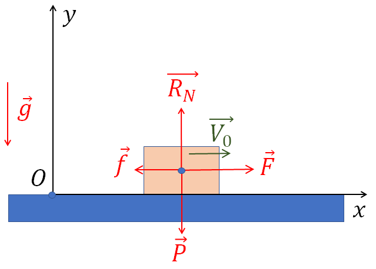{width="3.4756944444444446in"
height="2.490972222222222in"}[Bilan des forces]{.underline} : le poids
$\overrightarrow{P} = m\overrightarrow{g}\$; la réaction du sol que l'on
peut décomposer en deux forces : $\overrightarrow{R_{N}}$ la réaction
normale au sol et $\overrightarrow{f}$ la force de frottement solide
dirigée selon la direction du sol (=suivant le sol=parallèle au sol) et
opposée au mouvement ; la force motrice $\overrightarrow{F}$ dirigée
dans le sens du mouvement parallèlement au sol.

On prend le repère cartésien afin de résoudre le problème (voir dessin).

Le PFD nous donne :

$$\overrightarrow{R_{N}} + \overrightarrow{f} + \overrightarrow{P} + \overrightarrow{F} = m\overrightarrow{a}{(M)}_{/R}$$

En coordonnées suivant les axes du repère associé au référentiel
d'étude$\$:
$\overrightarrow{P} = - mg\overrightarrow{u_{y}}\$;$\ \overrightarrow{R_{N}} = R_{N}{\overrightarrow{u}}_{y}\$;
$\overrightarrow{f} = - f{\overrightarrow{u}}_{x}\$;
$\overrightarrow{F} = F{\overrightarrow{u}}_{x}$.

Alors :
$R_{N}{\overrightarrow{u}}_{y} - f{\overrightarrow{u}}_{x} - mg\overrightarrow{u_{y}} + F{\overrightarrow{u}}_{x} = ma_{x}\overrightarrow{u_{x}} + ma_{y}\overrightarrow{u_{y}}$

Soit les 2 équations : $\left\{ \begin{array}{r}
a_{x} = - \frac{f}{m} + \frac{F}{m} \\
a_{y} = \frac{R_{N}}{m} - g
\end{array} \right\}$

Or le mouvement est rectiligne suivant $(Ox)$ : $a_{y} = 0$.

Donc : $\left\{ \begin{array}{r}
a_{x} = - \frac{f}{m} + \frac{F}{m} \\
0 = \frac{R_{N}}{m} - g
\end{array} \right\}$

##### Avec frottements et avec force motrice

C'est le cas général.

$$\left\{ \begin{array}{r}
a_{x} = - \frac{f}{m} + \frac{F}{m} \\
0 = \frac{R_{N}}{m} - g
\end{array} \right\} \Leftrightarrow \ \left\{ \begin{array}{r}
a_{x} = - \frac{f + F}{m} \\
\mu mg = f
\end{array} \right\} \Leftrightarrow \ a_{x} = - \mu g + \frac{F}{m}$$

En intégrant entre les instants 0 et $t$ on a :
$v(t) = \left( - \mu g + \frac{F}{m} \right)t + V_{0}$

En intégrant de nouveau on a :
$x(t) = \frac{1}{2}\left( - \mu g + \frac{F}{m} \right)t^{2} + V_{0}t + x(t = 0)$

Le mouvement peut être rectiligne uniformément retardé ou accéléré en
fonction du signe de $- \mu g + \frac{F}{m}$.

##### 

##### Avec frottements et sans force motrice

On a donc$\ F = 0$.

Alors $\left\{ \begin{array}{r}
a_{x} = - \frac{f}{m} \\
0 = \frac{R_{N}}{m} - g
\end{array} \right\} \Leftrightarrow \ \left\{ \begin{array}{r}
a_{x} = - \frac{f}{m} \\
mg = R_{N}
\end{array} \right\}$ et comme ${f = \mu R}_{N}$ avec $\mu$ le
coefficient de frottements solides, on a donc :

$$\left\{ \begin{array}{r}
a_{x} = - \frac{f}{m} \\
\mu mg = f
\end{array} \right\} \Leftrightarrow \ a_{x} = - \mu g$$

En intégrant entre les instants 0 et $t$ on a facilement :
$v(t) = - \mu gt + v(t = 0) = - \mu gt + V_{0}$

En intégrant de nouveau on a :
$x(t) = - \frac{\mu g}{2}t^{2} + V_{0}t + x(t = 0)$

On a donc un mouvement rectiligne uniformément retardé.

##### Sans frottements et avec force motrice

On a donc $f = 0\ et\ a_{x} = + \frac{F}{m}$

En intégrant entre les instants 0 et $t$ on a :
$v(t) = \frac{F}{m}t + V_{0}$

En intégrant de nouveau on a :
$x(t) = \frac{F}{m}t^{2} + V_{0}t + x(t = 0)$.

C'est un mouvement rectiligne uniformément accéléré.

##### Sans frottements et sans force motrice

On a donc $f = 0\ et\ F = 0$.

Alors $\left\{ \begin{array}{r}
0 = 0 \\
0 = \frac{R_{N}}{m} - g
\end{array} \right\}$ donc
$\sum_{}^{}\overrightarrow{F} = \overrightarrow{0}$, alors d'après le
principe d'inertie, s'il y a mouvement à $t = 0\ s$ à la vitesse
$\overrightarrow{V_{0}}$ on a directement : $v(t) = cte = V_{0}$

En intégrant on a donc : $x(t) = V_{0}t + x(t = 0)$.

C'est un mouvement rectiligne uniforme

52. []{#_Toc10551340 .anchor}Mouvement rectiligne (sur le sol incliné)

C'est le même mouvement que précédemment mais cette fois-ci, le sol fait
un angle avec l'horizontale. On peut distinguer deux cas : avec ou sans
frottements solides.

##### SANS FROTTEMENTS

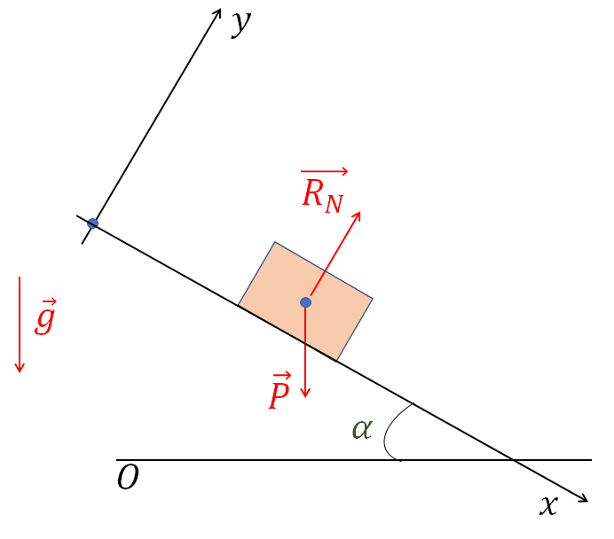{width="2.3618055555555557in"
height="2.075in"}[Situation]{.underline} : On considère un corps de
masse $m$ assimilé à un point matériel M glissant sur une pente. On ne
considère pas les frottements solides. Le référentiel d'étude est le
référentiel terrestre supposé Galiléen.

[Bilan des forces]{.underline} : le poids
$\overrightarrow{P} = m\overrightarrow{g}\$; $\overrightarrow{R_{N}}$ la
réaction normale au sol.

On prend le repère cartésien afin de résoudre le problème (voir dessin).

Le PFD nous donne :

$$\overrightarrow{R_{N}} + \overrightarrow{P} = m\overrightarrow{a}{(M)}_{/R}$$

Dans la base $(O;{\overrightarrow{u}}_{x},{\overrightarrow{u}}_{y})\$:
$\overrightarrow{P} = + mgsin\ \alpha\ \overrightarrow{u_{x}}\  - mgcos\ \alpha\ \overrightarrow{u_{y}}\$;$\ \overrightarrow{R_{N}} = R_{N}{\overrightarrow{u}}_{y}\$;.

Alors :$\ \left\{ \begin{array}{r}
a_{x} = gsin\ \alpha \\
a_{y} = \frac{R_{N}}{m} - gcos\ \alpha
\end{array} \right\}$

Or le mouvement est rectiligne suivant Ox : $a_{y} = 0$.

Donc, $\left\{ \begin{array}{r}
a_{x} = gsin\ \alpha \\
0 = \frac{R_{N}}{m} - gcos\ \alpha
\end{array} \right\} \Leftrightarrow \ \ \left\{ \begin{array}{r}
a_{x} = gsin\ \alpha \\
R_{N} = mgcos\ \alpha
\end{array} \right\}$ ; l'accélération vaut donc :
$a_{x} = gsin\ \alpha$.

En intégrant entre les instants 0 et $t$ on a :
$v(t) = (gsin\ \alpha)t + v(t = 0)$

En intégrant de nouveau on a :
$x(t) = \frac{1}{2}(gsin\ \alpha)t^{2} + v(t = 0)t + x(t = 0)$.

C'est un mouvement rectiligne uniformément accéléré (l'accélération est
effectivement constante).

##### 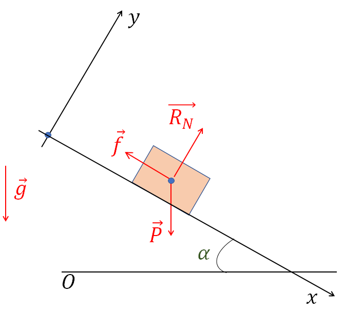{width="2.3618055555555557in" height="2.1430555555555557in"}avec FROTTEMENTS

[Situation]{.underline} : On considère un corps de masse $m$ assimilé à
un point matériel M glissant sur une pente. On considère les frottements
solides. Le référentiel d'étude est le référentiel terrestre supposé
Galiléen.

[Bilan des forces]{.underline} : le poids
$\overrightarrow{P} = m\overrightarrow{g}\$; $\overrightarrow{R_{N}}$ la
réaction normale au sol.

On prend le repère cartésien afin de résoudre le problème (voir dessin).

Le PFD nous donne :
$\overrightarrow{R_{N}} + \overrightarrow{P} + \overrightarrow{f} = m\overrightarrow{a}{(M)}_{/R}$

Dans la base $(O;{\overrightarrow{u}}_{x},{\overrightarrow{u}}_{y})\$:
$\overrightarrow{P} = + mgsin\ \alpha\ \overrightarrow{u_{x}} - mgcos\ \alpha\ \overrightarrow{u_{y}}\$;$\ \overrightarrow{R_{N}} = R_{N}{\overrightarrow{u}}_{y}\$;$\ \overrightarrow{f} = - f{\overrightarrow{u}}_{x}\$

Alors :$\ \left\{ \begin{array}{r}
a_{x} = gsin\ \alpha - f \\
a_{y} = \frac{R_{N}}{m} - gcos\ \alpha
\end{array} \right\} \Leftrightarrow \left\{ \begin{array}{r}
a_{x} = gsin\ \alpha - \frac{f}{m} \\
\mu gmcos\ \alpha = f
\end{array} \right\}$

Car le mouvement est rectiligne suivant $Ox$ : $a_{y} = 0$ et on a
${f = \mu R}_{N}$ où $\mu$ est le coefficient de frottement.

Donc l'accélération vaut :
$a_{x} = gsin\ \alpha - \mu gcos\ \alpha = g\left( \sin\alpha - \mu\cos\alpha \right)$.

En intégrant entre les instants 0 et $t$ on a :
$v(t) = g\left( \sin\alpha - \mu\cos\alpha \right)t + V_{0}$

En intégrant de nouveau on a :
$x(t) = \frac{g}{2}\left( \sin\alpha - \mu\cos\alpha \right)t^{2} + V_{0}t + x(t = 0)$.

C'est un mouvement rectiligne uniformément accéléré ou retardé suivant
le signe de $\sin\alpha - \mu\cos\alpha$.

53. {width="2.3618055555555557in"
    height="1.8777777777777778in"}La chute libre

C'est un problème qui a occupé les scientifiques pendant longtemps,
jusqu'à Newton dans les faits. C'est un problème « standard » à résoudre
en dynamique du point matériel. Il s'agit du mouvement d'un corps
partant d'une altitude donnée et lâché sans vitesse initiale.

On peut distinguer deux cas : *sans et avec frottement de l'air*.

##### SANS FROTTEMENTS DE L'AIR

[Situation]{.underline} : On considère un corps de masse $m$ assimilé à
un point matériel M, situé à une hauteur $h_{0}$ du sol à $t = 0$. La
masse est lâchée **sans vitesse initiale**. On ne considère pas les
frottements de l'air. Le référentiel d'étude est le référentiel
terrestre supposé Galiléen.

*Que se passe-t-il lorsque la masse est lâchée ?*

La masse $m$ va chuter jusqu'au sol. Comme Il n'y a pas de frottements,
la masse est soumise uniquement à son poids.

[Bilan des forces]{.underline} : le poids
$\overrightarrow{P} = m\overrightarrow{g}$.

On prend le repère cartésien afin de résoudre le problème (voir dessin).

Le PFD nous donne :

$$\overrightarrow{P} = m\overrightarrow{a}{(M)}_{/R}$$

Ici il est facile d'établir que l'accélération n'a de composante que
selon la verticale. En effet d'après
$\overrightarrow{P} = m\overrightarrow{a}{(M)}_{/R}$ le vecteur
accélération est colinéaire au vecteur poids. Comme ce dernier est
toujours selon la verticale, $\overrightarrow{a}{(M)}_{/R}$ est lui
aussi uniquement suivant la verticale.

Ce qui donne :
$- mg\overrightarrow{u_{z}} = ma_{z}\overrightarrow{u_{z}}\  \Leftrightarrow - g\overrightarrow{u_{z}} = a_{z}\overrightarrow{u_{z}}\  \Leftrightarrow \ a_{z} = - g$

En intégrant entre les instants 0 et $t$, on a facilement :
$v(t) = - gt + v(t = 0)$.

Or ici $v(t = 0) = 0$, donc $v(t) = - gt$.

En intégrant de nouveau entre les instants 0 et $t\$:
$z(t) = - \frac{1}{2}gt^{2} + z(t = 0)$

Or $z(t = 0) = h_{0}$, donc $z(t) = - \frac{1}{2}gt^{2} + h_{0}$

Le point M est donc animé d'un mouvement rectiligne uniformément
accéléré.

On peut calculer facilement le temps de chute (c'est-à-dire le temps mis
par la masse pour passer d'une hauteur $h_{0}$ à 0) :

$$0 = - \frac{1}{2}g{t_{c}}^{2} + h_{0}\  \Leftrightarrow \ {t_{c}}^{2} = 2\frac{h_{0}}{g} \Leftrightarrow \ t_{c} = \sqrt{2\frac{h_{0}}{g}}$$

A cet instant :
$v\left( \ t_{c} \right) = g\ t_{c} = g\sqrt{2\frac{h_{0}}{g}} = \sqrt{2gh_{0}}$

##### avec FROTTEMENTS DE L'AIR

[Enoncé]{.underline} : On considère un corps de masse $m$ assimilé à un
point matériel M, situé à une hauteur $h_{0}$ du sol à $t = 0$. La masse
est lâchée sans vitesse initiale. On considère les frottements de l'air
tel que $\overrightarrow{f} = - \alpha\overrightarrow{v}$. Le
référentiel d'étude est le référentiel terrestre supposé Galiléen.

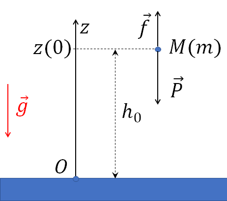{width="2.3618055555555557in"
height="2.0909722222222222in"}*Que se passe-t-il lorsque la masse est
lâchée ?*

La masse $m$ va chuter jusqu'au sol.

[Bilan des forces]{.underline} : le poids
$\overrightarrow{P} = m\overrightarrow{g}$ et la force de frottement
$\overrightarrow{f} = - \alpha\overrightarrow{v}$

Le PFD nous donne :

$\overrightarrow{P} + \overrightarrow{f} = m\overrightarrow{a}{(M)}_{/R} \Leftrightarrow \ \  - mg\overrightarrow{u_{z}} - \alpha v_{z}\overrightarrow{u_{z}} = ma_{z}\overrightarrow{u_{z}}$.

On a donc : $- mg - \alpha v_{z} = ma_{z}$.

Or $a_{z} = \frac{dv_{z}}{dt}_{/R}\$

Donc on a: $- m\frac{dv_{z}}{dt}_{/R} - \alpha v_{z} = mg$ soit :

$$+ \frac{dv_{z}}{dt}_{/R} + \frac{\alpha}{m}v_{z} = - g$$

*Remarque : C'est une équation différentielle du premier ordre. En effet
elle est de la forme :*

$\dot{X} + \frac{1}{\tau}X = A\ \$ *ou autrement écrit*
$\frac{dX}{dt} + \frac{1}{\tau}X = A\$*avec A et* $\tau\$*des constantes
données .*

###### Comment résoudre une équation différentielle du premier ordre

La solution de cette équation est de la forme :

$$X(t) = A\tau + Ke^{- \frac{t}{\tau}}$$

Avec $A\tau$ la solution particulière et $Ke^{- \frac{t}{\tau}}$ la
solution générale.

-La solution particulière est trouvée en considérant dans l'équation
différentielle $\frac{dX}{dt} = 0$.

\- La constante K est à déterminer en utilisant une condition initiale
(condition à t=0). En pratique : on connait $x(0) = C$ avec $C$
constant. Or $x(0) = A\tau + Ke^{0} = A\tau + K$. Donc on peut écrire
que :

$A\tau + K = C \Leftrightarrow K = C - A\tau$. Au final :
$x(t) = A\tau + (C - A\tau)e^{- \frac{t}{\tau}}$

Reprenons notre problème et appliquons cela à notre problème :

La solution particulière de
$\  + \frac{dv}{dt}_{/R} + \frac{\alpha}{m}v = - g$ est :
$v_{p} = - mg/\alpha$.

La solution générale de
$\  + \frac{dv}{dt}_{/R} + \frac{\alpha}{m}v = - g$ est 
$v_{G} = Ke^{- \frac{\alpha t}{m}}$.

D'après les conditions initiales, on sait que $v(0) = 0$. Alors on a
$v(0) = 0 = - \frac{mg}{\alpha} + K$.

Ce qui donne la vitesse finale :

$$v(t) = - \frac{mg}{\alpha} + {\frac{mg}{\alpha}e}^{- \frac{\alpha t}{m}}$$

Attention rappelons que cette vitesse est négative car le corps qui
chute se dirige de haut en bas (à l'opposé de Oz défini).

La norme de la vitesse est la valeur absolue de
$\ v(t) = - \frac{mg}{\alpha} + {\frac{mg}{\alpha}e}^{- \frac{\alpha t}{m}}$
soit :

$$\left| v(t) \right| = {\frac{mg}{\alpha}(1 - e}^{- \frac{\alpha t}{m}})$$

**La valeur** $\frac{\mathbf{mg}}{\mathbf{\alpha}}$ **correspond à la
vitesse limite atteinte par le corps (c'est la valeur limite de**
$\left| \mathbf{v}\left( \mathbf{t} \right) \right|$ **lorsque**
$\mathbf{t}$ **tend vers l'infini. C'est aussi la valeur absolue de la
solution particulière.**

Pour obtenir la position du corps au cours du temps, il faut intégrer
$\ v(t) = - \frac{mg}{\alpha} + {\frac{mg}{\alpha}e}^{- \frac{\alpha t}{m}}$.

On obtient :

$$z(t) = \  - \frac{mg}{\alpha}t - \left( \frac{m}{\alpha} \right)^{2}g\left\lbrack e^{- \frac{\alpha t}{m}} - 1 \right\rbrack + h_{0}$$

54. []{#_Toc10551342 .anchor}La balistique

La balistique consiste à envoyer un objet en lui donnant une vitesse
initiale et avec un angle donné par rapport à l'horizontale. La
balistique concerne donc tous les problèmes de lancer, jet de
projectile, de divers sports etc... C'est donc un problème « commun » à
résoudre en dynamique du point matériel. De nouveau nous allons
distinguer deux cas : *sans et avec frottement de l'air*.

##### SANS FROTTEMENTS DE L'AIR

[Situation]{.underline} : On considère un corps de masse $m$ assimilé à
un point matériel M. A $t = 0$, on lance un objet de masse m avec une
vitesse $V_{0}$ faisant un angle $\theta$ avec l'axe Ox. On ne considère
pas les frottements de l'air.

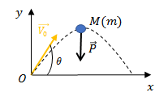{width="2.156550743657043in"
height="1.354355861767279in"}Le référentiel d'étude est le référentiel
terrestre supposé Galiléen.

[Bilan des forces]{.underline} : le poids
$\overrightarrow{P} = m\overrightarrow{g}$.

On prend le repère cartésien afin de résoudre le problème (voir dessin).

Le PFD nous donne : $\overrightarrow{P} = m\overrightarrow{a}{(M)}_{/R}$

Dans la base $(O;{\overrightarrow{u}}_{x},{\overrightarrow{u}}_{y})\$:
$\overrightarrow{P} = - mg\overrightarrow{u_{y}}$.

Alors on a :
$- mg\overrightarrow{u_{y}} = ma_{x}\overrightarrow{u_{x}} + ma_{y}\overrightarrow{u_{y}}$

Soit les 2 équations : $\left\{ \begin{array}{r}
a_{x} = 0 \\
a_{y} = - g
\end{array} \right\}$

Alors on a en intégrant : $\left\{ \begin{array}{r}
dv_{x} = 0 \\
{dv}_{y} = - gdt
\end{array} \right\} \Leftrightarrow \ \left\{ \begin{array}{r}
v_{x} = v_{x}(t = 0) \\
v_{y} = - gt + v_{y}(t = 0)
\end{array} \right\}$,

Or on a : $\left\{ \begin{array}{r}
v_{x}(t = 0) = V_{0}\cos\theta \\
v_{y}(t = 0) = V_{0}\sin\theta
\end{array} \right\}$,

Ce qui amène : $\left\{ \begin{array}{r}
v_{x} = V_{0}\cos\theta \\
v_{y} = - gt + V_{0}\sin\theta
\end{array} \right\}$

En intégrant encore une fois :

$$\left\{ \begin{array}{r}
x(t) = V_{0}\cos{\theta \times}t + x(t = 0) \\
y(t) = - \frac{1}{2}gt^{2} + V_{0}\sin{\theta \times}t + y(t = 0)
\end{array} \right\}$$

Généralement $x(t = 0)$=0 mais $y(t = 0)$ n'est pas forcément nul (comme
par exemple un lancer au basket...).

Dans notre exemple (voir dessin) les deux sont nuls à t=0, donc :

$$\left\{ \begin{array}{r}
x(t) = V_{0}\cos{\theta \times}t \\
y(t) = - \frac{1}{2}gt^{2} + V_{0}\sin{\theta \times}t
\end{array} \right\}$$

Dans les faits, on cherchera à déterminer [le temps de vol]{.underline},
le point de chute (son abscisse x(t)), ou la vitesse initiale en
connaissant au moins l'un de ces paramètres.

Comment retrouver l'équation de trajectoire $y(x)$ à partir des
équations horaires ?

On remarque que $V_{0} = \frac{x(t)}{\cos\theta \times t}$ et
$t^{2} = \frac{{x(t)}^{2}}{{V_{0}}^{2}\cos^{2}\theta}$. En remplaçant
dans l'expression de $y(t)$, on a :

$$y(t) = - \frac{1}{2}g\frac{{x(t)}^{2}}{{V_{0}}^{2}\cos^{2}\theta} + \frac{x(t)}{\cos\theta \times t}\sin{\theta \times}t\ $$

$$\Leftrightarrow \ \ y(x) = - \frac{1}{2}g\frac{x^{2}}{{V_{0}}^{2}\cos^{2}\theta} + x\tan\theta$$

[C'est l'équation de trajectoire.]{.underline}

##### aVEC FROTTEMENTS DE L'AIR

[Situation]{.underline} : On considère un corps de masse $m$ assimilé à
un point matériel M. A $t = 0$, on lance un objet de masse m avec une
vitesse $V_{0}$ faisant un angle $\theta$ avec l'axe Ox. On considère
les frottements de l'air tel que
$\overrightarrow{f} = - \alpha\overrightarrow{v}$.

Le référentiel d'étude est le référentiel terrestre supposé Galiléen.

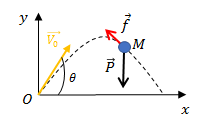{width="2.1666666666666665in"
height="1.2604166666666667in"}[Bilan des forces]{.underline} : le poids
$\overrightarrow{P} = m\overrightarrow{g}$ et la force de frottement
$\ \ \ \ \ \ \overrightarrow{f} = - \alpha\overrightarrow{v}$

On prend le repère cartésien afin de résoudre le problème (voir dessin).

Le PFD nous donne : $\overrightarrow{P} = m\overrightarrow{a}{(M)}_{/R}$

Dans la base $(O;{\overrightarrow{u}}_{x},{\overrightarrow{u}}_{y})\$:
$\overrightarrow{P} = - mg\overrightarrow{u_{y}}$ et
$\overrightarrow{f} = - \alpha(v_{x}\overrightarrow{u_{x}} + v_{y}\overrightarrow{u_{y}})$

Alors on a :
$- mg\overrightarrow{u_{y}} - \alpha v_{x}\overrightarrow{u_{x}} - \alpha v_{y}\overrightarrow{u_{y}} = ma_{x}\overrightarrow{u_{x}} + ma_{y}\overrightarrow{u_{y}}$

Soit les 2 équations : $\left\{ \begin{array}{r}
a_{x} = - \frac{\alpha}{m}v_{x} \\
a_{y} = - g - \frac{\alpha}{m}v_{y}
\end{array} \right\}$

On obtient 2 équations différentielles du premier ordre en vitesse. Leur
résolution comme montré pour la chute libre conduit à :

$$\left\{ \begin{array}{r}
v_{x}(t) = Ke^{- \frac{\alpha t}{m}} \\
v_{y}(t) = - \frac{mg}{\alpha} + {K_{1}e}^{- \frac{\alpha t}{m}}
\end{array} \right\}$$

Or on a : $\left\{ \begin{array}{r}
v_{x}(t = 0) = V_{0}\cos\theta = K \\
v_{y}(t = 0) = V_{0}\sin\theta = - \frac{mg}{\alpha} + K_{1}
\end{array} \right\} \Leftrightarrow \ \left\{ \begin{array}{r}
K = V_{0}\cos\theta \\
K_{1} = V_{0}\sin\theta + \frac{mg}{\alpha}
\end{array} \right\}$

On a donc :$\ \left\{ \begin{array}{r}
v_{x}(t) = V_{0}\cos\theta e^{- \frac{\alpha t}{m}} \\
v_{y}(t) = - \frac{mg}{\alpha} + {(V_{0}\sin\theta + \frac{mg}{\alpha})e}^{- \frac{\alpha t}{m}}
\end{array} \right\}\$

En intégrant encore une fois :

$$\left\{ \begin{array}{r}
x(t) = - \frac{m}{\alpha}V_{0}\cos\theta\left( e^{- \frac{\alpha t}{m}} - 1 \right) \\
y(t) = - \frac{mg}{\alpha}t - \frac{m}{\alpha}\left( V_{0}\sin\theta + \frac{mg}{\alpha} \right)\left( e^{- \frac{\alpha t}{m}} - 1 \right)
\end{array} \right\}$$

Avec $x(t = 0)$=0 et $y(t = 0) = 0$ dans notre exemple.

55. []{#_Toc10551343 .anchor}Bilan

-Dans ce chapitre nous avons vu comment résoudre des problèmes de
mouvements rectilignes, de chute libre et de balistique à l'aide de la
seconde loi de Newton. Nous avons regardé la méthodologie à appliquer à
travers des exemples et des exercices pour chaque cas : La méthodologie
est bien sûr à apprendre et maitriser.

-Quitte à se répéter, il y a peu de choses nouvelles dans la dynamique :
les projections, bilan des forces et cinématique ont été vus dans les
chapitres précédents du cours. Ils interviennent juste tous ensembles en
dynamique. Bien entendu, il faut alors bien maîtriser tous les outils
précédemment abordés depuis le début du cours.

-La seule nouveauté est l'équation différentielle de 1^er^ degré. Il
faut bien apprendre comment la résoudre afin de déterminer les équations
horaires du mouvement dans les cas où elle intervient.

# Chapitre 5 : De la dynamique du point matériel en référentiel galiléen {#chapitre-5-de-la-dynamique-du-point-matériel-en-référentiel-galiléen .ch}

# *Mouvements oscillants (pendules et ressorts), et théorème du moment cinétique* {#mouvements-oscillants-pendules-et-ressorts-et-théorème-du-moment-cinétique .ch}

1.  Introduction

Ce chapitre est la suite de la dynamique. Il est consacré aux systèmes
oscillants (pendules et système masse-ressorts), ainsi qu'aux mouvements
circulaires.

Les méthodes de résolution sont les mêmes que celles vues au chapitre
précédent. Néanmoins il y a deux nouveautés : la résolution des
équations différentielles du second ordre et la résolution d'un problème
de dynamique de mouvement circulaire à l'aide des moments.

Ce chapitre est organisé comme le précédent : on voit en exemple
plusieurs situations pour chacun des systèmes (qu'il faudra travailler
car ce sont des applications déjà) puis des exercices spécifiques sont
aussi vus.

56. []{#_Toc10551347 .anchor}Mouvements oscillants

[Situation]{.underline} : On considère un corps de masse $m$ assimilé à
un point matériel M. Le point M est en mouvement oscillatoire. On
associe le repère cartésien au référentiel. On va avoir deux types de
mouvement oscillatoire : les systèmes oscillants rectilignes et les
systèmes oscillants circulaires.

57. []{#_Toc76046125 .anchor}Le ressort linéaire

Le *système oscillant linéaire* par excellence est le système avec un
ressort. La masse M est accrochée à un ressort de raideur $k$, de masse
négligeable, de longueur au repos (longueur à vide) l~0~.

A l'instant $t = 0$, la masse est écartée de la position d'équilibre et
lâchée avec ou sans vitesse initiale.

On peut considérer ou pas des frottements. Il y a deux situations
différentes : le mouvement est vertical ou horizontal.

###### 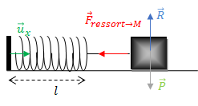{width="2.5729166666666665in" height="1.3854166666666667in"}Mouvement oscillant horizontal

$$O$$

Soit une masse accrochée à un ressort de constante de raideur k, de
masse négligeable, de longueur au repos (longueur à vide) l~0~. On
suppose le ressort linéaire.

###### sans frottements 

[Bilan des forces]{.underline} : le poids
$\overrightarrow{P} = m\overrightarrow{g}$, $\overrightarrow{R}$ la
réaction du support et la force de rappel du ressort
${\overrightarrow{F}}_{ressort \rightarrow M}$.

On prend le repère cartésien afin de résoudre le problème.

Le PFD nous donne :

$${\overrightarrow{F}}_{ressort \rightarrow M} + \overrightarrow{R} + \overrightarrow{P} = m\overrightarrow{a}{(M)}_{/R}$$

Dans la base $(O;{\overrightarrow{u}}_{x},{\overrightarrow{u}}_{y})\$:
$\overrightarrow{P} = - mg{\overrightarrow{u}}_{y}$ ;
$\overrightarrow{R} = + R{\overrightarrow{u}}_{y}$ ;
${\overrightarrow{F}}_{ressort \rightarrow M} = - k(l - l_{0}){\overrightarrow{u}}_{x}$

Soit : $\left\{ \begin{array}{r}
 - k(l - l_{0}) = ma \\
 - mg + R = 0
\end{array} \right\}\$⇔ $\left\{ \begin{array}{r}
 - \frac{k}{m}(l - l_{0}) = a \\
R = mg
\end{array} \right\}$ car l'accélération n'a de composante que suivant
$Ox$ car le mouvement est linéaire suivant cet axe.

On a alors de manière évidente : $- \frac{k}{m}(l - l_{0}) = \ddot{x}$.

Si on ne connait pas $l_{0}$, on peut exprimer l'accélération au-dessus
en fonction de $l_{e}$, la longueur à l'équilibre. En effet, par
définition (voir Chapitre sur la statique du point matériel) :
$- \frac{k}{m}(l_{e} - l_{0}) = 0$.

Ainsi : $- \frac{k}{m}(l - l_{0}) = \ddot{x}$
⇔$- \frac{k}{m}(l - l_{0} + l_{e} - l_{e}) = \ddot{x}$
⇔$\  - \frac{k}{m}(l - l_{e})$+$\ \frac{k}{m}\left( l_{e} - l_{0} \right) = \ddot{x}$

⇔ $\  - \frac{k}{m}(l - l_{e}) = \ddot{x}$

En faisant le changement de variable suivant :

$X(t) = \ l - l_{e} = x - x_{e}$, on a $\dot{X}(t) = \dot{x}$ et
$\ddot{X}(t) = \ddot{x}$

Alors on a $\  - \frac{k}{m}X(t) = \ddot{X}(t)$. C'est une équation
différentielle du second ordre.

En effet, elle est de la forme : $\ddot{X} + {\omega_{0}}^{2}X = 0$.

###### Comment résoudre une équation différentielle du Second ordre

La solution de cette équation est de la forme :

$X(t) = A\cos{\ (}\omega_{0}t) + B\ sin(\omega_{0}t)$.

Les paramètres $A$ et $B$ sont à déterminer avec les conditions
initiales. Puisqu'il y a deux paramètres, il faut utiliser deux
conditions initiales : la première sur la position$\ X(0)$, la seconde
sur la vitesse$\ \dot{X}(O)$. Il y a 4 cas différents.

[Cas]{.underline} $X(0) = X_{0}$ [et]{.underline} $\ \dot{X}(O) = 0$

$X(0) = X_{0} = A$ et $\dot{X}(O) = B\omega_{0} = 0$

On a donc au final : $X(t) = X_{0}\cos{\ (}\omega_{0}t)$

[Cas]{.underline} $X(0) = 0$ [et]{.underline} $\ \dot{X}(O) = V_{0}$

$X(0) = 0 = A$ et $\dot{X}(O) = B\omega_{0} = V_{0}$

On a donc au final : $X(t) = \frac{V_{0}}{\omega}\sin{\ (}\omega_{0}t)$

[Cas]{.underline} $X(0) = 0$ [et]{.underline} $\ \dot{X}(O) = 0$

$X(0) = 0 = A$ et $\dot{X}(O) = B\omega_{0} = 0$

On a donc au final : $X(t) = 0$

[Cas]{.underline} $X(0) = X_{0}$ [et]{.underline} $\ \dot{X}(O) = V_{0}$

$X(0) = X_{0} = A$ et $\dot{X}(O) = B\omega_{0} = V_{0}$

On a donc au final :
$X(t) = X_{0}\cos{\ (}\omega_{0}t) + \frac{V_{0}}{\omega}\sin{\ (}\omega_{0}t)$

Reprenons le cas de notre ressort, nous avons alors de manière
générale :

$$X(t) = A\cos{\ (}\sqrt{\frac{k}{m}}t) + B\ sin(\sqrt{\frac{k}{m}}t)$$

Soit\
$$x(t) = A\cos{\ (}\sqrt{\frac{k}{m}}t) + B\sin\left( \sqrt{\frac{k}{m}}t \right) + x_{e}$$

###### avec frottements solide :

Le seul changement est qu'il y a une force de frottement solide en plus
selon l'axe des $x$ tel que :
${\overrightarrow{f}}_{s} = f_{s}{\overrightarrow{u}}_{x}$ (cette force
est opposée au mouvement, elle est donc toujours de sens inverse à
${\overrightarrow{F}}_{ressort \rightarrow M}$)

En appliquant le PFD on obtient facilement : :

$\left\{ \begin{array}{r}
 + f_{s} - k(l - l_{0}) = ma \\
 - mg + R = 0
\end{array} \right\}\$⇔ $\left\{ \begin{array}{r}
\mu g - \frac{k}{m}(l - l_{0}) = a \\
R = mg
\end{array} \right\}$ car $f_{s} = \mu R$ avec $\mu$ le coefficient de
frottement solide

Au final, on obtient facilement l'équation différentielle suivante (en
utilisant la condition d'équilibre) :

$$\ddot{X}(t) + \frac{k}{m}X(t) = 0$$

C'est la même équation différentielle que sans frottements. Cela vient
du fait que la position d'équilibre inclus les frottements (c'est cette
position qui est différente pas le mouvement d'oscillations autour).

##### Mouvement oscillant vertical

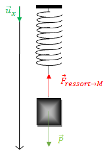{width="1.9273523622047244in"
height="2.802474846894138in"}

Soit une masse accrochée à un ressort de constante de raideur $k$, de
masse négligeable, de longueur au repos (longueur à vide) l~0~. On
suppose le ressort linéaire.

###### sans frottements 

[Bilan des forces]{.underline} : le poids
$\overrightarrow{P} = m\overrightarrow{g}$, et la force de rappel du
ressort ${\overrightarrow{F}}_{ressort \rightarrow M}$.

On prend le repère cartésien afin de résoudre le problème.

Le PFD nous donne :

$${\overrightarrow{F}}_{ressort \rightarrow M} + \overrightarrow{P} = m\overrightarrow{a}{(M)}_{/R}$$

Dans la base $(O;{\overrightarrow{u}}_{x},{\overrightarrow{u}}_{y})\$ et
d'après le schéma :

$\overrightarrow{P} = + mg{\overrightarrow{u}}_{x}$  et
${\overrightarrow{F}}_{ressort \rightarrow M} = - k(l - l_{0}){\overrightarrow{u}}_{x}$

Soit : $mg - k(l - l_{0}) = ma$ ⇔ $mg - k(l - l_{0}) = m\ddot{x}$ car
l'accélération n'a de composante que suivant Ox car le mouvement est
linéaire suivant cet axe.

Ce qui donne : $g - \frac{k}{m}(l - l_{0}) = \ddot{x}$ ⇔
$\ddot{x} + \frac{k}{m}\left( l - l_{0} \right) = g$

On doit exprimer l'accélération au-dessus en fonction de $l_{e}$, la
longueur à l'équilibre. Par définition (voir Chapitre sur la statique du
point matériel) : $g - \frac{k}{m}(l_{e} - l_{0}) = 0$.

Ainsi : $g - \frac{k}{m}(l - l_{0}) = \ddot{x}$ ⇔
$g - \frac{k}{m}(l - l_{0} + l_{e} - l_{e}) = \ddot{x}$
⇔$\ g - \frac{k}{m}(l - l_{e})$+$\ \frac{k}{m}\left( l_{e} - l_{0} \right) = \ddot{x}$

⇔ $\  - \frac{k}{m}(l - l_{e}) = \ddot{x}$

En faisant le changement de variable suivant :

$X(t) = \ l - l_{e} = x - x_{e}$, on a $\dot{X}(t) = \dot{x}$ et
$\ddot{X}(t) = \ddot{x}$

Alors on a $\  - \frac{k}{m}X(t) = \ddot{X}(t)$. C'est une équation
différentielle du second ordre comme nous l'avons vu pour le pendule :

$\ddot{X}(t) + \frac{k}{m}X(t) = 0$.

C'est exactement la même équation différentielle que dans le cas
horizontal ! Les solutions sont donc les mêmes : physiquement cela vient
du fait que la position d'équilibre inclus le poids dans le cas
vertical.

*avec frottements fluides :*

Attention dans le cas vertical les frottements ne sont pas solides (il
n'y a pas de support), ils sont dû dans le cas le plus fréquent aux
frottements de l'air.

[Bilan des forces]{.underline} : le poids
$\overrightarrow{P} = m\overrightarrow{g}$, et la force de rappel du
ressort ${\overrightarrow{F}}_{ressort \rightarrow M}$ et
$\overrightarrow{f} = - \alpha\overrightarrow{v}(M)$ la force de
frottements fluides

Le PFD nous donne :

$$\overrightarrow{f} + {\overrightarrow{F}}_{ressort \rightarrow M} + \overrightarrow{P} = m\overrightarrow{a}{(M)}_{/R}$$

Dans la base $(O;{\overrightarrow{u}}_{x},{\overrightarrow{u}}_{y})\$ :
$\overrightarrow{P} = + mg{\overrightarrow{u}}_{x}$  ;
${\overrightarrow{F}}_{ressort \rightarrow M} = - k(l - l_{0}){\overrightarrow{u}}_{x}$
et $\overrightarrow{f} = - \alpha\dot{x}{\overrightarrow{u}}_{x}$.

Soit : $- \ \alpha\dot{x}$+mg$- k(l - l_{0}) = ma$ ⇔
$- \ \alpha\dot{x}$+mg$- k(l - l_{0}) = m\ddot{x}$ car l'accélération
n'a de composante que suivant $Ox$ car le mouvement est linéaire suivant
cet axe.

Ce qui donne :
$- \ \frac{\alpha}{m}\dot{x} + g - \frac{k}{m}(l - l_{0}) = \ddot{x}$ ⇔
$\ddot{x} + \ \frac{\alpha}{m}\dot{x} + \frac{k}{m}\left( l - l_{0} \right) = g$

On doit exprimer l'accélération au-dessus en fonction de $l_{e}$, la
longueur à l'équilibre. Par définition (voir Chapitre sur la statique du
point matériel) : $g - \frac{k}{m}(l_{e} - l_{0}) = 0$.

On obtient alors facilement que :
$\ddot{x} + \ \frac{\alpha}{m}\dot{x} + \frac{k}{m}\left( l - l_{e} \right) = 0$

En faisant le changement de variable suivant :

$X(t) = \ l - l_{e} = x - x_{e}$, on a $\dot{X}(t) = \dot{x}$ et
$\ddot{X}(t) = \ddot{x}$

On a alors : $\ddot{X} + \ \frac{\alpha}{m}\dot{X} + \frac{k}{m}X = 0$

La résolution de cette équation différentielle sera vue au semestre 2.

58. Le pendule

Le *système oscillant circulaire* par excellence est le pendule. Le
pendule est un système où la masse M est accrochée à un fil sans masse,
toujours tendu, de longueur $OM = l$. A l'instant $t = 0$, le pendule
possède un angle $\theta_{0}$ avec la verticale, le pendule ayant ou pas
une vitesse initiale. On peut considérer ou pas les frottements fluides
(essentiellement dues à l'air).

######  sans frottements

[Bilan des forces]{.underline} : le poids
$\overrightarrow{P} = m\overrightarrow{g}$ et $\overrightarrow{T}$ la
tension du fil.

On prend le repère polaire afin de résoudre le problème.

Le PFD nous donne :

$$\overrightarrow{T} + \overrightarrow{P} = m\overrightarrow{a}{(M)}_{/R}$$

Dans la base
$(O;{\overrightarrow{u}}_{r},{\overrightarrow{u}}_{\theta})\$:
$\overrightarrow{P} = mgcos\ \theta\ {\overrightarrow{u}}_{r} - mgsin\ \theta{\overrightarrow{u}}_{\theta}$
et $\overrightarrow{T} = - T\ {\overrightarrow{u}}_{r}$

En effectuant une étude cinématique, on obtient que l'accélération
s'écrie :

$$\overrightarrow{a}(M/R) = - l\dot{\theta ²}\overrightarrow{u_{r}} + l\ddot{\theta}\overrightarrow{u_{\theta}}$$

On a alors :
$- T\ {\overrightarrow{u}}_{r} + mgcos\ \theta\ {\overrightarrow{u}}_{r} - mgsin\ \theta{\overrightarrow{u}}_{\theta} =$
$- ml\dot{\theta ²}\overrightarrow{u_{r}} + ml\ddot{\theta}\overrightarrow{u_{\theta}}$

Soit : $\left\{ \begin{array}{r}
 - T + mgcos\ \theta = - ml\dot{\theta ²} \\
 - mgsin\ \theta = ml\ddot{\theta}
\end{array} \right\}\$⇔ $\left\{ \begin{array}{r}
 - T + gcos\ \theta + l\dot{\theta ²} = 0 \\
l\ddot{\theta} + gsin\ \theta = 0
\end{array} \right\}$

La première des équations est une équation liant le carré de la vitesse
à l'angle et la tension du fil. La seconde équation est une équation
liant l'accélération angulaire à la position : c'est l'équation du
mouvement : $l\ddot{\theta} + msin\ \theta = 0$.

Cette équation ne peut pas être résolue analytiquement pour tous les
angles. Par contre pour les petits angles oui ! Si on a $\theta \ll 1$,
alors $sin\ \theta\sim\theta$, et l'équation du mouvement devient :

$l\ddot{\theta} + g\theta = 0\$; C'est une équation différentielle du
second degré.

Reprenons notre problème et appliquons cela à notre pendule :

L'équation du second ordre était $l\ddot{\theta} + g\theta = 0\$soit
$\ddot{\theta} + \frac{g}{l}\theta = 0\$ soit
$\ddot{\theta} + {\omega_{O}}^{2}\theta = 0\$avec
${\omega_{O}}^{2} = \frac{g}{l}$.

La solution générale est
donc θ$(t) = A\cos{\ (}\sqrt{\frac{g}{l}}t) + B\ sin(\sqrt{\frac{g}{l}}t)$

Et donc suivant le cas étudié (conditions initiales de l'énoncé) on a :

[Cas]{.underline} $\theta(0) = \theta_{0}$ [et]{.underline}
$\ \dot{\theta}(O) = 0$

$\theta(0) = \theta_{0} = A$ et $\dot{\theta}(O) = B\omega_{O} = 0$

On a donc au final : $\theta(t) = \theta_{0}\cos(\omega_{O}t)$

[Cas]{.underline} $\theta(0) = \vartheta_{0}$ [et]{.underline}
$\ \dot{\theta}(O) = V_{0}$

$\theta(0) = \theta_{0} = A$ et $\theta(O) = B\omega_{O} = V_{0}$

On a donc au final :
$\theta(t) = \theta_{0}\cos(\omega_{O}t) + \frac{V_{0}}{\omega_{O}}\sin(\omega_{O}t)$

###### avec frottements fluide 

[Bilan des forces]{.underline} : le poids
$\overrightarrow{P} = m\overrightarrow{g}$, $\overrightarrow{T}$ la
tension du fil et $\overrightarrow{f} = - \alpha\overrightarrow{v}(M)$
la force de frottements fluides

On prend le repère polaire afin de résoudre le problème.

Le PFD nous donne :

$$\overrightarrow{f} + \overrightarrow{T} + \overrightarrow{P} = m\overrightarrow{a}{(M)}_{/R}$$

Dans la base
$(O;{\overrightarrow{u}}_{r},{\overrightarrow{u}}_{\theta})\$:
$\overrightarrow{P} = mgcos\ \theta\ {\overrightarrow{u}}_{r} - mgsin\ \theta{\overrightarrow{u}}_{\theta}$
et $\overrightarrow{T} = - T\ {\overrightarrow{u}}_{r}$et
$\overrightarrow{f} = - \alpha(v_{r}\ {\overrightarrow{u}}_{r} + v_{\theta}{\overrightarrow{u}}_{\theta})$

En effectuant une étude cinématique, on obtient que la vitesse et
l'accélération s'écrie :

$$\overrightarrow{v}(M) = + l\dot{\theta}\overrightarrow{u_{\theta}}$$

$$\overrightarrow{a}(M) = - l\dot{\theta ²}\overrightarrow{u_{r}} + l\ddot{\theta}\overrightarrow{u_{\theta}}$$

On a alors :
$- \alpha l\dot{\theta}\overrightarrow{u_{\theta}} - T\ {\overrightarrow{u}}_{r} + mgcos\ \theta\ {\overrightarrow{u}}_{r} - mgsin\ \theta{\overrightarrow{u}}_{\theta} =$
$- ml\dot{\theta ²}\overrightarrow{u_{r}} + ml\ddot{\theta}\overrightarrow{u_{\theta}}$

L'équation du mouvement devient :
$- \alpha l\dot{\theta} - mgsin\ \theta = ml\ddot{\theta}$

Soit :
$\ddot{\theta} + \frac{\alpha}{m}\dot{\theta} + \frac{g}{l}sin\ \theta = 0$

De nouveau cette équation n'a pas de solution analytique pour tous les
angles. Par contre pour les petits angles oui ! Si on a $\theta \ll 1$,
alors $sin\ \theta\sim\theta$, et l'équation du mouvement devient :

$$\ddot{\theta} + \frac{\alpha}{m}\dot{\theta} + \frac{g}{l}\theta = 0$$

La résolution de cette équation différentielle sera vue au semestre 2
comme pour le ressort.

59. []{#_Toc10551348 .anchor}Théorème du moment cinétique

Le théorème du moment cinétique est très utile dans les problèmes
circulaires. Il sert à résoudre le problème comme on peut le faire avec
la seconde loi de Newton (PFD) : c'est une autre manière de faire. Il
découle directement du PFD (la démonstration est triviale).

Il n'est valable que pour les mouvements circulaires !

Commençons tout d'abord à définir ce qu'est le moment d'une grandeur
physique.

60. []{#_Toc76046127 .anchor}Préambule : notion de produit vectoriel

Le produit vectoriel de deux vecteurs $\overrightarrow{u}$ et
$\overrightarrow{v}$ est un vecteur noté
$\overrightarrow{c} = \overrightarrow{u} \land \overrightarrow{v}$. Le
vecteur résultant $\overrightarrow{c}$ est tel que :

- Sa direction est perpendiculaire aux vecteurs $\overrightarrow{u}$ et
  $\overrightarrow{v}$

- Sa norme est
  $\left\| \overrightarrow{u} \right\|.\left\| \overrightarrow{v} \right\|.\left| \sin\left( \overrightarrow{u},\overrightarrow{v} \right) \right|$

- Son sens est donné par la règle du trièdre direct

De plus, on a :

- $\overrightarrow{u} \land \overrightarrow{v} = - \overrightarrow{v} \land \overrightarrow{u}$

- $\overrightarrow{u} \land \overrightarrow{v} = \overrightarrow{0}\  \Leftrightarrow \ \overrightarrow{u}\ et\ \overrightarrow{v}$
  sont colinéaires

**Méthode 1 : Méthode du Gamma**

Soient deux vecteurs $\overrightarrow{u} = \begin{pmatrix}
a \\
b \\
c
\end{pmatrix}$ et $\overrightarrow{v} = \begin{pmatrix}
d \\
e \\
f
\end{pmatrix}$ exprimée dans une BOND quelconque
$\left( \overrightarrow{i},\overrightarrow{j},\overrightarrow{k} \right)$.

La méthode du « gamma » permet de faire le calcul du produit vectoriel
$\overrightarrow{u} \land \overrightarrow{v}$ simplement et rapidement.

Cette méthode est la suivante :

Pour connaitre le résultat du produit vectoriel selon
$\overrightarrow{i}$ on écrit les deux vecteurs en colonne et l'on barre
les composantes selon $\overrightarrow{i}$. Le résultat du produit
vectoriel est alors :

{width="1.3602985564304462in"
height="0.6470581802274715in"}

De même le résultat du produit vectoriel selon $\overrightarrow{j}$, on
écrit les deux vecteurs en colonne et l'on barre les composantes selon
$\overrightarrow{j}$. Le résultat du produit vectoriel est alors :

{width="1.3911406386701661in"
height="0.6456692913385826in"}

De même le résultat du produit vectoriel selon $\overrightarrow{k}$, on
écrit les deux vecteurs en colonne et l'on barre les composantes selon
$\overrightarrow{k}$. Le résultat du produit vectoriel est alors :

{width="1.3642924321959755in"
height="0.6456692913385826in"}

Ainsi, on obtient :

$$\overrightarrow{u} \land \overrightarrow{v} = \begin{pmatrix}
bf - ce \\
cd - af \\
ae - bd
\end{pmatrix}$$

**Méthode 2 : Méthode de calcul rapide pour une BOND**

Le produit vectoriel entre deux vecteurs unitaires d'une BOND donne plus
ou moins le troisième vecteur de la base. Pour retrouver facilement les
résultats, il suffit d'écrire sur son brouillon la base deux fois.

Par exemple, pour la base cartésienne, on écrit :
$\overrightarrow{e_{x}}\ \overrightarrow{e_{y}}\ \overrightarrow{e_{z}}\ \overrightarrow{e_{x}}\ \overrightarrow{e_{y}}\ \overrightarrow{e_{z}}$

Ensuite, il n'y a qu'à suivre le sens du produit vectoriel recherché.

Si je cherche $\overrightarrow{e_{x}} \land \overrightarrow{e_{y}}$, je
me déplace vers la droite (sens direct) donc le résultat est
$+ \overrightarrow{e_{z}}$.

Si je cherche $\overrightarrow{e_{y}} \land \overrightarrow{e_{x}}$, je
me déplace vers la gauche (sens indirect) donc le résultat est
$- \overrightarrow{e_{z}}$.

61. []{#_Toc76046128 .anchor}La notion de moment

Le moment d'une grandeur physique $\overrightarrow{A}$ représente la
capacité de cette grandeur à faire tourner un système autour d'un point.
Dans le cas de la mécanique du point matériel, tous les moments
représentent donc la capacité des grandeurs à faire tourner le point
matériel (la masse m) autour d'un point fixe.

Un moment est très lié au phénomène de balancier. **Un moment est
forcément un vecteur** (il est dirigé selon l'axe de rotation) et il est
toujours calculé en un point.

Le moment d'une grandeur s'exprime par :

$$\overrightarrow{M_{O}}\left( \overrightarrow{A} \right) = \overrightarrow{OM}\  \land \ \overrightarrow{A}$$

Le point $O$ est le point de calcul, c'est le point fixe autour duquel
tourne le point $M$.

Le point $M$ est le point matériel dont le mouvement est étudié.

La grandeur $\overrightarrow{A}$ est la grandeur physique qui s'applique
sur $M$.

On appelle souvent le point $O$ le pivot, la distance OM le levier, le
point M le point d'application.

62. []{#_Toc76046129 .anchor}Le moment cinétique

Le moment cinétique est le moment de la quantité de mouvement (exemple :
le spin de l'électron).

La quantité de mouvement en référentiel Galiléen d'un point matériel
s'exprime par : $\overrightarrow{p}(M) = m\overrightarrow{v}(M)_{/R}$.
C'est une notion que nous avons vue au Chapitre 0.

Son moment est noté
$\overrightarrow{L_{O}}\left( \overrightarrow{p} \right)$, avec O le
point autour duquel tourne le point M.

On a donc pour moment cinétique en O d'un point M animé d'un mouvement
circulaire, la grandeur :

$$\overrightarrow{L_{O}}\left( \overrightarrow{p} \right) = \overrightarrow{OM}\  \land \ m\overrightarrow{v}(M)$$

De manière pragmatique, puisque le mouvement est circulaire, vous devez
savoir retrouver la vitesse en coordonnées cylindriques (ou polaires)
très rapidement (comme dans le cas du pendule) : c'est de la
cinématique.

63. []{#_Toc76046130 .anchor}Le moment de force

Le moment de force est le moment d'une force appliquée sur le point M.

Le théorème du moment cinétique relie le moment cinétique et le moment
des forces qui s'appliquent au point M.

Le moment d'une force est noté
$\overrightarrow{M_{O}}\left( \overrightarrow{F} \right)$, avec O le
point autour duquel tourne le point M.

On a donc pour chacune des forces s'appliquant sur un point matériel M
et animé d'un mouvement circulaire d'un point O fixe, le moment de force
en O suivant :

$$\overrightarrow{M_{O}}\left( \overrightarrow{F} \right) = \overrightarrow{OM}\  \land \ \overrightarrow{F}$$

Chacune des forces appliquées au point M possède un moment distinct
calculé au point O.

64. []{#_Toc76046131 .anchor}Le théorème du moment cinétique

Le théorème du moment cinétique est le suivant :

La dérivée par rapport au temps du moment cinétique calculé en un point
O fixe dans le référentiel d'étude et autour duquel tourne un point
matériel M est égale à la somme du moment des forces calculé en O
s'appliquant sur M.

$$\frac{d\overrightarrow{L_{O}}\left( \overrightarrow{p} \right)}{dt} = \sum_{}^{}{\overrightarrow{M_{O}}\left( {\overrightarrow{F}}_{\rightarrow M} \right)}$$

En exprimant grâce à leur définition, les grandeurs dans la relation
précédente, on a :

$$\frac{d}{dt}\left( \overrightarrow{OM}\  \land \ m\overrightarrow{v}(M) \right) = \sum_{}^{}{\overrightarrow{OM}\  \land \ \overrightarrow{F}}$$

Ou

$$m\frac{d}{dt}\left( \overrightarrow{OM}\  \land \ \overrightarrow{v}(M) \right) = \overrightarrow{OM}\  \land \ \sum_{}^{}\overrightarrow{F}$$

Si vous ne vous trompez pas, les produits vectoriels sont tous
uniquement suivant un seul axe et c'est le même pour tous.

65. []{#_Toc10551350 .anchor}Bilan

Dans ce chapitre nous avons vu comment résoudre des problèmes de
mouvements oscillants circulaires ou rectilignes à l'aide de la seconde
loi de Newton. Nous avons regardé la méthodologie à appliquer à travers
des exemples et des exercices pour chaque cas : il faut bien revoir les
cordonnées polaires et cylindriques (cinématique) ainsi que les forces
de rappel des ressorts.

Il y a cependant 2 nouveautés dans ce chapitre :

- L'équation différentielle de 2eme degré.

- Le théorème du moment cinétique. C'est une autre manière de déterminer
  l'équation du mouvement (sans utiliser le PFD). Il faut bien maitriser
  et revoir le produit vectoriel pour pouvoir l'appliquer efficacement,
  ainsi que la cinématique en coordonnées polaires et cylindriques.
  Attention, ce théorème n'est valable en mécanique du point matériel
  que pour un mouvement circulaire autour d'un point fixe.
